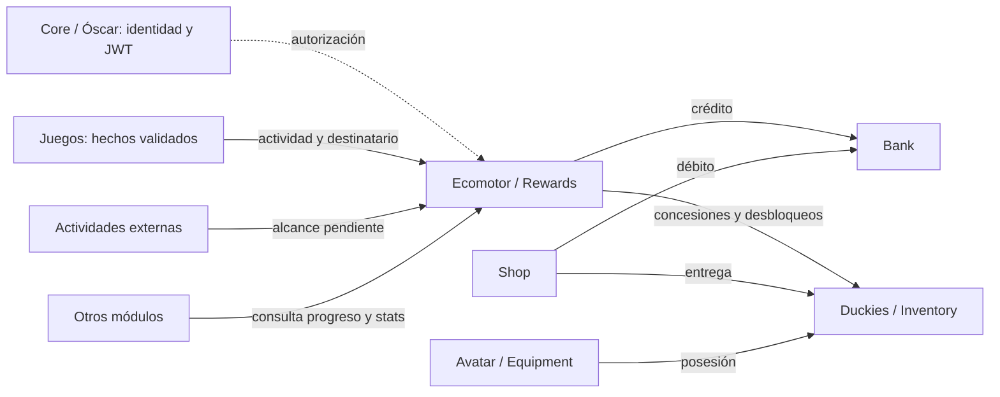

# Arquitectura del Equipo 5 · Estado integrado y Rewards v0 candidato

## 1. Estado y fuentes

DOC-3 (18/10/2026), sobre develop `9495bda` tras PR #34, registra los
[principios R1–R8 aprobados internamente por Jaime](decisions.md#doc-3--arquitectura-rewards-v1--acuerdos-internos-de-parte-a--18102026).
Orientan Parte A; el [contrato Rewards v0](contracts/rewards-v0.md) conserva su
versión y estado global candidato, con [validaciones residuales](pending-decisions.md#3-validación-conjunta-de-rewards-v0).
No hay ratificación conjunta A/B/C/Core/juegos ni implementación de Rewards;
S1–S7-A no cambian y S8-A sigue aprobado y pausado.

DOC-2 (18/10/2026), sobre develop `33b4e87` tras PR #33, añade la
[matriz de procedencia y acuerdos](contracts/integracion-equipo5-v0.md#0-matriz-de-procedencia-y-acuerdos--doc-2)
y el [índice común ERD/diccionarios PR07](ERD.md). El corte de implementación
§2.1 sigue vigente: DOC-2 no integra funciones ni cambia los contratos S1–S7-A.
Las fuentes adicionales aportan respuestas y decisiones atribuidas, no aprobación
global: permanecen abiertos R-01, fuente física del saldo con Core, tarifas,
penalizaciones Escape y contratos compartidos. Rewards v0 continúa candidato y
S8-A aprobado y pausado. La matriz identifica diferencias de fecha/autoridad;
los antecedentes de las dailys siguientes no se reinterpretan retrospectivamente.

Consolidación documental de los acuerdos internos del 08/10/2026 y las aclaraciones
del 09/10 y 13/10. Óscar expresó conformidad verbal general con el documento
funcional leído, sin identificar su versión exacta ni aprobar diseños técnicos
detallados. **Rewards v0 sigue siendo una propuesta técnica aceptada provisionalmente
como base de trabajo, pendiente de validación conjunta.** No hay aprobación global
de Óscar, Core, B/C o juegos del ERD V2, la estructura física de D-21 o los contratos.

| Fuente | Procedencia y autoridad |
| --- | --- |
| `DAR3_ (1).pdf`, §§9–10, pp. 48–53 | Consulta directa del alcance general, servicio común de recompensas y mínimo de intercambio. DAR3 no asigna individualmente A/B/C. |
| `11201_PR07_proyecto Ducky Arenas.pdf`, pp. 4–5, 10–11 y 17 | Consulta directa de proceso/evaluación: diseño antes del ORM, cardinalidades, borrado, permisos, tests y evidencias Git. Persiste el conflicto User/auth bajo D-17. |
| `DuckyEcomotor.pdf`, pp. 1–7 | Consulta directa: gestor central, reglas configurables, Bank/Shop, siete etapas y especializaciones en Actual. Su XP externa entra en tensión con la rectificación verbal del 09/10. |
| `DAR_formulas.pdf`, pp. 7–12 y 18 | Consulta directa de cálculo de acciones, consolidación, REST/WebSockets y ejemplo de stats; no se adoptan automáticamente fórmulas, código u ORM. |
| `DAR_DuckyClash.pdf`, p. 8; `DuckyTraining.pdf`, p. 1; `DuckyEscape.pdf`, pp. 1–2 | Consulta directa de tabla de stats por rol, repetibilidad/límite diario y premios parciales/finales. El Escape local no se identifica como la nueva versión consolidada mencionada en la reunión. |
| Dailys del 06, 07, 08 y 09/10/2026 | Notas y conclusiones: aclaraciones del profesor, propuestas de participantes y asuntos pendientes; no aprobación global de modelos o contratos. |
| Acta de la daily del 13/10/2026 y aclaraciones verificadas comunicadas por Jaime | Solo los puntos contrastados de conformidad, controlador antiguo, autonomía, LMS/Bank y recursos gráficos; las demás notas no se elevan a acuerdos. |
| Acuerdos internos comunicados del 08/10 | Reparto y organización objetivo registrados en D-20/D-21; no se infieren de comentarios de la reunión. |
| [Decisiones](decisions.md), [ERD](erd/ecomotor.md) y [Rewards v0](contracts/rewards-v0.md) | Se distinguen decisiones D vigentes, aceptación interna condicionada de Parte A y contrato candidato. |

DAR3 es la fuente principal de requisitos y responsabilidades. PR07 es guía de
desarrollo, metodología, evidencias y evaluación: en la daily del 06/10/2026 se
aclaró que su plan diario era una guía, no un calendario literal obligatorio.
Los PDFs posteriores amplían o precisan especificaciones; las aclaraciones
explícitas de las dailys pueden rectificarlas. Ante contradicción se documenta
el conflicto antes de fijar una interpretación. La documentación del repositorio
no constituye aprobación del profesor. Las cantidades ilustrativas no son
valores oficiales.

Se distinguen requisitos documentales, aclaraciones/rectificaciones del profesor,
propuestas de participantes, acuerdos internos, propuestas técnicas candidatas
no aceptadas conjuntamente y decisiones pendientes de validación.

## 2. Decisiones vigentes y organización objetivo

D-20 fija Jaime/A, Henry/B y Fernando/C. D-21 acuerda cuatro apps de dominio,
conservando `apps.users`. D-13 permanece como propuesta histórica de otro reparto;
D-14…D-16 no quedan confirmadas automáticamente.

En la mini daily del 06/10/2026 se propuso la organización de apps y quedó
pendiente de revisión. En la daily del 08/10/2026 Óscar indicó una revisión
por encima del documento y que faltaba examinarlo con más detalle. D-20/D-21
fueron aceptados por Jaime, Henry y Fernando para organizar el trabajo. No se
reabre ese reparto: siguen pendientes la revisión física de apps, las interfaces
A/B/C y los requisitos de Óscar/Core y de los equipos consumidores.

**Antecedente del 16/10/2026 (`05d65f2`, PR #25):** el corte tras S1/S1.1,
Día 4 y Admin aún no incluía S2-A–S7-A. Esa descripción queda superada por §2.1;
no se reescriben las decisiones de aquellos incrementos. D-21 conserva cuatro apps
objetivo, sin acreditar integración de Duckies, Bank o Shop. D-18 mantiene
rutas/labels y D-11 la ubicación de perfiles. Conservación, contratos físicos y
reconciliación de migraciones A/C siguen pendientes.

D-05/D-09/D-10/D-17 conservan User estándar y ausencia de autenticación local.
Se utiliza `settings.AUTH_USER_MODEL`. **Óscar es el interlocutor de Core/Equipo 0**
para User, autenticación, JWT, integración y conservación; no se da por resuelto
el conflicto de PR07 ni se atribuye una política de borrado a ejemplos del PDF.

| Área / app objetivo | Responsable interno | Autoridad y límite |
| --- | --- | --- |
| Parte A · `apps.ecomotor` | Jaime | XP histórica, nivel, etapas, evolución, especializaciones, stats/puntos e historiales. Coordina Rewards y reglas; solicita efectos a sus propietarios. |
| Rewards · capacidad de Ecomotor | Jaime, con revisión A/B/C | Entrada lógica de hechos recompensables, evaluación, deduplicación y trazabilidad completas; no exige otra app. |
| Parte B · `apps.duckies` | Henry | Duckies, identidad de objetos, posesión, cantidades, concesiones, consumos, avatar, compatibilidad y equipamiento. Inventory y Equipment son capacidades de Duckies. |
| Parte C · `apps.bank` | Fernando | Única fuente de verdad de wallet, saldo y movimientos auditables de Duki Coins. Créditos, débitos y reservas si se incluyen apuestas. |
| Parte C · `apps.shop` | Fernando | Catálogo comercial, precios, disponibilidad y compras; coordina cargo con Bank y entrega con Duckies. |
| `apps.users` / integración Core | Equipo 5 con Óscar/Core | Perfiles actuales; identidad global, autenticación y JWT pertenecen a Core. |
| Juegos y otros emisores | Sus equipos | Validan hechos/resultados en su dominio; no son autoridad sobre XP, monedas o stats canónicos. |

El catálogo comercial de Shop se distingue de la identidad/posesión de objetos de
Duckies. Cada servicio escribe su estado; la coordinación no autoriza escrituras
directas en modelos de otra parte.

### 2.1. Estado vigente de implementación · DOC-1

Corte verificado el 18/10/2026: `origin/develop` en
`b42cb5fdd5c4509670a337c1c79e260714c78c9f`. PR #32 es la última integrada;
las PR de la tabla están fusionadas y sus commits pertenecen a esta baseline.
Esto acredita implementación local, no aprobación externa ni integración global.

| Incremento | PR integrada | Implementación y contrato local |
| --- | --- | --- |
| S1/S1.1 | [#22](https://github.com/Martret92/duckyarenas-team5/pull/22) | [progression.py](../apps/ecomotor/progression.py): resolve_level, resolve_stage y calculate_progression puros, sin ORM; [contrato S1](decisions.md#s1--cálculos-puros-de-progresión--aceptación-interna-provisional), trazado por [#26](https://github.com/Martret92/duckyarenas-team5/pull/26). |
| Día 4-A/B | [#23](https://github.com/Martret92/duckyarenas-team5/pull/23), [#24](https://github.com/Martret92/duckyarenas-team5/pull/24) | Catálogos, perfil, stats, XPEvent, EvolutionEvent y progreso de especialización; [ERD y migraciones](erd/ecomotor.md#11-integración-estructural-vigente--día-4). |
| Día 5 | [#25](https://github.com/Martret92/duckyarenas-team5/pull/25) | Admin solo para superusuarios; catálogos editables únicamente sin perfiles, progreso/historiales de consulta y borrados prohibidos. S7-A añade su evento como consulta. |
| S2-A | [#27](https://github.com/Martret92/duckyarenas-team5/pull/27) | [Inicialización](contracts/ecomotor-initialization-v1.md) atómica e idempotente de perfil/stats para User existente, sin signals ni reparación legacy. |
| S3 | [#28](https://github.com/Martret92/duckyarenas-team5/pull/28) | [Concesión XP](contracts/ecomotor-xp-v1.md): cálculo S1, puntos de niveles nuevos y todas las evoluciones en una transacción; replay histórico local. |
| S4-A | [#29](https://github.com/Martret92/duckyarenas-team5/pull/29) | [Consultas](contracts/ecomotor-progress-queries-v1.md) de progreso e historial persistidos, solo lectura; sin snapshot único entre consultas concurrentes. |
| S5-A | [#30](https://github.com/Martret92/duckyarenas-team5/pull/30) | [Web personal](contracts/ecomotor-progress-web-v1.md) GET/HEAD, login_required e identidad desde request.user; URL local ecomotor:progress, sin montaje en config/urls.py. |
| S6-A | [#31](https://github.com/Martret92/duckyarenas-team5/pull/31) | [Configuración/diagnóstico](contracts/ecomotor-configuration-v1.md): JSON explícito y check_ecomotor_readiness; no activa el candidato ni configura el servidor. |
| S7-A | [#32](https://github.com/Martret92/duckyarenas-team5/pull/32) | [Asignación](contracts/ecomotor-stat-allocation-v1.md) solo en Actual, coste 1:1, evento/snapshots idempotentes y migración 0005 aditiva protegida. |

El esquema local de Parte A tiene **nueve entidades**: las ocho del V2 histórico
más StatAllocationEvent. Sus modelos están en apps.ecomotor (ocho) y apps.users
(UserProfileEcomotor); UserProfileBank no forma parte de ese recuento.
No hay servicios integrados de especialización o XP de dominio, Rewards, economía,
objetos o juegos. Las flechas de §5 representan arquitectura objetivo candidata.

INITIAL_CONFIGURATION continúa en None. Existen carga JSON y diagnóstico técnico,
pero faltan valores autorizados, instalación real y política histórica de cambios
(P8/V2-A28). TECHNICALLY_READY no equivale a aprobación funcional. La consulta básica
S4-A/S5-A no depende de configurar nuevas concesiones.

S8-A está **aprobado internamente por Jaime y pausado, sin implementar**:
adaptador web GET/POST para asignar puntos exclusivamente mediante S7-A,
autenticación Django existente, CSRF, request.user e idempotencia. Véase
[decisión S8-A](decisions.md#s8-a--interfaz-web-de-asignación--aprobada-y-pausada).
No hay interfaz de escritura de puntos en la baseline actual.

El repositorio contiene tests de modelos/migraciones, Admin, servicios, consultas,
HTTP y concurrencia SQLite file-backed. Última regresión comunicada: **407 tests
correctos**. DOC-1 revisa código, contratos y procedencia Git, sin volver a ejecutar
la suite ni comprobar instalaciones o datos reales.

## 3. Requisitos funcionales y límites de V2

La XP histórica es acumulativa y no decreciente. Resultado o XP provisional de
partida, recompensa evaluada y XP consolidada son magnitudes distintas.
Penalizaciones de una partida no descuentan XP histórica ya concedida.

Las nueve épocas iniciales de DAR3 son antecedente del diseño posterior de
siete etapas, mantenido como dirección V2 candidata sin aprobación global de
sus modelos, umbrales o constraints.
Las siete etapas son **Prehistoria, Griega, Romana, Renacentista, Contemporánea,
Siglo XX y Actual**. Nivel y etapa son conceptos distintos. Umbrales, recompensas
y desbloqueos son configurables; evolución automática no implica equipamiento
automático. Las especializaciones actuales son **Developer, Ciberseguridad,
Sistemas, Data y Gamer**, dentro de Actual. Data / Data & IA y los códigos
técnicos requieren normalización con los consumidores.

Los stats son **ATK, DEF, LOG, SPE, VEL e INT**. Parte A distingue base persistente,
puntos disponibles y valores efectivos. El ERD V2 histórico aceptó ocho entidades,
niveles independientes y transiciones múltiples; [erd/ecomotor.md](erd/ecomotor.md)
distingue ese antecedente del esquema vigente de nueve entidades tras S7-A.
Ningún ejemplo del PDF aprueba iniciales,
límites o tablas nuevas.

DAR3 describe seis piezas principales por época obtenidas mediante progreso y
misiones, diferenciadas de complementos estéticos, y conserva progresos y conjuntos
anteriores tras evolucionar. Mantiene inventario, compatibilidad, historiales y
Museo Ducky. Su adaptación de nueve épocas a las siete etapas V2 provisionales
requiere contraste; no impone seis campos físicos por etapa.

**Desbloquear**, **conceder/poseer**, **equipar** y **elegir apariencia** son operaciones
distintas. R-01 sigue en estado mixto: Jaime recordó entrega y equipamiento
automáticos; no consta aceptación inequívoca de Henry del autoequipamiento.
La entrega automática sin equipamiento del ERD global es una propuesta, no un
cierre aceptado. El 15–16/10 Jaime y Henry acordaron proponer a Óscar seleccionar
libremente apariencias completas de cualquier época desbloqueada; no adoptaron
esa política. Obtención, variantes comprables y comportamiento al saltar etapas
siguen pendientes en [pendientes](pending-decisions.md).
Las nueve épocas y INITIAL del V1 no son reglas actuales. El mínimo interno
UserSpecializationProgress sin rank conserva XP de dominio independiente;
fuentes, rangos y obligatoriedad no tienen validación global.

## 4. Notas y conclusiones de las dailys

| Daily / tema | Contenido y categoría | Estado y tratamiento |
| --- | --- | --- |
| 06, 07 y 09/10/2026 · código común | Se habló de funciones existentes para recompensas, puntos y monedas, de compartir código y de evitar duplicar funcionalidades. | Antecedente de coordinación. El 13/10 se aclaró que el controlador antiguo sencillo de DuckyCoins no debe esperarse ni reutilizarse obligatoriamente; Wallet/saldo canónicos, autorizaciones y contratos siguen pendientes. No conocemos firmas ni modelos verificados del código anterior. |
| 09/10/2026 · Ecomotor | Óscar indicó centralización funcional de recompensas y estadísticas; el emisor valida su actividad. | Aclaración funcional, no aprobación de modelos, funciones o payloads. |
| 09/10/2026 · XP externa | Óscar planteó reservar XP a juegos y monedas a actividades externas, rectificando la dirección anterior. | Conflicto con Ecomotor pp. 1–2 y 6: falta confirmar XP histórica/de dominio, actividades, vigencia, usuarios/recompensas existentes y configuración futura. No se autoriza borrar XP ni convertir automáticamente todas las actividades externas en premios sin XP. |
| 09/10/2026 · stats | Antes de Actual se habló de estadísticas determinadas por rol; en Actual se planteó distribuir o editar puntos. | Aclaración parcial: iniciales, presupuesto y límites pendientes. No adoptar todos a 5, tabla de Clash o suma de 45 como valores oficiales; tampoco cambios/reinicio de especialización. |
| 09/10/2026 · cursos | Se desarrollaron ejemplos de objetos temáticos y posibles puntos adicionales. | Dirección apoyada, no regla cerrada. Condiciones, cantidades, efectos y V1 pendientes. Bonificaciones diarias de XP por cursos fueron propuestas discutidas, no confirmadas. |
| 09/10/2026 · Training | Se reiteraron XP por repeticiones válidas y una moneda por juego/día. | Conforme al PDF; acceso, límite de monedas e idempotencia por sesión son cuestiones distintas. Moneda para toda la vida fue propuesta de participante no aceptada. |
| 09/10/2026 · Escape | Se indicó XP por stages completados que se conserva aunque no termine la partida y premio final independiente. | Stage no equivale a habitación. La ausencia de monedas por stage no elimina necesariamente premios por habitación. Versión consolidada posterior y consolidación parcial/final pendientes. |
| 09/10/2026 · Quiz | Tiempo, aciertos, estadísticas y resultados participan en el cálculo. | Aclaración funcional; cantidades ilustrativas no son premios obligatorios y el contrato sigue por validar. |
| 09/10/2026 · Clash | Resultado validado y participantes; Bank reserva fondos de ambos al aceptar un duelo con apuesta. | Instrucción condicional a apuestas. DAR3 p. 42 contempla primera entrega sin ellas; V1, liberación/liquidación y cancelación pendientes. |
| 09/10/2026 · evaluación | Se vinculó el 19/10 a exámenes/documentación práctica y se planteó codificar la semana siguiente. | Orientación formativa, no fecha final de todo DuckyArenas ni autorización del ORM. |
| 13/10/2026 · conformidad funcional | Óscar confirmó lectura y valoración general favorable del documento enviado por Jaime. | La vinculación con el criterio funcional enviado el 07/10 es razonable por contexto, sin versión exacta identificada. No aprueba ERD V2, D-21 física, Rewards v0, modelos, migraciones ni interfaces. |
| 13/10/2026 · controlador antiguo | Óscar describió un controlador sencillo para incrementar DuckyCoins y aclaró que no es necesario esperar ni reutilizarlo obligatoriamente. | Aclaración limitada a ese componente, no desaparición de todos los servicios anteriores. Consultar código previo es opcional; Core, Wallet/saldo canónicos, movimientos, autorización, idempotencia, concurrencia y contratos económicos siguen abiertos. |
| 13/10/2026 · autonomía | Óscar dejó margen de implementación y pidió comunicar dudas; el equipo expuso avances y coordinación pendiente. | Se puede continuar desarrollando, sin validación técnica detallada. Las ocho interfaces de Henry siguen como propuestas pendientes de consenso A/B/C. |
| 13/10/2026 · LMS/insignias/Bank | Óscar mencionó corrección automática en LMS, insignias, euros, cotización de DuckyCoins y posible relación futura con Bank. | Expectativa de integración futura, sin fórmula, conversión, cantidades, XP externa, reglas, modelos, endpoints ni inclusión obligatoria en V1. P1 no queda resuelta ni reabierta. |
| 13/10/2026 · recursos gráficos | Óscar mostró y publicó en Classroom materiales de ataques, escudos, relojes, botiquines, pócimas y comida. Henry comunicó internamente haberlos localizado. | Disponibilidad, no aprobación del catálogo. Inspección pendiente; algunas imágenes requieren separar objetos y normalizar tamaños. Códigos, precios, efectos, duraciones, consumo, compatibilidad y V1 no están decididos. |

Cambio de rol por pago/objeto, freemium, reducción a Quiz y DukiStats 2.0 son
propuestas de participantes. No justifican aplazar globalmente RPG o WebSockets,
ni prueban aprobación del ERD. La revisión superficial comentada por Óscar en
la daily del 08/10/2026 no equivale a aprobación detallada.
La preferencia de compra por rol comentada en la daily del 09/10/2026 no es una
restricción comercial definitiva.

## 5. Flujos y Rewards v0 candidato

Las flechas no fijan HTTP interno ni despliegues independientes.
[Rewards v0](contracts/rewards-v0.md) concentra la semántica candidata para evitar
duplicarla en el ERD: identidad origen/hecho/destinatario, huella validada, versión
de reglas, resultado persistido, referencias a efectos y APPLIED/NO_REWARD.
Los premios son independientes: monedas, objetos o puntos no requieren XPEvent.

Se propone un monolito modular Django y una transacción exterior de Rewards
solo si todos sus servicios usan la misma BD y conexión transaccional.
Ecomotor controla XP/evolución/puntos; Bank monedas; Duckies objetos. Un fallo
revierte efectos y registro final conjuntamente bajo esa condición.
No se aprueba automáticamente ORM de RewardEvent, tabla RewardRule ni FKs.

Shop coordina compra, validación de fondos y entrega mediante los propietarios.
Ecomotor pp. 4–5 también le atribuye comprobaciones de condiciones/saldo;
el reparto exacto con Shop debe acordarse, consultando a Bank sin duplicar saldo.
Rewards v0 no cierra automáticamente el contrato de compras o reservas.

## 6. REST, cálculo de acciones y tiempo real

DAR_formulas pp. 7–12 documenta estas interfaces objetivo, todavía sin contrato
de integración aprobado por el Equipo 5:

| Referencia documental | Encaje a validar |
| --- | --- |
| POST `/api/v1/ecomotor/calculate-action/` | Cálculo servidor de acción/XP provisional, daño y efectos; distinguirlo de otorgar progreso o monedas definitivamente. |
| POST `/api/v1/ecomotor/commit-rewards/` | Consolidación final con Bank y progresión; adaptar hechos, destinatarios y respuesta al contrato candidato sin sustituir esta referencia unilateralmente. |
| `ws/arenas/{room_id}/` y eventos de combate | La fuente sitúa sincronización en Ecomotor; infraestructura, ownership realtime, productores/consumidores y alcance V1 requieren contraste con Óscar/Core/juegos. |

La fuente incluye JWT, X-Client-Game, stats y cantidades en ejemplos de payload.
Un header declarado no acredita por sí solo el origen; deben acordarse permisos,
validación de datos y obtención de stats canónicos con Core. La forma de expresar
batch de resultados y los efectos parciales de Escape siguen pendientes.
No se aprueba una API nueva incompatible ni se descartan estas rutas o eventos.
REST y RPG completo permanecen en el objetivo; su cobertura V1 y WebSockets no
se resuelven mediante propuestas de participantes.

## 7. Integridad y concurrencia

D-19 continúa vigente íntegramente en [decisions.md](decisions.md):
`transaction.atomic()` antes de leer estado mutable, `BEGIN IMMEDIATE`,
timeout de 5 segundos, constraints e idempotencia persistente.
SQLite tiene un único escritor efectivo para toda la BD, sin bloqueo por fila
real de `select_for_update()`. Transacciones cortas sin I/O externo; timeout
implica rollback y retry en nueva transacción con la misma clave.

D-19 no garantiza atomicidad entre conexiones, bases de datos o transacciones
independientes. La transacción exterior de Rewards v0 es una propuesta adicional
condicionada, no una reinterpretación de D-19. Recuperación distribuida, compras,
reservas, correcciones y devoluciones requieren contrato específico.

## 8. Pendientes y siguiente entrega

### S4-A: consultas locales de progreso e historial integradas · PR #29

[S4-A V1](contracts/ecomotor-progress-queries-v1.md), aprobado internamente por
Jaime, consulta perfiles inicializados sin escrituras ni llamadas a S2-A/S3.
El overview conserva datos básicos aunque falte configuración; sus objetivos de
nivel y etapa se validan independientemente. El historial muestra snapshots XP e
IDs de evoluciones persistidos, sin reconstruir niveles, puntos o códigos históricos.
No utiliza atomic()/IMMEDIATE para lectura ni promete un snapshot único entre
consultas concurrentes. No incorpora HTTP, autenticación de vistas ni CRUD PR07;
Core, conservación, configuración oficial y contratos compartidos siguen pendientes.

### S3 V1: concesión local de XP histórica integrada · PR #28

[S3 V1](contracts/ecomotor-xp-v1.md), aprobado internamente por Jaime bajo
V2-A12/A22/A23 y D-19, concede XP solo sobre perfiles ya inicializados. Valida
catálogos y correspondencia interna de etapas, usa exclusivamente S1 y persiste
XPEvent, todas las EvolutionEvent y puntos nuevos dentro de una transacción.
El replay es histórico: snapshots e IDs persistidos, campos no almacenados None;
no recalcula contra catálogos actuales ni modifica eventos. No inicializa S2-A,
concede objetos/monedas, modifica atributos base ni resuelve Rewards/Core.
El esquema existente no guarda niveles/puntos/códigos históricos completos;
esa limitación forma parte explícita del contrato. La configuración de códigos
autorizados sigue ausente, por lo que las concesiones nuevas reales permanecen
bloqueadas hasta disponer de ella. Este incremento no cambia modelos/migraciones.

### S2-A local: inicialización integrada · PR #27

Parte A ya implementa [S2-A](contracts/ecomotor-initialization-v1.md), aprobado
internamente por Jaime bajo V2-A13/D-19/R-12. Inicializa conjuntamente perfil y
estadísticas de un User existente, con configuración confiable, catálogos validados
y puntos del nivel 1. La configuración de atributos y códigos queda ausente hasta
su autorización; los fixtures de tests no son configuración de producción.
La idempotencia conserva progreso existente; estados parciales/legacy se rechazan.
No sustituye el provisionamiento global Core ni implementa XP/Rewards/inventario.
S2-A se integró sin alterar modelos ni migraciones; la baseline vigente está en §2.1.
Conservación, contratos compartidos y parámetros oficiales
permanecen pendientes, sin aprobación global de Óscar.

El contraste interno hasta el 16/10 distingue conformidad conceptual de integración:
Henry aceptó conceptualmente el 14/10 las propuestas de Jaime R-05 (ItemGrant,
entregas y deduplicación) y R-08 (RewardEvent, trazabilidad e idempotencia completa).
No ratifica campos, ORM, migraciones ni contratos físicos con Fernando/Core/juegos.
El ERD global y H01–H08 son base documental interna de trabajo, no APIs aprobadas
ni implementadas. Fernando aceptó revisar la reubicación de Bank/Shop; el traslado
y la reconciliación de migraciones A/C siguen abiertos.

El acuerdo local R-12 de Jaime y Henry del 13/10 permite avanzar con el inicializador
Ecomotor. S1 y S2-A locales no quedan bloqueados por el diseño físico de Rewards
ni por la aprobación externa de Core. S2-A1/S2-A2 permanecen intactas: perfil y
stats atómicos e idempotentes, sin signals ni nuevo User; seis stats y puntos desde
configuración confiable. La creación global de User y la orquestación final de
Ducky/Wallet, legacy y autorizaciones siguen bajo coordinación de Core.

[Pendientes](pending-decisions.md) concentra preguntas y validadores;
[plan](team5-work-plan.md) asigna trabajo bajo D-20/D-21.
Prioridades: Core, identidad/autorización, conservación y Wallet/saldo canónicos;
contratos Rewards/Bank/Shop/Inventory y consenso de interfaces A/B/C; reconciliar
modelos y migraciones A/C antes de merge; hechos validados y dependencias reales
con los juegos, Escape consolidado, compras e idempotencia/concurrencia.
Se mantiene el conflicto de XP externa, stats/cursos, compatibilidad REST,
ownership realtime y alcance evaluable PR07. El controlador antiguo sencillo
no bloquea el avance ni exige reutilización; el resto de la integración sigue abierta.

El [ERD de Parte A](erd/ecomotor.md) conserva el V2 histórico de ocho entidades
y V2-A1…V2-A29 internas condicionadas; el esquema integrado añade StatAllocationEvent.
DOC-1 no cambia ese ORM ni concede aprobación global a Rewards v0 o al ERD compartido.
La demostración DAR3 de actividad, recompensa, compra, equipamiento e historial
sigue como referencia, con alcance final por contrastar. Historiales/Museo,
integraciones externas y pedidos físicos deben priorizarse sin eliminarlos
silenciosamente. Techies y cotización variable quedan fuera de primera entrega
según DAR3.

## S5-A · Adaptador web personal local integrado · PR #30

El [contrato S5-A](contracts/ecomotor-progress-web-v1.md), aprobado internamente
por Jaime/Parte A, adapta S4-A a una plantilla autónoma de lectura GET/HEAD.
login_required utiliza Django; request.user resuelve exclusivamente el perfil propio.
404 para ausencia, 409 para inconsistencia y 503 para BD, sin detalles internos.
Muestra progreso, stats base, objetivos independientes y diez concesiones recientes
sin reconstrucciones históricas. No escribe ni invoca inicialización/concesión.
La URL local ecomotor:progress se prueba mediante URLconf aislada; config/urls.py
no cambia. Montaje, login final, home y plantilla compartida dependen de Core.
No sustituye CRUD PR07 ni resuelve configuración oficial o contratos globales.
Conserva la ausencia de snapshot transaccional conjunto de S4-A.

## S6-A · Carga de configuración y diagnóstico local integrados · PR #31

El [contrato S6-A](contracts/ecomotor-configuration-v1.md) añade lectura explícita
de JSON interno y diagnóstico SELECT de configuración/catálogos. El cargador
devuelve un objeto sin activar la referencia INITIAL_CONFIGURATION; no hay hooks
de arranque ni cambios de settings. El comando comprueba un candidato o el estado
real de su propio proceso, nunca afirma activar el servidor web. Preparación
técnica y aprobación funcional son independientes. S2-A/S3 conservan contratos,
S4-A/S5-A sus consultas básicas. Sin esquema nuevo ni reparación/concurrencia
transaccional añadida. Instalación autorizada, valores oficiales y V2-A28 pendientes.

## S7-A · Asignación local de puntos integrada · PR #32

[S7-A](contracts/ecomotor-stat-allocation-v1.md) añade gasto transaccional 1:1 en
un atributo base, solo en Actual validada por S1/catálogo/códigos confiables.
StatAllocationEvent registra snapshots independientes de XPEvent y replay sin
configuración actual. D-19 serializa S3/S7-A; solo atributo elegido y saldo cambian
junto al evento. Admin de consulta y 0005 aditiva con reversión protegida.
S1–S6-A y otros equipos intactos; conservación CASCADE provisional, configuración
funcional y contratos globales pendientes. Sin interfaz web de asignaciones.
