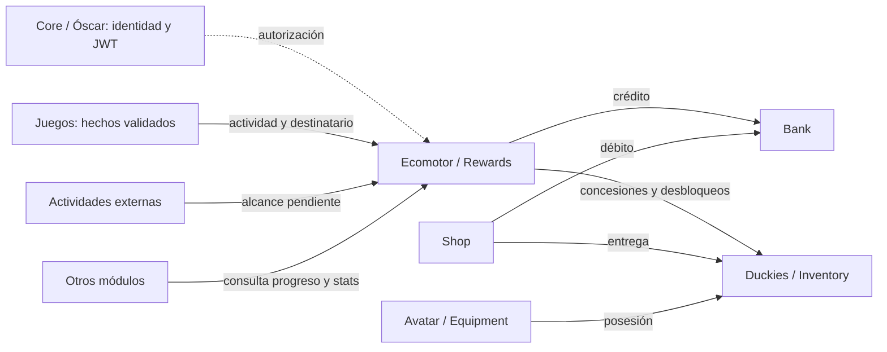

# Arquitectura del Equipo 5 · Estado integrado y Rewards v0 candidato

## 1. Estado y fuentes

**Actualización A3.4 · 20/10/2026:** baseline `8b6b0f7`, reglas puras A3.3 integradas
por PR #66. Persistencia y servicio de clasificación todavía no existen. La
[dirección A3.4](#15-a34--dirección-de-persistencia-local) está aprobada internamente,
no sus modelos/migraciones definitivos o acuerdos Core/P5. Las notas anteriores
que describen reglas como futuras conservan su corte histórico; S3 V1 sigue activo.

**Actualización A3.3 · 20/10/2026:** baseline `75177a2`, con PR #61/#62 integradas.
A3.1 (#58) y A3.2 (#60) están implementados; las notas siguientes que los presentan
como futuros conservan su corte histórico. [A3.3](#14-a33--clasificación-persistente-de-perfiles)
es arquitectura interna de clasificación, no tablas o servicios disponibles.
S3 V1 continúa como único escritor XP; A2.1 no concede ni activa el objetivo.

**Precisión objetivo · 20/10/2026:** [ATR-OBJ-01](decisions.md#atr-obj-01--nomenclatura-de-atributos-objetivo--20102026),
posterior a la conciliación de la PR #61, fija internamente LOG = Lógica y
CUACK = Especial / Especialización en el diseño 02C. No cambia V1, sus datos ni
activa el objetivo. Las notas fechadas siguientes conservan sus cortes históricos.

**Conciliación funcional · 20/10/2026:** base `f034d2f`, aclaraciones de Óscar
consultadas en coordinación y confirmadas directamente por Jaime en 02C.
[§13](#13-aclaraciones-funcionales-confirmadas-y-contraste-con-02c) separa confirmación
funcional, antecedentes e integración técnica pendiente. No se cambian códigos,
reglas activas o datos; la fotografía de implementación anterior se conserva.

**Actualización A3.2 · 20/10/2026:** base `8024fa7`, A3 (#57) y A3.1 (#58)
integrados. [A3.2](#12-a32--extracción-legacy-de-solo-lectura) es arquitectura
interna aprobada, **no extractor implementado**. A3.1 ya evalúa snapshots puros;
las menciones anteriores a su implementación futura son cortes históricos.
S3 V1 sigue activo; no hay migración ni activación del objetivo.

**Actualización A3 · 20/10/2026:** develop `7039ae6` incluye A2.1 puro (#56) y
Duckies (#54). [A3](#11-a3--compatibilidad-histórica-y-activación-coordinada) registra
compatibilidad y activación aprobadas internamente y condicionadas, **sin activar
ni implementar escritores objetivo**. Las menciones anteriores al planificador A2
futuro son cortes históricos; hoy está integrado, sin autorización de concesiones.

**Actualización A2 · 20/10/2026:** base develop `6a7d1d7`, A1.1 (#52) y A1.2
(#53) integrados como módulos puros. La [arquitectura A2](#10-a2--adaptación-de-xp-histórica-objetivo)
aprobada internamente en 02C separa el futuro escritor XP objetivo de S3 V1.
A2 no está implementado ni activado; clasificación persistente y transición
pertenecen a A3. Los cortes 02C siguientes conservan su baseline histórica.

**Corte vigente 02C · 20/10/2026:** develop `8401d46` integra S14-A (#50) y
S13-A1 (#47). La [arquitectura objetivo 02C](#9-arquitectura-objetivo-02c--no-implementada)
recoge acuerdos internos nuevos, **sin implementación ni activación**. Los cortes
DOC-S14-A/DOC-S13-A1 siguientes conservan su redacción histórica anterior a sus
implementaciones; el estado actual prevalece en §9.1. Contratos V1 intactos,
incluidas sus notas históricas de revisión.

**Actualización DOC-S14-A:** develop
`e401c33045b4f1b4c8621c54c21757483769b56b` integra S13-A1 puro (#47).
El [cambio de especialización S14-A](contracts/ecomotor-specialization-switch-v1.md)
está aprobado internamente en 02B, sin implementar: una activa, progresos de las
cinco conservados, primera activación en cero, retorno sin reset y cambio en Actual
sin alterar XP histórica, nivel, etapa, stats o recompensas. Servicio candidato
transaccional separado de S11-A, estado esperado y D-19; sin evento físico ni
replay histórico completo. **Precisiones S14-A-08/09**, aprobadas internamente en
02B sobre develop `f4c9ce4167f37dcf302b3b3093333a688068e801` (PR #48), resuelven
la compatibilidad: S11-A deberá admitir múltiples progresos coherentes y recuperar
la activa sin escrituras/configuración de etapas, conservando validación estructural,
primera selección y conflicto ante otro código. S14-A comprobará primero el estado
esperado: si no coincide, rechazará incluso un objetivo ya activo; si coincide,
la repetición coherente no escribe ni reevalúa etapas/elegibilidad. El cambio
efectivo exige Actual y D-19. Son reglas por implementar, no cambios de código;
el límite A → B → A se conserva.
S13-A2/persistencia de rangos pendientes; no evaluación para conceder ascensos.
La recompensa tardía de una especialización ya inactiva requiere revisar S12-A-02
y evidencias con Rewards/Core, sin excepción aprobada. P5/P7 y conservación
siguen abiertos; DomainXPEvent conceptual y Rewards F2-A bloqueado.
Los cortes anteriores sin implementación de S13-A1 son antecedentes documentales.

**Actualización DOC-S13-A1 · 18/10/2026:** base develop
`5d36778449e7c796e2770ddfdb97f25e8f8b280f`, con DOC-S12-A integrado (#45).
La [arquitectura de rangos y contrato candidato del evaluador puro](contracts/ecomotor-ranks-evaluator-v1.md)
registra S13-A-01…07 y precisiones S13-A1 aprobadas internamente por Jaime/02B,
sin implementación. Evaluar el siguiente rango no confirma un ascenso; políticas
versionadas y evidencias verificadas no equivalen a autorización global.
Se conserva el progreso de las cinco especializaciones al alternar y se adoptan
importes independientes de XP general/dominio (opción B), sin baremos oficiales
ni servicio de cambio. Las referencias previas a S13-A sin diseño son antecedentes.
S11-A sigue implementado; S12-A conceptual, persistencia de rangos/DomainXPEvent,
autorización, cambio de especialización y recompensas tardías siguen pendientes.
P5/P7 abiertos, Rewards F1-A implementado, F2-A bloqueado y Rewards v0 candidato.
No se modifica el esquema físico ni se aprueban nuevas relaciones/on_delete.

**Actualización DOC-S12-A · 18/10/2026:** develop
`84f809df43c7db9b438a6541a298214ce8d97b50` incluye S8-A (#40), UI-A (#41),
S9-A (#42), S10-A (#43) y S11-A (#44). S11-A implementa selección inicial, no
concesión positiva de dominio. [S12-A](contracts/ecomotor-domain-xp-v1.md) está
aprobado conceptualmente por 02B, sin implementación ni persistencia autorizada.
Rewards F1-A está implementado (#38); F2-A sigue bloqueado por DOC-6 y Rewards v0
continúa candidato global. Las pausas/revisiones de los cortes anteriores son
antecedentes históricos, no estados vigentes. Esta PR solo actualiza documentación.

**Corte DOC-6 · 18/10/2026:** develop `5a4e079` incluye Fase 1 Rewards por
[PR #38](https://github.com/Martret92/duckyarenas-team5/pull/38):
[tipos](../apps/ecomotor/reward_types.py),
[identidad/huella](../apps/ecomotor/reward_identity.py) y
[evaluación pura](../apps/ecomotor/reward_rules.py), sin ORM ni efectos reales.
Jaime aprueba internamente la [arquitectura persistente local F2-A](decisions.md#doc-6--arquitectura-persistente-rewards-f2-a--18102026),
**sin implementación** ni ratificación de Core/Henry/Fernando/juegos. Los cortes
DOC-1…DOC-4 siguientes son antecedentes fechados; sus menciones a Rewards sin
implementar no describen el núcleo puro ya integrado. El contrato global v0
permanece candidato; F2-A y process_reward todavía no existen.

DOC-4 (18/10/2026), sobre develop `be9e7aa` tras PR #35, registra
[T1–T8 aprobadas internamente por Jaime](decisions.md#doc-4--diseño-técnico-rewards-v1--t1t8--18102026)
y el [diseño técnico candidato](contracts/rewards-v0.md#10-diseño-técnico-interno--doc-4).
SHA-256/canonicalización, integración futura S3 y tipos de evaluación se distinguen
de RewardEvent/RewardLimitUsage físicos candidatos. El contrato global sigue v0;
[conservación, contratos y transporte](pending-decisions.md#7-validación-residual-del-diseño-técnico--doc-4)
condicionan las fases posteriores. No se implementa Rewards ni se modifica S1–S7-A;
S8-A continúa aprobado y pausado.

DOC-3 (18/10/2026), sobre develop `9495bda` tras PR #34, registra los
[principios R1–R8 aprobados internamente por Jaime](decisions.md#doc-3--arquitectura-rewards-v1--acuerdos-internos-de-parte-a--18102026).
Orientan Parte A; el [contrato Rewards v0](contracts/rewards-v0.md) conserva su
versión y estado global candidato, con [validaciones residuales](pending-decisions.md#3-validación-conjunta-de-rewards-v0).
No hay ratificación conjunta A/B/C/Core/juegos ni implementación de Rewards;
S1–S7-A no cambian y S8-A sigue aprobado y pausado.

DOC-2 (18/10/2026), sobre develop `33b4e87` tras PR #33, añade la
[matriz de procedencia y acuerdos](contracts/integracion-equipo5-v0.md#0-matriz-de-procedencia-y-acuerdos--doc-2)
y el [índice común ERD/diccionarios PR07](ERD.md). El corte de implementación
§2.1 sigue vigente: DOC-2 no integra funciones ni cambia los contratos S1–S7-A.
Las fuentes adicionales aportan respuestas y decisiones atribuidas, no aprobación
global: permanecen abiertos R-01, fuente física del saldo con Core, tarifas,
penalizaciones Escape y contratos compartidos. Rewards v0 continúa candidato y
S8-A aprobado y pausado. La matriz identifica diferencias de fecha/autoridad;
los antecedentes de las dailys siguientes no se reinterpretan retrospectivamente.

Consolidación documental de los acuerdos internos del 08/10/2026 y las aclaraciones
del 09/10 y 13/10. Óscar expresó conformidad verbal general con el documento
funcional leído, sin identificar su versión exacta ni aprobar diseños técnicos
detallados. **Rewards v0 sigue siendo una propuesta técnica aceptada provisionalmente
como base de trabajo, pendiente de validación conjunta.** No hay aprobación global
de Óscar, Core, B/C o juegos del ERD V2, la estructura física de D-21 o los contratos.

| Fuente | Procedencia y autoridad |
| --- | --- |
| `DAR3_ (1).pdf`, §§9–10, pp. 48–53 | Consulta directa del alcance general, servicio común de recompensas y mínimo de intercambio. DAR3 no asigna individualmente A/B/C. |
| `11201_PR07_proyecto Ducky Arenas.pdf`, pp. 4–5, 10–11 y 17 | Consulta directa de proceso/evaluación: diseño antes del ORM, cardinalidades, borrado, permisos, tests y evidencias Git. Persiste el conflicto User/auth bajo D-17. |
| `DuckyEcomotor.pdf`, pp. 1–7 | Consulta directa: gestor central, reglas configurables, Bank/Shop, siete etapas y especializaciones en Actual. Su XP externa entra en tensión con la rectificación verbal del 09/10. |
| `DAR_formulas.pdf`, pp. 7–12 y 18 | Consulta directa de cálculo de acciones, consolidación, REST/WebSockets y ejemplo de stats; no se adoptan automáticamente fórmulas, código u ORM. |
| `DAR_DuckyClash.pdf`, p. 8; `DuckyTraining.pdf`, p. 1; `DuckyEscape.pdf`, pp. 1–2 | Consulta directa de tabla de stats por rol, repetibilidad/límite diario y premios parciales/finales. El Escape local no se identifica como la nueva versión consolidada mencionada en la reunión. |
| Dailys del 06, 07, 08 y 09/10/2026 | Notas y conclusiones: aclaraciones del profesor, propuestas de participantes y asuntos pendientes; no aprobación global de modelos o contratos. |
| Acta de la daily del 13/10/2026 y aclaraciones verificadas comunicadas por Jaime | Solo los puntos contrastados de conformidad, controlador antiguo, autonomía, LMS/Bank y recursos gráficos; las demás notas no se elevan a acuerdos. |
| Acuerdos internos comunicados del 08/10 | Reparto y organización objetivo registrados en D-20/D-21; no se infieren de comentarios de la reunión. |
| [Decisiones](decisions.md), [ERD](erd/ecomotor.md) y [Rewards v0](contracts/rewards-v0.md) | Se distinguen decisiones D vigentes, aceptación interna condicionada de Parte A y contrato candidato. |

DAR3 es la fuente principal de requisitos y responsabilidades. PR07 es guía de
desarrollo, metodología, evidencias y evaluación: en la daily del 06/10/2026 se
aclaró que su plan diario era una guía, no un calendario literal obligatorio.
Los PDFs posteriores amplían o precisan especificaciones; las aclaraciones
explícitas de las dailys pueden rectificarlas. Ante contradicción se documenta
el conflicto antes de fijar una interpretación. La documentación del repositorio
no constituye aprobación del profesor. Las cantidades ilustrativas no son
valores oficiales.

Se distinguen requisitos documentales, aclaraciones/rectificaciones del profesor,
propuestas de participantes, acuerdos internos, propuestas técnicas candidatas
no aceptadas conjuntamente y decisiones pendientes de validación.

## 2. Decisiones vigentes y organización objetivo

D-20 fija Jaime/A, Henry/B y Fernando/C. D-21 acuerda cuatro apps de dominio,
conservando `apps.users`. D-13 permanece como propuesta histórica de otro reparto;
D-14…D-16 no quedan confirmadas automáticamente.

En la mini daily del 06/10/2026 se propuso la organización de apps y quedó
pendiente de revisión. En la daily del 08/10/2026 Óscar indicó una revisión
por encima del documento y que faltaba examinarlo con más detalle. D-20/D-21
fueron aceptados por Jaime, Henry y Fernando para organizar el trabajo. No se
reabre ese reparto: siguen pendientes la revisión física de apps, las interfaces
A/B/C y los requisitos de Óscar/Core y de los equipos consumidores.

**Antecedente del 16/10/2026 (`05d65f2`, PR #25):** el corte tras S1/S1.1,
Día 4 y Admin aún no incluía S2-A–S7-A. Esa descripción queda superada por §2.1;
no se reescriben las decisiones de aquellos incrementos. D-21 conserva cuatro apps
objetivo, sin acreditar integración de Duckies, Bank o Shop. D-18 mantiene
rutas/labels y D-11 la ubicación de perfiles. Conservación, contratos físicos y
reconciliación de migraciones A/C siguen pendientes.

D-05/D-09/D-10/D-17 conservan User estándar y ausencia de autenticación local.
Se utiliza `settings.AUTH_USER_MODEL`. **Óscar es el interlocutor de Core/Equipo 0**
para User, autenticación, JWT, integración y conservación; no se da por resuelto
el conflicto de PR07 ni se atribuye una política de borrado a ejemplos del PDF.

| Área / app objetivo | Responsable interno | Autoridad y límite |
| --- | --- | --- |
| Parte A · `apps.ecomotor` | Jaime | XP histórica, nivel, etapas, evolución, especializaciones, stats/puntos e historiales. Coordina Rewards y reglas; solicita efectos a sus propietarios. |
| Rewards · capacidad de Ecomotor | Jaime, con revisión A/B/C | Entrada lógica de hechos recompensables, evaluación, deduplicación y trazabilidad completas; no exige otra app. |
| Parte B · `apps.duckies` | Henry | Duckies, identidad de objetos, posesión, cantidades, concesiones, consumos, avatar, compatibilidad y equipamiento. Inventory y Equipment son capacidades de Duckies. |
| Parte C · `apps.bank` | Fernando | Única fuente de verdad de wallet, saldo y movimientos auditables de Duki Coins. Créditos, débitos y reservas si se incluyen apuestas. |
| Parte C · `apps.shop` | Fernando | Catálogo comercial, precios, disponibilidad y compras; coordina cargo con Bank y entrega con Duckies. |
| `apps.users` / integración Core | Equipo 5 con Óscar/Core | Perfiles actuales; identidad global, autenticación y JWT pertenecen a Core. |
| Juegos y otros emisores | Sus equipos | Validan hechos/resultados en su dominio; no son autoridad sobre XP, monedas o stats canónicos. |

El catálogo comercial de Shop se distingue de la identidad/posesión de objetos de
Duckies. Cada servicio escribe su estado; la coordinación no autoriza escrituras
directas en modelos de otra parte.

### 2.1. Estado vigente de implementación · DOC-1

Corte verificado el 18/10/2026: `origin/develop` en
`b42cb5fdd5c4509670a337c1c79e260714c78c9f`. PR #32 es la última integrada;
las PR de la tabla están fusionadas y sus commits pertenecen a esta baseline.
Esto acredita implementación local, no aprobación externa ni integración global.
El corte DOC-1 se conserva como antecedente. La baseline actual de S9-A es
`b1b25cd8d67f45ede8de6b6642cb2eae29b6c1e8`: S8-A está integrada mediante
PR #40 y UI-A mediante PR #41; el historial S9-A se incorpora en su rama para revisión.

| Incremento | PR integrada | Implementación y contrato local |
| --- | --- | --- |
| S1/S1.1 | [#22](https://github.com/Martret92/duckyarenas-team5/pull/22) | [progression.py](../apps/ecomotor/progression.py): resolve_level, resolve_stage y calculate_progression puros, sin ORM; [contrato S1](decisions.md#s1--cálculos-puros-de-progresión--aceptación-interna-provisional), trazado por [#26](https://github.com/Martret92/duckyarenas-team5/pull/26). |
| Día 4-A/B | [#23](https://github.com/Martret92/duckyarenas-team5/pull/23), [#24](https://github.com/Martret92/duckyarenas-team5/pull/24) | Catálogos, perfil, stats, XPEvent, EvolutionEvent y progreso de especialización; [ERD y migraciones](erd/ecomotor.md#11-integración-estructural-vigente--día-4). |
| Día 5 | [#25](https://github.com/Martret92/duckyarenas-team5/pull/25) | Admin solo para superusuarios; catálogos editables únicamente sin perfiles, progreso/historiales de consulta y borrados prohibidos. S7-A añade su evento como consulta. |
| S2-A | [#27](https://github.com/Martret92/duckyarenas-team5/pull/27) | [Inicialización](contracts/ecomotor-initialization-v1.md) atómica e idempotente de perfil/stats para User existente, sin signals ni reparación legacy. |
| S3 | [#28](https://github.com/Martret92/duckyarenas-team5/pull/28) | [Concesión XP](contracts/ecomotor-xp-v1.md): cálculo S1, puntos de niveles nuevos y todas las evoluciones en una transacción; replay histórico local. |
| S4-A | [#29](https://github.com/Martret92/duckyarenas-team5/pull/29) | [Consultas](contracts/ecomotor-progress-queries-v1.md) de progreso e historial persistidos, solo lectura; sin snapshot único entre consultas concurrentes. |
| S5-A | [#30](https://github.com/Martret92/duckyarenas-team5/pull/30) | [Web personal](contracts/ecomotor-progress-web-v1.md) GET/HEAD, login_required e identidad desde request.user; URL local ecomotor:progress, sin montaje en config/urls.py. |
| S6-A | [#31](https://github.com/Martret92/duckyarenas-team5/pull/31) | [Configuración/diagnóstico](contracts/ecomotor-configuration-v1.md): JSON explícito y check_ecomotor_readiness; no activa el candidato ni configura el servidor. |
| S7-A | [#32](https://github.com/Martret92/duckyarenas-team5/pull/32) | [Asignación](contracts/ecomotor-stat-allocation-v1.md) solo en Actual, coste 1:1, evento/snapshots idempotentes y migración 0005 aditiva protegida. |

El esquema local de Parte A tiene **nueve entidades**: las ocho del V2 histórico
más StatAllocationEvent. Sus modelos están en apps.ecomotor (ocho) y apps.users
(UserProfileEcomotor); UserProfileBank no forma parte de ese recuento.
La primera selección de especialización S11-A está integrada (#44). No hay servicio
de XP de dominio positiva, coordinación transaccional Rewards, economía, objetos
o juegos integrado en este corte de Parte A. Fase 1 pura sí está integrada
por PR #38, según el corte DOC-6 de §1. Las flechas de §5 representan arquitectura
objetivo candidata.

INITIAL_CONFIGURATION continúa en None. Existen carga JSON y diagnóstico técnico,
pero faltan valores autorizados, instalación real y política histórica de cambios
(P8/V2-A28). TECHNICALLY_READY no equivale a aprobación funcional. La consulta básica
S4-A/S5-A no depende de configurar nuevas concesiones.

S8-A está **integrada mediante PR #40**: adaptador web GET/POST para asignar
puntos exclusivamente mediante S7-A, autenticación Django, CSRF, request.user
e idempotencia. UI-A (PR #41) comparte plantilla base y CSS local entre páginas.
Véase el [contrato S8-A](contracts/ecomotor-stat-allocation-web-v1.md).

El repositorio contiene tests de modelos/migraciones, Admin, servicios, consultas,
HTTP y concurrencia SQLite file-backed. Regresión histórica comunicada en DOC-1:
**407 tests correctos**. DOC-1 revisa código, contratos y procedencia Git, sin volver a ejecutar
la suite ni comprobar instalaciones o datos reales.

## 3. Requisitos funcionales y límites de V2

**Antecedente V2/V1:** la secuencia terminada en Actual y las condiciones siguientes
describen el diseño anterior todavía implementado. 02C sustituye su objetivo
funcional según §9, sin activación ni reinterpretación de filas/eventos existentes.

La XP histórica es acumulativa y no decreciente. Resultado o XP provisional de
partida, recompensa evaluada y XP consolidada son magnitudes distintas.
Penalizaciones de una partida no descuentan XP histórica ya concedida.

Las nueve épocas iniciales de DAR3 son antecedente del diseño posterior de
siete etapas, mantenido como dirección V2 candidata sin aprobación global de
sus modelos, umbrales o constraints.
Las siete etapas son **Prehistoria, Griega, Romana, Renacentista, Contemporánea,
Siglo XX y Actual**. Nivel y etapa son conceptos distintos. Umbrales, recompensas
y desbloqueos son configurables; evolución automática no implica equipamiento
automático. Las especializaciones actuales son **Developer, Ciberseguridad,
Sistemas, Data y Gamer**, dentro de Actual. Data / Data & IA y los códigos
técnicos requieren normalización con los consumidores.

Los stats son **ATK, DEF, LOG, SPE, VEL e INT**. Parte A distingue base persistente,
puntos disponibles y valores efectivos. El ERD V2 histórico aceptó ocho entidades,
niveles independientes y transiciones múltiples; [erd/ecomotor.md](erd/ecomotor.md)
distingue ese antecedente del esquema vigente de nueve entidades tras S7-A.
Ningún ejemplo del PDF aprueba iniciales,
límites o tablas nuevas.

DAR3 describe seis piezas principales por época obtenidas mediante progreso y
misiones, diferenciadas de complementos estéticos, y conserva progresos y conjuntos
anteriores tras evolucionar. Mantiene inventario, compatibilidad, historiales y
Museo Ducky. Su adaptación de nueve épocas a las siete etapas V2 provisionales
requiere contraste; no impone seis campos físicos por etapa.

**Antecedente R-01 · 15–16/10/2026.** Desbloquear, conceder/poseer, equipar
y elegir apariencia son operaciones distintas. R-01 sigue en estado mixto:
Jaime recordó entrega y equipamiento
automáticos; no consta aceptación inequívoca de Henry del autoequipamiento.
La entrega automática sin equipamiento del ERD global es una propuesta, no un
cierre aceptado. El 15–16/10 Jaime y Henry acordaron proponer a Óscar seleccionar
libremente apariencias completas de cualquier época desbloqueada; no adoptaron
esa política. Obtención, variantes comprables y comportamiento al saltar etapas
siguen pendientes en [pendientes](pending-decisions.md).
La lista de nueve épocas de DAR3 no se sustituye por una propuesta interna;
el mínimo local V2 conserva siete etapas provisionalmente. INITIAL del V1 no
se convierte en invariante actual. UserSpecializationProgress sin rank conserva
XP de dominio independiente; fuentes, rangos y obligatoriedad sin validación global.

### 3.1. Vestimentas históricas · Propuesta DOC-5

**Antecedente, con aclaración posterior en §13:** la reutilización durante épocas
intermedias descrita debajo fue propuesta E5, no conducta confirmada. Óscar confirmó
imagen completa por época, solo la vigente durante progresión histórica y uso de
anteriores desbloqueadas tras elegir especialización. Esto no aprueba adquisición,
autoequipamiento, objetos o relaciones Duckies; los pendientes antiguos se acotan
a esas consecuencias técnicas/funcionales, sin reabrir la secuencia de épocas.

Criterio propuesto por E5 el 18/10/2026, recogido en CORE-07, E5-02 y B-06 del
documento compartido y en el [registro DOC-5](decisions.md#doc-5--criterio-funcional-propuesto-de-vestimentas-históricas--18102026).
Es posterior a R-01: lo precisa como propuesta, sin cerrar su aceptación técnica
ni convertirlo en aprobación del profesor.

| Concepto | Comportamiento funcional propuesto / autoridad |
| --- | --- |
| Evolución | Ecomotor determina la transición; evolución automática por umbral no implica por sí sola adquisición o equipamiento. |
| Adquisición | E5 propone obtener el conjunto completo de la nueva época al evolucionar, pendiente de compatibilidad con progreso/misiones DAR3. |
| Posesión | Duckies conservaría todos los conjuntos completos anteriores ya obtenidos. No se decide si conjunto equivale a uno o varios objetos. |
| Equipamiento | E5 propone equipar automáticamente el conjunto nuevo; no consta aprobación de Óscar ni aceptación técnica inequívoca de Henry de todos sus detalles. |
| Selección de apariencia | El usuario podría volver a equipar cualquier conjunto anterior obtenido, incluso en épocas intermedias; no conjuntos de épocas futuras todavía no alcanzadas. Duckies controla equipamiento/apariencias. |

DAR3, pp. 3 y 48, conserva las seis piezas principales por época, obtención por
progreso y misiones, conservación del progreso/conjuntos y nueve épocas incluida
Era Espacial. Debe aclararse cómo encajan esos requisitos con las siete etapas
provisionales y la propuesta de conjuntos completos; no se eliminan piezas ni
se adopta una lista oficial nueva. CORE-07, B-06, P6 y R-01 siguen pendientes con
Óscar; identidades, idempotencia, adquisición, equipamiento y recuperación deben
acordarse con Henry antes de implementar. [Preguntas y bloqueos](pending-decisions.md#8-vestimentas-históricas--propuesta-doc-5).
No hay implementación, modelos nuevos o contratos definitivos en DOC-5.

## 4. Notas y conclusiones de las dailys

| Daily / tema | Contenido y categoría | Estado y tratamiento |
| --- | --- | --- |
| 06, 07 y 09/10/2026 · código común | Se habló de funciones existentes para recompensas, puntos y monedas, de compartir código y de evitar duplicar funcionalidades. | Antecedente de coordinación. El 13/10 se aclaró que el controlador antiguo sencillo de DuckyCoins no debe esperarse ni reutilizarse obligatoriamente; Wallet/saldo canónicos, autorizaciones y contratos siguen pendientes. No conocemos firmas ni modelos verificados del código anterior. |
| 09/10/2026 · Ecomotor | Óscar indicó centralización funcional de recompensas y estadísticas; el emisor valida su actividad. | Aclaración funcional, no aprobación de modelos, funciones o payloads. |
| 09/10/2026 · XP externa | Óscar planteó reservar XP a juegos y monedas a actividades externas, rectificando la dirección anterior. | Conflicto con Ecomotor pp. 1–2 y 6: falta confirmar XP histórica/de dominio, actividades, vigencia, usuarios/recompensas existentes y configuración futura. No se autoriza borrar XP ni convertir automáticamente todas las actividades externas en premios sin XP. |
| 09/10/2026 · stats | Antes de Actual se habló de estadísticas determinadas por rol; en Actual se planteó distribuir o editar puntos. | Aclaración parcial: iniciales, presupuesto y límites pendientes. No adoptar todos a 5, tabla de Clash o suma de 45 como valores oficiales; tampoco cambios/reinicio de especialización. |
| 09/10/2026 · cursos | Se desarrollaron ejemplos de objetos temáticos y posibles puntos adicionales. | Dirección apoyada, no regla cerrada. Condiciones, cantidades, efectos y V1 pendientes. Bonificaciones diarias de XP por cursos fueron propuestas discutidas, no confirmadas. |
| 09/10/2026 · Training | Se reiteraron XP por repeticiones válidas y una moneda por juego/día. | Conforme al PDF; acceso, límite de monedas e idempotencia por sesión son cuestiones distintas. Moneda para toda la vida fue propuesta de participante no aceptada. |
| 09/10/2026 · Escape | Se indicó XP por stages completados que se conserva aunque no termine la partida y premio final independiente. | Stage no equivale a habitación. La ausencia de monedas por stage no elimina necesariamente premios por habitación. Versión consolidada posterior y consolidación parcial/final pendientes. |
| 09/10/2026 · Quiz | Tiempo, aciertos, estadísticas y resultados participan en el cálculo. | Aclaración funcional; cantidades ilustrativas no son premios obligatorios y el contrato sigue por validar. |
| 09/10/2026 · Clash | Resultado validado y participantes; Bank reserva fondos de ambos al aceptar un duelo con apuesta. | Instrucción condicional a apuestas. DAR3 p. 42 contempla primera entrega sin ellas; V1, liberación/liquidación y cancelación pendientes. |
| 09/10/2026 · evaluación | Se vinculó el 19/10 a exámenes/documentación práctica y se planteó codificar la semana siguiente. | Orientación formativa, no fecha final de todo DuckyArenas ni autorización del ORM. |
| 13/10/2026 · conformidad funcional | Óscar confirmó lectura y valoración general favorable del documento enviado por Jaime. | La vinculación con el criterio funcional enviado el 07/10 es razonable por contexto, sin versión exacta identificada. No aprueba ERD V2, D-21 física, Rewards v0, modelos, migraciones ni interfaces. |
| 13/10/2026 · controlador antiguo | Óscar describió un controlador sencillo para incrementar DuckyCoins y aclaró que no es necesario esperar ni reutilizarlo obligatoriamente. | Aclaración limitada a ese componente, no desaparición de todos los servicios anteriores. Consultar código previo es opcional; Core, Wallet/saldo canónicos, movimientos, autorización, idempotencia, concurrencia y contratos económicos siguen abiertos. |
| 13/10/2026 · autonomía | Óscar dejó margen de implementación y pidió comunicar dudas; el equipo expuso avances y coordinación pendiente. | Se puede continuar desarrollando, sin validación técnica detallada. Las ocho interfaces de Henry siguen como propuestas pendientes de consenso A/B/C. |
| 13/10/2026 · LMS/insignias/Bank | Óscar mencionó corrección automática en LMS, insignias, euros, cotización de DuckyCoins y posible relación futura con Bank. | Expectativa de integración futura, sin fórmula, conversión, cantidades, XP externa, reglas, modelos, endpoints ni inclusión obligatoria en V1. P1 no queda resuelta ni reabierta. |
| 13/10/2026 · recursos gráficos | Óscar mostró y publicó en Classroom materiales de ataques, escudos, relojes, botiquines, pócimas y comida. Henry comunicó internamente haberlos localizado. | Disponibilidad, no aprobación del catálogo. Inspección pendiente; algunas imágenes requieren separar objetos y normalizar tamaños. Códigos, precios, efectos, duraciones, consumo, compatibilidad y V1 no están decididos. |

Cambio de rol por pago/objeto, freemium, reducción a Quiz y DukiStats 2.0 son
propuestas de participantes. No justifican aplazar globalmente RPG o WebSockets,
ni prueban aprobación del ERD. La revisión superficial comentada por Óscar en
la daily del 08/10/2026 no equivale a aprobación detallada.
La preferencia de compra por rol comentada en la daily del 09/10/2026 no es una
restricción comercial definitiva.

## 5. Flujos y Rewards v0 candidato

Las flechas no fijan HTTP interno ni despliegues independientes.
[Rewards v0](contracts/rewards-v0.md) concentra la semántica candidata para evitar
duplicarla en el ERD: identidad origen/hecho/destinatario, huella validada, versión
de reglas, resultado persistido, referencias a efectos y APPLIED/NO_REWARD.
Los premios son independientes: monedas, objetos o puntos no requieren XPEvent.

Se propone un monolito modular Django y una transacción exterior de Rewards
solo si todos sus servicios usan la misma BD y conexión transaccional.
Ecomotor controla XP/evolución/puntos; Bank monedas; Duckies objetos. Un fallo
revierte efectos y registro final conjuntamente bajo esa condición.
No se aprueba automáticamente ORM de RewardEvent, tabla RewardRule ni FKs.

Shop coordina compra, validación de fondos y entrega mediante los propietarios.
Ecomotor pp. 4–5 también le atribuye comprobaciones de condiciones/saldo;
el reparto exacto con Shop debe acordarse, consultando a Bank sin duplicar saldo.
Rewards v0 no cierra automáticamente el contrato de compras o reservas.

### 5.1. Persistencia y XP histórica local · F2-A (DOC-6)

La [sección técnica F2-A](contracts/rewards-v0.md#12-f2-a--persistencia-y-xp-histórica-local--doc-6)
desarrolla Fase 1 y [S3](contracts/ecomotor-xp-v1.md), sin cambiarlos.
Fase 1 produce RewardDecision; el futuro coordinador validaría autorización,
identidad/huella y efectos soportados, aplicaría S3 con XP positiva y perfil
persistido, y guardaría RewardEvent y el resultado histórico confirmado.
NO_REWARD solo representa evaluación válida sin efectos, incluso para User sin
perfil si no requiere XP. Efectos no soportados se rechazan por completo.

RewardEvent es **modelo físico candidato bloqueado hasta Core**, con identidad
única origen/hecho/User, huella/versiones, snapshot reward-result-v1 y vínculo
XPEvent opcional. La clave S3 rewards:v1: deriva de la identidad, no de la huella
semántica del contenido. Replay recupera el resultado original, sin reevaluar
reglas/catálogos; incoherencias causales u XPEvent huérfano son errores sin reparación.
D-19 rige la transacción exterior local del mismo alias, con rollback completo,
retry explícito y sin I/O externo. No implica atomicidad entre conexiones/BD.

Core debe confirmar User/PK canónico, conservación/anonimización/eliminación,
on_delete y relaciones con XPEvent/perfiles, y autorización **antes de la tabla
y migración**. Configuración válida de evolución y reglas autorizadas condicionan
los premios reales. Bank, Duckies y juegos no bloquean este diseño local, pero
siguen fuera, junto con monedas, inventario/vestimenta, dominio, puntos directos,
cupos, REST/WebSockets y batch. [Bloqueos F2-A](pending-decisions.md#9-bloqueos-de-persistencia-rewards-f2-a--doc-6).
No se implementa Rewards global, ni se modifica el ERD ni se reactiva S8-A.

## 6. REST, cálculo de acciones y tiempo real

DAR_formulas pp. 7–12 documenta estas interfaces objetivo, todavía sin contrato
de integración aprobado por el Equipo 5:

| Referencia documental | Encaje a validar |
| --- | --- |
| POST `/api/v1/ecomotor/calculate-action/` | Cálculo servidor de acción/XP provisional, daño y efectos; distinguirlo de otorgar progreso o monedas definitivamente. |
| POST `/api/v1/ecomotor/commit-rewards/` | Consolidación final con Bank y progresión; adaptar hechos, destinatarios y respuesta al contrato candidato sin sustituir esta referencia unilateralmente. |
| `ws/arenas/{room_id}/` y eventos de combate | La fuente sitúa sincronización en Ecomotor; infraestructura, ownership realtime, productores/consumidores y alcance V1 requieren contraste con Óscar/Core/juegos. |

La fuente incluye JWT, X-Client-Game, stats y cantidades en ejemplos de payload.
Un header declarado no acredita por sí solo el origen; deben acordarse permisos,
validación de datos y obtención de stats canónicos con Core. La forma de expresar
batch de resultados y los efectos parciales de Escape siguen pendientes.
No se aprueba una API nueva incompatible ni se descartan estas rutas o eventos.
REST y RPG completo permanecen en el objetivo; su cobertura V1 y WebSockets no
se resuelven mediante propuestas de participantes.

## 7. Integridad y concurrencia

D-19 continúa vigente íntegramente en [decisions.md](decisions.md):
`transaction.atomic()` antes de leer estado mutable, `BEGIN IMMEDIATE`,
timeout de 5 segundos, constraints e idempotencia persistente.
SQLite tiene un único escritor efectivo para toda la BD, sin bloqueo por fila
real de `select_for_update()`. Transacciones cortas sin I/O externo; timeout
implica rollback y retry en nueva transacción con la misma clave.

D-19 no garantiza atomicidad entre conexiones, bases de datos o transacciones
independientes. La transacción exterior de Rewards v0 es una propuesta adicional
condicionada, no una reinterpretación de D-19. Recuperación distribuida, compras,
reservas, correcciones y devoluciones requieren contrato específico.

## 8. Pendientes y siguiente entrega

### S4-A: consultas locales de progreso e historial integradas · PR #29

[S4-A V1](contracts/ecomotor-progress-queries-v1.md), aprobado internamente por
Jaime, consulta perfiles inicializados sin escrituras ni llamadas a S2-A/S3.
El overview conserva datos básicos aunque falte configuración; sus objetivos de
nivel y etapa se validan independientemente. El historial muestra snapshots XP e
IDs de evoluciones persistidos, sin reconstruir niveles, puntos o códigos históricos.
No utiliza atomic()/IMMEDIATE para lectura ni promete un snapshot único entre
consultas concurrentes. No incorpora HTTP, autenticación de vistas ni CRUD PR07;
Core, conservación, configuración oficial y contratos compartidos siguen pendientes.

### S3 V1: concesión local de XP histórica integrada · PR #28

[S3 V1](contracts/ecomotor-xp-v1.md), aprobado internamente por Jaime bajo
V2-A12/A22/A23 y D-19, concede XP solo sobre perfiles ya inicializados. Valida
catálogos y correspondencia interna de etapas, usa exclusivamente S1 y persiste
XPEvent, todas las EvolutionEvent y puntos nuevos dentro de una transacción.
El replay es histórico: snapshots e IDs persistidos, campos no almacenados None;
no recalcula contra catálogos actuales ni modifica eventos. No inicializa S2-A,
concede objetos/monedas, modifica atributos base ni resuelve Rewards/Core.
El esquema existente no guarda niveles/puntos/códigos históricos completos;
esa limitación forma parte explícita del contrato. La configuración de códigos
autorizados sigue ausente, por lo que las concesiones nuevas reales permanecen
bloqueadas hasta disponer de ella. Este incremento no cambia modelos/migraciones.

### S2-A local: inicialización integrada · PR #27

Parte A ya implementa [S2-A](contracts/ecomotor-initialization-v1.md), aprobado
internamente por Jaime bajo V2-A13/D-19/R-12. Inicializa conjuntamente perfil y
estadísticas de un User existente, con configuración confiable, catálogos validados
y puntos del nivel 1. La configuración de atributos y códigos queda ausente hasta
su autorización; los fixtures de tests no son configuración de producción.
La idempotencia conserva progreso existente; estados parciales/legacy se rechazan.
No sustituye el provisionamiento global Core ni implementa XP/Rewards/inventario.
S2-A se integró sin alterar modelos ni migraciones; la baseline vigente está en §2.1.
Conservación, contratos compartidos y parámetros oficiales
permanecen pendientes, sin aprobación global de Óscar.

El contraste interno hasta el 16/10 distingue conformidad conceptual de integración:
Henry aceptó conceptualmente el 14/10 las propuestas de Jaime R-05 (ItemGrant,
entregas y deduplicación) y R-08 (RewardEvent, trazabilidad e idempotencia completa).
No ratifica campos, ORM, migraciones ni contratos físicos con Fernando/Core/juegos.
El ERD global y H01–H08 son base documental interna de trabajo, no APIs aprobadas
ni implementadas. Fernando aceptó revisar la reubicación de Bank/Shop; el traslado
y la reconciliación de migraciones A/C siguen abiertos.

El acuerdo local R-12 de Jaime y Henry del 13/10 permite avanzar con el inicializador
Ecomotor. S1 y S2-A locales no quedan bloqueados por el diseño físico de Rewards
ni por la aprobación externa de Core. S2-A1/S2-A2 permanecen intactas: perfil y
stats atómicos e idempotentes, sin signals ni nuevo User; seis stats y puntos desde
configuración confiable. La creación global de User y la orquestación final de
Ducky/Wallet, legacy y autorizaciones siguen bajo coordinación de Core.

[Pendientes](pending-decisions.md) concentra preguntas y validadores;
[plan](team5-work-plan.md) asigna trabajo bajo D-20/D-21.
Prioridades: Core, identidad/autorización, conservación y Wallet/saldo canónicos;
contratos Rewards/Bank/Shop/Inventory y consenso de interfaces A/B/C; reconciliar
modelos y migraciones A/C antes de merge; hechos validados y dependencias reales
con los juegos, Escape consolidado, compras e idempotencia/concurrencia.
Se mantiene el conflicto de XP externa, stats/cursos, compatibilidad REST,
ownership realtime y alcance evaluable PR07. El controlador antiguo sencillo
no bloquea el avance ni exige reutilización; el resto de la integración sigue abierta.

El [ERD de Parte A](erd/ecomotor.md) conserva el V2 histórico de ocho entidades
y V2-A1…V2-A29 internas condicionadas; el esquema integrado añade StatAllocationEvent.
DOC-1 no cambia ese ORM ni concede aprobación global a Rewards v0 o al ERD compartido.
La demostración DAR3 de actividad, recompensa, compra, equipamiento e historial
sigue como referencia, con alcance final por contrastar. Historiales/Museo,
integraciones externas y pedidos físicos deben priorizarse sin eliminarlos
silenciosamente. Techies y cotización variable quedan fuera de primera entrega
según DAR3.

## S5-A · Adaptador web personal local integrado · PR #30

El [contrato S5-A](contracts/ecomotor-progress-web-v1.md), aprobado internamente
por Jaime/Parte A, adapta S4-A a una plantilla autónoma de lectura GET/HEAD.
login_required utiliza Django; request.user resuelve exclusivamente el perfil propio.
404 para ausencia, 409 para inconsistencia y 503 para BD, sin detalles internos.
Muestra progreso, stats base, objetivos independientes y diez concesiones recientes
sin reconstrucciones históricas. No escribe ni invoca inicialización/concesión.
La URL local ecomotor:progress se prueba mediante URLconf aislada; config/urls.py
no cambia. Montaje, login final, home y plantilla compartida dependen de Core.
No sustituye CRUD PR07 ni resuelve configuración oficial o contratos globales.
Conserva la ausencia de snapshot transaccional conjunto de S4-A.

## S6-A · Carga de configuración y diagnóstico local integrados · PR #31

El [contrato S6-A](contracts/ecomotor-configuration-v1.md) añade lectura explícita
de JSON interno y diagnóstico SELECT de configuración/catálogos. El cargador
devuelve un objeto sin activar la referencia INITIAL_CONFIGURATION; no hay hooks
de arranque ni cambios de settings. El comando comprueba un candidato o el estado
real de su propio proceso, nunca afirma activar el servidor web. Preparación
técnica y aprobación funcional son independientes. S2-A/S3 conservan contratos,
S4-A/S5-A sus consultas básicas. Sin esquema nuevo ni reparación/concurrencia
transaccional añadida. Instalación autorizada, valores oficiales y V2-A28 pendientes.

## S7-A · Asignación local de puntos integrada · PR #32

[S7-A](contracts/ecomotor-stat-allocation-v1.md) añade gasto transaccional 1:1 en
un atributo base, solo en Actual validada por S1/catálogo/códigos confiables.
StatAllocationEvent registra snapshots independientes de XPEvent y replay sin
configuración actual. D-19 serializa S3/S7-A; solo atributo elegido y saldo cambian
junto al evento. Admin de consulta y 0005 aditiva con reversión protegida.
S1–S6-A y otros equipos intactos; conservación CASCADE provisional, configuración
funcional y contratos globales pendientes. La interfaz posterior es S8-A (PR #40).

## S8-A · Interfaz de asignación local integrada · PR #40

Jaime reactiva [S8-A](contracts/ecomotor-stat-allocation-web-v1.md) después de
DOC-6; las referencias anteriores a su pausa describen sus cortes históricos.
Adaptador GET/POST con login/CSRF Django y perfil exclusivo de request.user.
S4-A muestra datos; S7-A recibe el formulario válido sin prevalidación de
elegibilidad, preservando replay. Clave segura por GET, conservación en POST y
PRG con mensajes distintos. Sin transacciones propias ni escrituras de negocio.
Ruta namespaced local, sin config/urls.py ni integración global Core. Rewards F1
y arquitectura F2-A intactas; F2-A sigue bloqueada para persistencia. No activa
configuración funcional ni resuelve contratos compartidos.

## S9-A · Historial web de asignaciones V1 · implementado para revisión

El [contrato S9-A](contracts/ecomotor-stat-allocation-history-web-v1.md) añade
consulta específica de StatAllocationEvent y página GET/HEAD personal de lectura.
Perfil desde request.user, alias de BD persistido y snapshots validados sin
catálogos actuales ni claves idempotentes en el resultado público. Paginación por
PK descendente exclusiva, diez entradas web, resultados frozen y errores seguros.
Reutiliza UI-A (#41) con navegación compartida; no modifica S4-A/S7-A, modelos,
migraciones, servicios de escritura ni montaje global. Solo SELECT, sin promesa
de snapshot concurrente único. Implementado y probado en rama feature, pendiente
de revisión/merge; no aprobación externa de Core. F2-A mantiene su bloqueo.

## S11-A y S12-A · estado vigente tras PR #44

[S11-A](contracts/ecomotor-specialization-v1.md) está integrado: selección inicial
en Actual, perfil/progreso atómicos, dominio inicial cero y repetición coherente
sin escrituras ni catálogos actuales. No supone autorización global ni cierre P7.
Las expresiones de revisión anteriores conservan su contexto histórico.

[S12-A](contracts/ecomotor-domain-xp-v1.md) registra alternativa C y S12-A-01…06:
Ecomotor propietario del efecto positivo de dominio; Rewards coordinador global;
perfil inicializado, especialización/progreso coherentes y Actual para concesión
nueva; identidad origen–hecho–perfil, repetición/conflictos y atomicidad conceptual.
DomainXPEvent es un concepto separado de las nueve entidades físicas integradas.
No se aprueban ORM, campos/FKs, migración u on_delete. Core debe resolver
conservación/anonimización/eliminación antes de persistir; emisores, vínculo confiable
hecho–destinatario y reglas requieren acuerdos antes de premios reales.
ValidatedRewardFact no autoriza por sí solo. No se desbloquea F2-A.

La firma grant_domain_xp y DomainXPGrantResult son candidatos, no servicios
disponibles. Detalles técnicos, reglas y rangos siguen pendientes. No se modifica
V2-A25/A26 ni DOC-6 retrospectivamente; S13-A no tiene arquitectura aprobada.

## 9. Arquitectura objetivo 02C · no implementada

**Precisión vigente:** ATR-OBJ-01 resuelve, tras el contraste de §13, los códigos y
significados objetivo LOG = Lógica y CUACK = Especial / Especialización.
LOG Logística/SPE Especial se conservan como antecedentes de la aprobación interna
inicial y de V1, sin renombrar datos ni atribuir al profesor códigos técnicos.
Históricos jugables, nivel 8 y restantes decisiones 02C no se reabren.

Acuerdos internos del Equipo 5 del 20/10/2026 registrados en
[decisiones 02C](decisions.md#02c--arquitectura-objetivo-del-ecomotor--20102026).
DAR3 mantiene nueve épocas como antecedente; la aclaración de Óscar del 19/10
comunicada por Jaime confirma las siete históricas siguientes. Modelos, estadísticas
y servicios son aprobación interna, no aprobación global del profesor.
[Contrato objetivo](contracts/ecomotor-playable-options-target-v1.md).

| Nivel | Época histórica objetivo |
| --- | --- |
| 1 | Prehistórico |
| 2 | Griego |
| 3 | Romano |
| 4 | Medieval |
| 5 | Renacentista |
| 6 | Revolución Industrial |
| 7 | Siglo XX |

Umbrales de época iguales a los de esos niveles; XP numérica pendiente. Nivel 8
abre elección, no nueva época; niveles posteriores continúan. Siglo XX es la
última histórica y puede seguir efectiva aplazando la elección. Una concesión
reconoce todas las transiciones cruzadas. No hay puntos adicionales por nivel
en el objetivo, aunque S3 V1 todavía los concede.

Desde nivel 8: históricos desbloqueados y Developer, Ciber, Sistemas, Data IA o
Gamer, códigos pendientes. Históricos son Duckies jugables, **no apariencias**.
Una opción explícita activa; antes rige época alcanzada. Primera elección confirma
opción/configuración juntas, abandono sin parcial. Alternar recupera configuraciones,
conserva XP histórica, nivel, etapa y progresos tecnológicos/rangos confirmados
independientes. S13-A2 aún no persiste rangos.

Cada opción conserva snapshot de seis bases y reparto independiente; efectivas =
bases + incrementos. Presupuesto inicial fijo del jugador utilizable en cada
opción sin consumo global, puntos pendientes permitidos. ATK Ataque, DEF Defensa,
VEL Velocidad, INT Inteligencia, **LOG Lógica**, **CUACK Especial / Especialización**.
CUACK es numérico, no identidad tecnológica ni un séptimo atributo. No convertir
SPE histórico a CUACK ni reinterpretar log_stat V1 como Lógica: V1 conserva
log_stat = Logística y spe = Especial / Especialización.
Training no modifica estos seis atributos ni concede puntos adicionales para ellos
en esta V1 objetivo; mejoras futuras requieren confirmación y coordinación.

OP-RED-01: redistribución gratuita, ilimitada, independiente por Ducky, histórica,
atómica e idempotente bajo concurrencia; sin monedas/objetos o cambios de bases,
XP/nivel/dominio/rangos. No es R-01 de equipamiento.
[Cuatro modelos conceptuales](erd/ecomotor.md#14-opciones-jugables--modelos-conceptuales-02c)
y SVC-OP-01…04 separan catálogo, selección, configuraciones e historia, todavía
sin implementación. Ecomotor posee progreso/selección/stats; Duckies inventario,
equipamiento/apariencia. La elección jugable no resuelve DOC-5.

### 9.1. Implementación verificada frente al objetivo

| Componente | Estado en develop 8401d46 / diferencia objetivo |
| --- | --- |
| S1/S2-A | Progresión pura e inicialización local integradas; catálogos V1 compatibles hasta activación coordinada. |
| S3 | XP histórica integrada con puntos de ascenso; adaptación futura sin puntos nuevos y revisión explícita de resultados heredados, sin cambiar contrato hoy. |
| S7-A | Asignación global CharacterStats/StatAllocationEvent integrada; no redistribución independiente por opción. |
| S11-A | Selección tecnológica inicial integrada (#44), compatibilidad de múltiples progresos adaptada en #50; elegibilidad V1 en Actual. |
| S13-A1 | Evaluador puro integrado por [#47](https://github.com/Martret92/duckyarenas-team5/pull/47), [rank_progression.py](../apps/ecomotor/rank_progression.py); evalúa, no confirma ni persiste rangos. |
| S14-A | Cambio tecnológico integrado por [#50](https://github.com/Martret92/duckyarenas-team5/pull/50), [specialization_switch_service.py](../apps/ecomotor/specialization_switch_service.py); estado esperado, progresos conservados y D-19. Idempotencia por estado, sin evento/replay histórico completo. |
| S13-A2 / DomainXPEvent | Confirmación/persistencia de rangos pendiente; DomainXPEvent conceptual, sin tabla física aprobada ni servicio positivo de dominio integrado. |
| Rewards | Fase 1 pura integrada; F2-A mantiene dependencias Core/configuración y no es servicio persistente implementado. |
| Opciones / SVC-OP-01…04 | Arquitectura objetivo aprobada internamente; sin modelos, migraciones ni servicios disponibles. |

Los contratos [XP V1](contracts/ecomotor-xp-v1.md),
[asignación V1](contracts/ecomotor-stat-allocation-v1.md),
[selección V1](contracts/ecomotor-specialization-v1.md) y
[cambio V1](contracts/ecomotor-specialization-switch-v1.md) conservan esos incrementos,
no la nueva selección histórica/tecnológica. S8-A ya está integrada (#40), conforme
a su actualización anterior; pausas DOC-1…DOC-6 son antecedentes. No se ejecutan
tests Django en esta consolidación documental.

### 9.2. Transición y límites

Inventariar datos y clasificar explícitamente nuevos/heredados antes de migrar.
Ausencia de UserPlayableState no significa perfil nuevo. No renombrar catálogos
para reinterpretar EvolutionEvent, reasignar CharacterStats a una opción, borrar
StatAllocationEvent o recalcular XP/niveles sin política aprobada. Evitar dos
autoridades entre active_specialization_code y selección nueva; activar servicios/
consumidores coordinadamente. Core/P5 debe acordar relaciones, conservación,
anonimización/eliminación y on_delete. Se conservan eventos y progresos.

Pendientes: códigos de épocas/tecnológicas, XP/bases/presupuesto autorizados, fórmulas, firmas, replay/revisión,
reparto idéntico y esquema físico; juegos, dominio/rangos y apariencia/inventario.
[Registro residual](pending-decisions.md#13-pendientes-residuales-de-la-arquitectura-objetivo-02c).
La secuencia V1 terminada en Actual sigue operativa; Siglo XX describe el objetivo
aprobado todavía no activado. Implementación posterior en 01B.

## 10. A2 · Adaptación de XP histórica objetivo

[Decisiones A2](decisions.md#a2--arquitectura-de-xp-histórica-objetivo--20102026)
aprobadas internamente en 02C, no ratificación del profesor/Core ni requisitos
técnicos literales de DAR3. [Contrato A2 objetivo](contracts/ecomotor-target-xp-v1.md)
separado del [contrato S3 V1](contracts/ecomotor-xp-v1.md), que permanece intacto.
A2-CT-01 es XP histórica sin puntos; A3-CT-01 es compatibilidad/migración/activación.

| Componente | Estado y responsabilidad |
| --- | --- |
| A1.1 · PR #52 | [target_catalog_validation.py](../apps/ecomotor/target_catalog_validation.py) valida snapshot objetivo de niveles/épocas; catalog_version identifica datos, no autorización de producción. |
| A1.2 · PR #53 | [target_progression.py](../apps/ecomotor/target_progression.py) calcula progresión y todos los cruces sobre A1.1, sin puntos, selección o efectos. Nivel 8 no añade época. |
| S3 V1 | Escritor integrado vigente: interfaz grant_historical_xp, puntos por nivel, validación e idempotencia actuales. No se altera para activar el objetivo. |
| A2 objetivo | Servicio separado aprobado arquitectónicamente, aún no implementado. Futura escritura XP/nivel/época e historiales causales sin puntos por nivel, D-19 y mismo alias. |
| Primer incremento A2 | Planificador puro sobre A1.1/A1.2, sin ORM/escrituras/modelos, migraciones ni activación; implementable después en su propio incremento, no creado aquí. |
| A3 | Debe resolver clasificación persistente nuevos/legacy, catálogos, compatibilidad de resultados/migración y activación coordinada del escritor único. |

La versión de concesión procede de una decisión confiable del servidor. Ni texto
de versión ni catálogo técnicamente válido habilitan producción; no inferirla por
nivel/etapa o ausencia de estado. Un perfil no recibe escritores contradictorios.

Identidad (profile, operation_key) compartida sin añadir versión: recuperar lo
existente sin nuevos catálogos/efectos; importe incompatible es conflicto. XPEvent
no guarda versión/nivel/época como snapshots y EvolutionEvent no conserva atributos
históricos de la etapa referenciada. No reconstruir información no persistida ni
atribuir procedencia por inferencia. En una concesión objetivo nueva compatible,
stat_points_awarded=0 y available_points_after=None; eso no cambia resultados V1.

La futura aplicación valida perfil, XP/nivel/etapa y estadísticas según
clasificación, catálogos y causalidad, sin reparación legacy. Crea exactamente el
XPEvent y las transiciones correspondientes bajo atomic/SQLite IMMEDIATE, timeout
5 s, constraints y rollback D-19; retry explícito con identidad idéntica.
No hay garantías entre BD independientes, cambios de configuración reales o I/O
externo en transacciones. [Bloqueos de persistencia/activación](pending-decisions.md#14-a2--dependencias-para-xp-histórica-objetivo).
Core/P5, dominio, rangos S13-A2, Rewards F2-A e inventario mantienen sus pendientes.
Esta actualización solo modifica documentación, sin tests Django ejecutados.

## 11. A3 · Compatibilidad histórica y activación coordinada

[A3-ARQ-01 y decisiones asociadas](decisions.md#a3--compatibilidad-histórica-y-activación-coordinada--20102026)
son aprobaciones internas condicionadas, no decisiones técnicas atribuidas a DAR3
u Óscar. [Contrato de transición](contracts/ecomotor-transition-target-v1.md) y
[puertas pendientes](pending-decisions.md#15-a3--condiciones-de-compatibilidad-y-activación).
A3-CT-01 conserva compatibilidad/migración; no cambia A1 de progresión ni A2 de XP.

Estado verificado: A1.1/A1.2 y [planificador A2.1](../apps/ecomotor/target_xp_plan.py)
integrados; plan_target_xp_grant devuelve TargetXPPlan inmutable, no consulta estado
persistido ni autoriza versión/escritura. S3 V1 conserva puntos e interfaz y sigue
vigente. Registro de política, catálogo objetivo físico, migrador, entrada única y
auditoría A3.1 **no están implementados**.

La dirección objetivo separa procedencia del perfil y transición en un registro
persistente unívoco por perfil; no clasifica por nivel/época/stats o ausencia de
estado jugable. Clasificar no autoriza XP. Preserva EvolutionStage V1 y propone
catálogo objetivo separado/versionado/inmutable tras uso. EvolutionEvent y la
relación histórica de PlayableOption requieren resolver identidad/causalidad física:
[frontera de esquema pendiente](erd/ecomotor.md#15-a3--frontera-física-de-la-transición).
No renombrar filas V1 para simular las épocas nuevas.

Única entrada futura con versión confiable de servidor y preferencia de corte
global inicial. Preparar, suspender y drenar escritores antiguos, migrar solo con
autorización, activar y supervisar/detener. Son conceptos de despliegue, no flags
implementados; no se promete retorno automático a S3 tras concesiones objetivo.
Replay mantiene (profile, operation_key): después de autorización/validaciones y
transacción, buscar historia **antes** de exigir clasificación o catálogo de nueva
concesión. Nuevas operaciones objetivo necesitan procedencia persistente inmutable,
sin solución física aprobada; nada reconstruye snapshots V1 inexistentes.

Duckies ya depende de EvolutionItem.stage a EvolutionStage y servicios que consultan
current_stage_code, ordinales y active_specialization_code ([modelos](../apps/duckies/models.py),
[servicios](../apps/duckies/services.py)). Época, identidad jugable y apariencia son
responsabilidades distintas. Coordinar catálogo/consumidores con Henry, sin cambiar
Duckies ni aprobar sus relaciones por este documento.

A3.1 se propone como auditoría pura posterior: snapshots explícitos y diagnósticos
inmutables sin ORM, efectos o autorización de migración. Primero inventario real,
esquema/relaciones aprobados, Core/P5, consumidores y pruebas; después activación
coordinada. Rewards F2-A, dominio persistente, S13-A2 e inventario/economía mantienen
sus límites. Sin cambios de código ni tests Django ejecutados en esta PR.

## 12. A3.2 · Extracción legacy de solo lectura

[Decisiones A3.2](decisions.md#a32--inventario-legacy-de-solo-lectura--20102026)
y [contrato de inventario](contracts/ecomotor-legacy-inventory-v1.md), aprobación
interna técnica del Equipo 5, no requisito literal DAR3. Un perfil por operación,
sin inventario masivo ni validación integral de otros dominios.

| Capa | Estado y responsabilidad |
| --- | --- |
| A3.1 · PR #58 | [Auditor puro](../apps/ecomotor/legacy_transition_audit.py) integrado: recibe LegacyAuditSnapshot tipado, devuelve diagnósticos limitados a su subconjunto observable V1, sin ORM/migración. |
| A3.2 | Extractor futuro por ID de perfil y alias interno confiable; evidencia tipada de perfil/stats/eventos propios/catálogo y causalidad mínima en ambos sentidos. No diagnósticos ni permisos de migración. |
| Clasificación/migración/XP | No se activan por extraer o auditar; requieren sus autorizaciones y decisiones. S3 V1 conserva su comportamiento. |

API conceptual extract_legacy_audit_snapshot(profile_id, *, using), no firma
implementada. Llamador autorizado por Core para inspección; entrada/existencia
validadas no sustituyen permisos. Solo snapshots A3.1 materializados, sin User,
modelos, QuerySets, claves en logs o datos personales de Core.

Todas las lecturas bajo transacción corta del mismo alias. La configuración
SQLite IMMEDIATE/timeout 5 permite fotografía coherente y **puede bloquear
escritores**; sin bloqueos de fila select_for_update ni promesa de lectura gratuita.
Se propone rechazar transacción exterior activa; sin I/O externo, esperas o
invocación automática de auditoría. Materializar antes de salir; cambios posteriores
no invalidan el pasado observado ni lo convierten en evidencia siempre vigente.

Sin snapshots parciales: cuatro flags de cobertura completos tras consulta correcta.
Vacíos observados son válidos; ausencia consultada de stats es None, no fallo de
lectura. Cobertura no prueba catálogo o historia coherentes. Timeout/truncado/fallo
produce error explícito, nunca vacío artificial. Causalidad propia→XP ajena y
ajena→XP propia se comprueba con información mínima; cruce confirmado rechaza
sin historial ajeno en respuesta. Causa realmente ausente conserva referencia
representable para XP_CAUSE_NOT_FOUND de A3.1, sin repararla.

No cubre integralmente StatAllocationEvent, especializaciones/dominio/rangos,
Duckies, umbrales históricos o puntos gastados; no certifica compatibilidad de
migración. [Pendientes](pending-decisions.md#16-a32--alcance-y-validaciones-pendientes)
conserva autorización Core, conservación/P5, clasificación/catálogos físicos y
activación. legacy_inventory_reader.py y sus tests son propuesta posterior 01B;
no se crean ni se ejecutan tests Django en este PR. S13-A2, dominio persistente,
Rewards F2-A e integración económica siguen bloqueados en sus respectivos alcances.

## 13. Aclaraciones funcionales confirmadas y contraste con 02C

**Antecedente de la PR #61:** la matriz conserva el contraste registrado entonces.
ATR-OBJ-01 resuelve posteriormente la nomenclatura objetivo en §9; las bases,
presupuesto, fórmulas y adaptación legacy no quedan resueltos por esta precisión.

Fuente consultada el 20/10/2026: documento compartido de coordinación, CORE-03,
CORE-07, PROF-04 y Training. Jaime confirmó directamente en 02C que Henry recogió
lo indicado por Óscar y que el profesor escribió los atributos en la pizarra.
La fuente mantiene marcadores/estados anteriores: no se infiere su cierre técnico
ni una fecha de respuesta. [Registro de procedencia](decisions.md#conciliación-de-aclaraciones-de-óscar--20102026)
y [matriz](contracts/integracion-equipo5-v0.md#02-aclaraciones-confirmadas-de-óscar--conciliación-del-20102026).
DAR3 sigue principal; aclaraciones posteriores no son decisiones Django aprobadas.

| Asunto | Confirmación funcional y contraste |
| --- | --- |
| Membresías | User, Free, Plus y Pro; User describe acceso visual previo, no el modelo Django. Misma XP por misma actividad elegible entre membresías jugables. Extra DuckyCoins por pago contemplado, sin cantidad/fórmula o baremo definitivo. |
| Training | Sus 2 XP Free / 5 XP Plus-Pro contradicen la igualdad confirmada; Training/E5/Core deben conciliar, sin nueva cantidad ni cambio de reglas por esta PR. |
| Vestimenta | Imagen completa por época, no seis piezas visuales separadas. En épocas históricas solo vigente; tras especialización, anteriores desbloqueadas. DOC-5/intermedias es antecedente no confirmado. No inferir un Item por imagen, adquisición/autoequipamiento o esquema Duckies. |
| Estadísticas | Ataque, Defensa, Velocidad, Inteligencia, Lógica y Cuak; específicas por época, distribución al alcanzar especialización. Cuak/códigos/bases/presupuesto por concretar; 45 no es valor oficial. Conflicto con LOG Logística/SPE Especial de 02C, sin mapeo o reinterpretación de datos aprobados. |
| Épocas | Se mantienen Prehistórico, Griego, Romano, Medieval, Renacentista, Revolución Industrial, Siglo XX y elección desde nivel 8, sin octava época ni cambios de identidad V1. |

La condición de reutilización visual tras especialización no se traslada por
inferencia a la elección histórica jugable 02C; requiere coordinación con Henry.
Separar apariencia, posesión, equipamiento y progreso. La concreción de atributos
requiere adaptación técnica explícita, no nuevas reglas para todos los servicios.
[Pendientes residuales](pending-decisions.md#17-aclaraciones-confirmadas-de-óscar--pendientes-residuales).
Sin cambios S3 V1, A3.1/A3.2, Rewards/Bank/Duckies o activación A2; este PR es documental.

## 14. A3.3 · Clasificación persistente de perfiles

[A3.3-ARQ-01 y acuerdos asociados](decisions.md#a33--clasificación-persistente-de-perfiles--20102026)
desarrollan A3-CLAS-01, aprobados internamente por Equipo 5; no son especificación
literal DAR3 ni aceptación externa. [Contrato conceptual](contracts/ecomotor-profile-classification-v1.md)
y [ERD candidato](erd/ecomotor.md#16-a33--política-de-progresión-e-historial-conceptuales).

ProfileProgressionPolicy separa procedencia explícita inmutable y transición,
con revisión monotónica no negativa, asociado unívocamente al perfil Ecomotor.
Sin registro significa **no clasificado**, no PENDING_REVIEW. No inferir por fecha,
nivel/XP/época/especialización/stats o ausencia de UserPlayableState.
ProfileProgressionPolicyEvent conserva acciones inmutables, estados/revisiones y
operador autorizado, con identidad conceptual (profile, operation_key) propia:
repetición compatible sin nuevos efectos; reutilización incompatible en conflicto.
Son dos modelos candidatos, sin tablas, constraints físicos ni migraciones aprobadas.

La operación futura confirma política e historial juntos bajo D-19, mismo alias,
IMMEDIATE/timeout 5 s, revisión esperada, idempotencia y rollback íntegro; sin I/O
externo ni bloqueo de fila supuesto en SQLite. La precisión posterior
[A3.3-MATRIX-01/RECOVERY-01/REV-01](decisions.md#a33--matriz-recuperación-y-revisiones--20102026)
aprueba internamente matriz, altas iniciales, recuperación y revisiones; no su
implementación. [Detalle canónico](contracts/ecomotor-profile-classification-v1.md#31-matriz-aprobada--a33-matrix-01).

Primera clasificación legacy en PENDING_REVIEW; pasos autorizados a V1_VERIFIED,
TARGET_PREPARED y TARGET_CONFIRMED según condiciones del contrato. Altas nativas
V1 requieren alta confiable/verificada; nativas objetivo solo tras activación global
y alta válida. Bloqueo por incidencia justificada desde cualquier estado salvo
BLOCKED; recuperación explícita al estado previo con nueva validación e historial
conservado. Resto de transiciones nuevas prohibidas, incluido retroceso de
TARGET_CONFIRMED a V1_VERIFIED y BLOCKED a BLOCKED (distinto de replay).
Primera revisión 1; cada transición confirmada suma 1 y crea evento; replay no muta.
[Protocolo conceptual aprobado después de PR #64](decisions.md#a33--contenido-revisión-y-replay--20102026):
contenido original estricto, primera expected_revision=None y búsqueda del evento
antes de exigir revisión/elegibilidad de transición nueva. Replay compatible devuelve
historia sin mutar ni presentarla como estado actual, incluso tras otras transiciones;
repetir bloqueo después de recuperar no vuelve a bloquear. Comparación injustificable
o contenido distinto se rechazan. Autorización inicial sigue obligatoria.
[Detalle del contrato](contracts/ecomotor-profile-classification-v1.md#72-orden-de-procesamiento--a33-replay-protocol-01).
Siguen pendientes representación física, participación canónica del operador y
protocolo/frontera de evidencia vigente; no se anida A3.2 por inferencia.

A3.2 extrae evidencia y A3.1 evalúa un subconjunto; COMPATIBLE no clasifica,
repara, migra o autoriza XP. S3 puede volver obsoleta una fotografía. Acordar cómo
validar evidencia actual en una frontera segura sin anidar el extractor, que
rechaza transacción exterior. Una clasificación TARGET_CONFIRMED no activa XP:
clasificación, corte global autorizado, emisor confiable y precondiciones XP son
controles distintos. S3 V1 sigue activo incluso sin registro A3.3 hasta corte
autorizado; no existen dos escritores habilitados por esta arquitectura.
BLOCKED tampoco sustituye los controles globales de activación o suspensión XP.

[Pendientes A3.3](pending-decisions.md#18-a33--pendientes-de-clasificación-persistente):
Core/P5 para conservación, anonimización/eliminación, relaciones/on_delete,
operador y autorización; Henry/Duckies para consumidores y catálogo. Primero
reglas puras/validadores 01B y acuerdos necesarios; después modelos sin backfill
automático, servicios/tests, catálogo/causalidad, migración y activación autorizadas.
En el corte de este apartado las reglas aún eran futuras; PR #66 las integra
como API pura, sin persistencia. §15 actualiza esa situación. No cambia ATR-OBJ-01 ni se desbloquean
Rewards F2-A, dominio persistente, S13-A2 o integraciones económicas.

## 15. A3.4 · Dirección de persistencia local

[A3.4-ARQ-01](decisions.md#a34--dirección-de-persistencia-de-clasificación--20102026)
aprueba internamente dirección física mínima, no modelos/migraciones finales.
[Reglas puras A3.3](../apps/ecomotor/profile_classification_rules.py) integradas
por #66: ClassificationRequest, PolicySnapshot, ConfirmedClassificationEvent y
evaluate_classification_rules no consultan BD, autorizan ni confirman operaciones.
El futuro adaptador persistente debe reconstruir originales exactos, no completar
historia desde estado actual o considerar NEW_CANDIDATE una confirmación.

Política y eventos candidatos en apps.ecomotor, propiedad E5, asociados al perfil
Ecomotor sin redefinir User/Core. Una política por perfil, procedencia inmutable,
transición separada, revisión positiva y ausencia sin clasificar. Evento inmutable
con solicitud, before/after, fecha y operador pendiente de Core/P5. Identidad de
operación (profile, operation_key) conservada; UNIQUE(profile, after_revision) es
solo propuesta adicional, insuficiente para validar cadena/causalidad/atomicidad.
[Persistencia candidata](contracts/ecomotor-classification-persistence-v1.md) detalla
campos, reconstrucción exacta y recomendación provisional frente a alternativas.

Autorización previa y transacción D-19 mismo alias: evento primero, validación
histórica/contenido por API pura y replay sin mutación; solo sin evento validar
revisión/procedencia/matriz y evidencia vigente, y confirmar política/evento juntos.
Lector interno específico como dirección para comprobaciones en transacción;
no invocar A3.2 anidado ni quitar sus protecciones. Actualidad no es suficiencia:
cobertura por transición y dependencias fuera de A3.1/A3.2 aún por especificar.

**Actualización A3.5 · 21/10/2026:** [cinco preferencias internas E5](contracts/ecomotor-classification-core-boundary-v1.md#6-a35--respuestas-preferidas-del-equipo-5--21102026)
listas para contrastar con Core, sin respuestas externas confirmadas ni permiso
físico. Preguntas originales intactas; [bloqueos compartidos](pending-decisions.md#30-a35--preferencias-internas-y-acuerdos-externos-pendientes)
conservados, sin cambios de idempotencia/replay o activación.

[Consulta Core/P5](contracts/ecomotor-classification-core-boundary-v1.md) no ratificada:
identidad/operador, autorización, ciclo de vida, retención y privacidad. Tipos,
longitudes, nulidad, colaciones, FKs, constraints y on_delete quedan abiertos;
no trasladar límites inexistentes de la API pura al esquema sin análisis.
[Puertas y fases](pending-decisions.md#19-a34--puertas-de-persistencia-y-servicio)
distinguen acuerdos previos a modelos/migraciones de condiciones del servicio.
No backfill, clasificación real, escritor objetivo, cambios S3 o integración de
otros dominios. Tests persistentes futuros, no ejecutados en esta PR documental.

## 16. A3.6 · Evidencia vigente y rechazo seguro

[Decisiones A3.6-FRESH/COVERAGE/GATE-01](decisions.md#a36--evidencia-vigente-y-condiciones-de-clasificación--20102026),
aprobadas internamente por Equipo 5 en 02C sobre `bccc617`, desarrollan A3.4/A3.3,
no requisitos literales DAR3 ni acuerdos externos.
[Contrato de evidencia](contracts/ecomotor-classification-evidence-v1.md) centraliza
cobertura por operación y pruebas futuras. No hay servicio/lector interno o modelos
persistentes implementados; las reglas puras #66 siguen sin confirmar operaciones.

Para operación nueva, verificar datos necesarios dentro de la misma transacción
que confirma política y evento: D-19, alias confiable, IMMEDIATE/timeout 5 s,
rollback conjunto y sin I/O externo. Fotografía A3.2/diagnóstico A3.1 previos no
garantizan vigencia; comprobar datos actuales tampoco prueba suficiencia funcional.
Lector interno específico como dirección; API/consultas y cobertura verificable por
transición aún pendientes, sin invocar A3.2 anidado o modificar sus protecciones.

Bloqueo requiere incidencia y autorización sin exigir que el perfil inconsistente
supere avance. Recuperación exige bloqueo íntegro y validación nueva para su destino
permitido. COMPATIBLE no equivale a V1_VERIFIED ni acredita toda la historia V1.
Falta de evidencia suficiente/vigente, autorización, condiciones externas o coherencia
impide confirmar una operación nueva. Replay conserva A3.3: evento primero,
autorización/contenido/integridad, resultado histórico sin efectos y sin revalidar
la elegibilidad actual como si fuera operación nueva.

[A3.5/Core/P5](contracts/ecomotor-classification-core-boundary-v1.md) sigue abierto,
con sus cinco preguntas sin ratificar; no se modifica esa consulta. [Pendientes](pending-decisions.md#20-a36--cobertura-y-protocolo-de-evidencia-pendientes)
conservan coberturas V1_VERIFIED/TARGET_PREPARED/TARGET_CONFIRMED, dependencias
propietarias, esquema y permisos. S3 V1 continúa único escritor XP; TARGET_CONFIRMED
no activa el objetivo. Sin cambios de código, clasificaciones o migraciones reales.

## 17. A3.6.2 · Contrato conceptual del lector V1

[Decisiones internas A3.6.2](decisions.md#a362--contrato-del-lector-transaccional-v1--20102026)
y [contrato central](contracts/ecomotor-classification-evidence-v1.md#8-a362--contrato-conceptual-del-lector-transaccional-v1),
sobre `1c03e64`, desarrollan A3.6/A3.6.1 sin API o lector implementados.
Servicio controla D-19; lector dentro de la misma transacción, sin abrir o confirmar
una propia, escribir, consultar otro alias, usar servicios escritores, anidar A3.2
o realizar I/O externo. in_atomic_block no basta para acreditar contexto confiable.

Perfil, alias autorizado, plan servidor y contexto son entradas conceptuales.
Resultado inmutable propuesto declara solicitado/realizado, cobertura/limitaciones
y diagnósticos, sin autorización global. Fallos técnicos no son cobertura completa;
diagnóstico de insuficiencia o incoherencia exige comprobación representable con
alcance declarado. Replay A3.3 se resuelve primero sin elegibilidad nueva del lector.
[Pendientes](pending-decisions.md#22-a362--detalle-del-lector-y-dependencias): API,
contexto confiable, formato, suficiencia V1_VERIFIED, procedencia y Core/Henry.
A3.5 sigue abierto; S3 V1 sigue único escritor. Sin código o cambios físicos.
