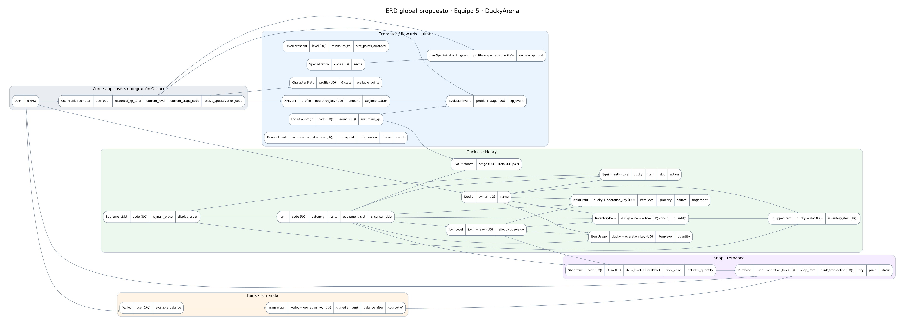
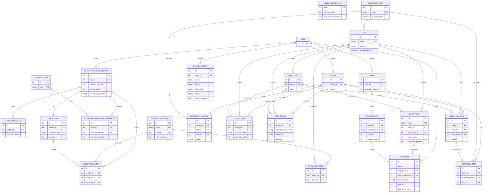

# DuckyArena · Equipo 5
## Resolución propuesta del ERD global y contratos A/B/C
**Versión:** 1.0 · 13 de octubre de 2026  
**Estado:** propuesta técnica cerrada para ratificación de Jaime, Henry y Fernando; dependencias con Óscar/Core señaladas aparte.  
**Ámbito:** únicamente DuckyArena, dentro de notodoescodigo.com. No modifica ni redefine el sistema económico global de la plataforma.

> **Cómo leer el documento.** «Decisión propuesta» significa que este informe recomienda adoptar una solución concreta, no que los compañeros o Core ya la hayan aprobado. «Actual» identifica elementos constatados en los modelos y documentos compartidos. «Pendiente Core» es una interfaz externa que el Equipo 5 no puede imponer.

## 1. Resultado ejecutivo

Se recomienda mantener **cuatro aplicaciones Django**: `apps.ecomotor` (Jaime), `apps.duckies` (Henry), `apps.bank` y `apps.shop` (Fernando), con `apps.users` como integración con Core. **Rewards es un servicio coordinador dentro de Ecomotor**, no una quinta aplicación. El ERD objetivo consta de **23 entidades dentro del alcance representado**: 7 modelos actuales de Ecomotor, 9 actuales de Duckies, 2 de Bank, 2 de Shop, `UserProfileEcomotor` en users y **2 modelos nuevos recomendados** (`RewardEvent` e `ItemGrant`), además del `User` de Core. Es decir, 7+9+2+2+1+2+1 = 24 nodos dibujados; **23 entidades excluyendo `User`**. `UserProfileBank`, mencionado en la documentación de Fernando, queda fuera del núcleo de las cuatro apps y no almacena saldo; su integración concreta se valida con Core.

**Reglas de producto confirmadas por el solicitante:** sin misiones; los permanentes se obtienen una sola vez; los consumibles admiten compras repetidas; compras exclusivamente con DuckyCoins; Shop solo comercializa objetos digitales de DuckyArena; sin merchandising físico; la plataforma notodoescodigo.com crea el usuario y, como parte del alta/provisión integrada, se crean Wallet, Ducky y perfiles necesarios; Óscar implementará después la integración de DuckyArena con la plataforma.

**Políticas adicionales recomendadas para cerrar el diseño:** las seis piezas históricas de cada etapa se conceden al alcanzar dicha etapa, sin equiparlas automáticamente; las piezas históricas no se venden en Shop V1; los cosméticos permanentes sí pueden venderse, una vez por usuario; los ataques, defensas y pistas son consumibles; Rewards registra de forma persistente la evaluación global; Duckies registra cada concesión; las compras y recompensas usan transacciones locales compartidas en la misma BD/alias SQLite. Estas son decisiones de diseño propuestas que requieren ratificación del equipo, no hechos establecidos por los documentos anteriores.

## 2. Límites de responsabilidad y reglas innegociables

| Propietario | Autoridad exclusiva | Prohibición de integración |
|---|---|---|
| Jaime / Ecomotor | XP histórica, XP de dominio, niveles, etapas, stats, especializaciones, eventos y coordinación de Rewards | No escribir inventario ni saldo directamente |
| Henry / Duckies | Catálogo general Item/ItemLevel, avatar, posesión, entrega, consumo, equipamiento y registro de concesiones | No cobrar, asignar XP ni decidir precios |
| Fernando / Bank | Wallet local, débitos/créditos, saldo y libro de movimientos de DuckyArena | No conceder objetos ni crear recompensas por cuenta propia |
| Fernando / Shop | Ofertas digitales, precios, compras, correlación con cobro y entrega | No mantener inventario ni saldo duplicado |
| Óscar / Core | User, identidad/autorización, aprovisionamiento e integración con moneda global | El Equipo 5 no impone esquema global ni JWT |

**Unicidad económica:** `Wallet.available_balance` es el saldo operativo **local propuesto** dentro de DuckyArena. No se declara fuente canónica global de notodoescodigo.com: Óscar debe determinar si la wallet local es delegada/canónica o si funciona mediante un adaptador de la economía global. Nunca se mantienen dos saldos independientes que puedan divergir.

## 3. Resolución de decisiones: una por una

### R-01 · Evolución y piezas históricas
**Problema actual.** `EvolutionStage.code` y `EvolutionItem.stage_code` son códigos de distinta longitud/validación; `EvolutionItem.required_xp` duplica potencialmente el umbral de etapa; `is_automatic` no tiene semántica acordada. No hay misiones.

**Decisión propuesta.** Convertir `EvolutionItem.stage_code` en `stage = ForeignKey('ecomotor.EvolutionStage', on_delete=PROTECT, related_name='historical_items')`; mantener `item = ForeignKey('duckies.Item', PROTECT)`; `UNIQUE(stage,item)`. Eliminar `required_xp` y `is_automatic` del esquema objetivo. Al entrar en una etapa se entregan todas sus piezas históricas configuradas, **sin equiparlas**; se conservan las de etapas anteriores. Para el alta inicial, conceder las piezas de Prehistoria durante la inicialización coordinada, sin inventar un XPEvent. Las evoluciones posteriores disparan concesiones usando la causa `EvolutionEvent`. Exigir **seis piezas principales por etapa** mediante validación de catálogo/seed (no mediante CHECK de una fila).

**Por qué es óptimo.** Una FK elimina códigos huérfanos y evita dos fuentes de verdad para XP; el servicio conserva la regla de seis piezas y la separación entre poseer y equipar. La dependencia de migración B→A es aceptable en el monolito modular si A no crea FKs de retorno a B. **Responsable:** Henry cambia EvolutionItem y concesión; Jaime emite transiciones e inicialización. **Afecta:** Henry y Jaime; Fernando solo si Shop muestra objetos históricos (no los vende V1). **Condición:** ratificar la concesión automática, ya que el documento de Jaime la dejaba abierta.

### R-02 · Equipamiento y avatar
**Problema.** Poseer un objeto no significa llevarlo equipado; hay seis piezas principales pero los códigos de slots no están cerrados.

**Decisión propuesta.** `EquipmentSlot` es catálogo único. Definir **seis códigos estables** de slots principales mediante un seed consensuado con el equipo visual (los nombres concretos no están fijados por la documentación); permitir slots cosméticos adicionales solo cuando exista necesidad funcional. `EquippedItem` conserva `UNIQUE(ducky,slot)` y `UNIQUE(inventory_item)`. `equip_item()` sustituye de forma atómica la ocupación del slot y escribe `EquipmentHistory` de desequipamiento/equipamiento. No equipar al evolucionar ni comprar.

**Por qué.** Evita seis columnas rígidas en Ducky y permite personalización sin romper inventario. **Implementa:** Henry. **Afecta:** Jaime (vista de evolución/Museo), Fernando (ficha de productos), frontend del juego.

### R-03 · Catálogo único de objetos y ofertas
**Problema.** `ShopItem.item_code` es texto y no garantiza la existencia de `Item` ni la variante `ItemLevel`.

**Decisión propuesta.** `ShopItem.item = ForeignKey('duckies.Item', PROTECT)` y `ShopItem.item_level = ForeignKey('duckies.ItemLevel', PROTECT, null=True, blank=True)`. Conservar `ShopItem.code` como SKU comercial único, independiente de `Item.code`. Una misma variante puede tener **varias ofertas** (por ejemplo, paquete de 1 o de 5 unidades), por lo que **no imponer UNIQUE(item,item_level)**. Validar que `item_level.item_id == item_id`; que ataque/defensa lleven nivel; que pista/cosmético no lo lleven; y que los objetos históricos no se comercialicen en V1.

**Por qué.** FK asegura integridad física en un único monolito y evita vender variantes ambiguas; varios SKU permiten packs sin duplicar el catálogo general. **Implementa:** Fernando (Shop) y Henry (reglas/consulta de catálogo). **Afecta:** Fernando y Henry.

### R-04 · Cantidades, permanentes y consumibles
**Problema.** `included_quantity` y `Purchase.quantity` tienen significado sin cerrar; el servicio actual fuerza cantidad de compra a 1.

**Decisión propuesta.** `ShopItem.included_quantity` = unidades digitales **por paquete**; `Purchase.quantity` = número de paquetes comprados; `delivered_quantity = included_quantity × Purchase.quantity`; `total_price_coins = unit_price_coins × Purchase.quantity`. En objetos permanentes, `included_quantity=1`, `Purchase.quantity=1`, inventario máximo 1 y una segunda compra se rechaza **sin débito**. En consumibles, se admiten packs y compras repetidas y se incrementa `InventoryItem.quantity`. `InventoryItem` mantiene una fila por (ducky,item,level), y elimina la fila cuando el consumible llega a cero. El historial se conserva en ItemUsage/ItemGrant.

**Por qué.** Modelo comercial flexible y reglas de inventario simples; elimina interpretaciones incompatibles y sobrecargos. **Implementa:** Fernando calcula importes/paquetes y rechaza duplicados; Henry garantiza las invariantes definitivas de inventario. **Afecta:** Fernando y Henry.

### R-05 · Entrega idempotente y modelo ItemGrant (NUEVO)
**Problema.** `ItemUsage` registra consumo, pero no existe trazabilidad persistente de cada concesión. Reintentos de Shop o Rewards pueden duplicar objetos.

**Decisión propuesta.** Añadir `ItemGrant` a Duckies: `ducky FK`, `item FK`, `item_level FK nullable`, `quantity PositiveInteger`, `source` (`SHOP`,`REWARDS`,`EVOLUTION`,`INITIALIZATION`), `operation_key CharField(255)`, `reference_type`, `reference_id`, `request_fingerprint`, `created_at`. `UNIQUE(ducky,operation_key)`. Un `grant_item()` transaccional valida fuente, objeto, nivel, cantidad y posesión; ante clave repetida con misma huella devuelve el **resultado histórico**, sin incrementar inventario; con huella diferente devuelve conflicto. No usar una única clave para varios ítems: derivar clave por recompensa/evolución **y código de ítem y nivel**. No introducir FK de ItemGrant a Purchase o RewardEvent: conservar referencia lógica evita ciclos entre apps.

**Por qué.** Auditoría e idempotencia duraderas sin acoplamiento circular. **Implementa:** Henry. **Afecta:** Jaime (Rewards/evolución) y Fernando (entrega comercial).

### R-06 · Compra atómica Shop → Bank → Duckies
**Problema.** Una compra no puede cobrar sin entregar; `Purchase.bank_transaction` es nullable; la idempotencia actual de Shop se comprueba demasiado tarde.

**Decisión propuesta.** Shop es **coordinador exclusivo de compras**, no Rewards. Ejecutar en `transaction.atomic()` exterior y SQLite `IMMEDIATE`, misma BD y alias: (1) validar usuario y clave, **buscar duplicado antes de revisar disponibilidad**; (2) comprobar huella de petición; (3) validar SKU, precio y cantidad; (4) verificar elegibilidad/posesión permanente; (5) llamar a Bank para débito idempotente; (6) llamar a Duckies para entrega idempotente; (7) persistir `Purchase` COMPLETED con `bank_transaction` **obligatorio** y `delivery_reference` (cadena/identificador de ItemGrant); (8) confirmar conjuntamente. Si cualquier paso falla, rollback completo. Mantener `Purchase.status` COMPLETED/REFUNDED para V1: no guardar PENDING si no existe transacción distribuida. Añadir `request_fingerprint` para detectar misma clave con SKU/cantidad incompatible. `unit_price_coins` es snapshot del precio y el total debe validarse con CHECK cuando el backend lo permita.

**Por qué.** Aprovecha monolito Django sin introducir colas, sagas ni estados inconsistentes; permite recuperación determinista. **Implementa:** Fernando, integrando servicio de Henry. **Afecta:** Fernando y Henry. **Condición técnica:** misma conexión transaccional; si Core exige un servicio monetario remoto, este contrato deja de ser atómico y debe rediseñarse con Óscar.

### R-07 · Wallet, movimientos y claves de Bank
**Problema.** Ledger actual solo compara tipo/importe para reintentos; falta cerrar fuente de verdad global.

**Decisión propuesta.** `Wallet(user OneToOne, available_balance>=0)` y `Transaction(wallet FK, signed amount !=0, balance_after>=0, operation_key, source_platform, issuing_entity, reference_type/id, fingerprint)`; `UNIQUE(wallet,operation_key)`. Definir signos: `REWARD` y `REFUND` positivos, `PURCHASE` negativo, `ADJUSTMENT` ambos con autorización reforzada. Crédito/débito solo por servicios Bank; saldo y movimiento en misma transacción; la huella incorpora tipo, importe, emisor, origen y referencia de negocio. Usar claves derivadas por operación (p. ej. `purchase:{purchase_key}:debit`, `reward:{reward_id}:coins`), sin reutilizar una clave para hechos distintos.

**Por qué.** Evita colisiones semánticas y mantiene trazabilidad financiera. **Implementa:** Fernando. **Afecta:** Jaime (créditos Rewards), Fernando (Shop) y Óscar (integración global). **Pendiente Core:** decidir qué representa físicamente `available_balance` fuera de DuckyArena.

### R-08 · Rewards centralizado y RewardEvent (NUEVO)
**Problema.** `XPEvent` solo deduplica XP histórica; una recompensa puede conceder monedas u objetos sin XP. Las reglas diarias no son lo mismo que deduplicar hechos.

**Decisión propuesta.** Añadir `RewardEvent` en `ecomotor` con `source`, `fact_id`, `user FK`, `payload_fingerprint`, `rules_version`, `status` (`APPLIED`,`NO_REWARD`), `result_snapshot JSON`, `created_at`, y `UNIQUE(source,fact_id,user)`. Rewards recibe **hechos validados por servidor**, comprueba identidad y huella, evalúa reglas/versiones y llama a Ecomotor (XP), Bank (monedas) y Duckies (objetos), todo en una transacción exterior si comparten conexión. El duplicado devuelve el snapshot original; `NO_REWARD` es final y deduplicable. No crear XPEvent para premios sin XP. No crear tabla RewardRule V1: reglas versionadas en configuración/código y registradas mediante `rules_version`. No implementar misiones.

**Por qué.** Una sola evidencia de recompensa completa y trazabilidad de efectos independientes, sin sobreingeniería. **Implementa:** Jaime, con servicios propietarios de Fernando y Henry. **Afecta:** los tres. **Pendiente externo:** identidad de hechos, autenticación y reglas exactas de cada juego/plataforma.

### R-09 · XP, evolución y concesiones coordinadas
**Problema.** XPEvent puede provocar varias evoluciones; no se deben perder piezas por saltar etapas.

**Decisión propuesta.** `grant_historical_xp()` crea XPEvent y todas las EvolutionEvent cruzadas; en la **misma transacción Rewards** invoca para cada etapa cruzada `grant_stage_items(stage,event_key)` de Duckies, que crea un ItemGrant por pieza. La XP inicial 0 y las piezas de Prehistoria se inicializan sin XPEvent ficticio. El servicio de XP puede ser invocado sin premio de objetos solo si el contrato de negocio lo permite y la evolución queda sincronizada por el coordinador de la operación; no hacer llamadas HTTP dentro de la transacción.

**Por qué.** Evita saltos de etapas y entregas parciales; el historial causal permanece coherente. **Implementa:** Jaime (evoluciones/Rewards) y Henry (entrega). **Afecta:** Jaime y Henry.

### R-10 · Uso de consumibles por juegos
**Problema.** ItemUsage tiene clave local, pero no define cómo evitar dos consumos por reenvío ni cómo autorizar el juego.

**Decisión propuesta.** `consume_item(user,item,level,quantity,operation_key,source_game,session_id)` es servicio de Duckies; valida sesión/autoridad, inventario, cantidad y huella; crea ItemUsage y descuenta en una transacción. Un reintento compatible devuelve el consumo anterior; incompatibilidad produce conflicto. El juego aplica el efecto de ItemLevel; Duckies **no decide ganador ni modifica XP**. Si un efecto requiere reserva antes de aplicarse, esa funcionalidad es contrato adicional de juegos, no un modelo nuevo en V1.

**Por qué.** Separa inventario de lógica del juego y evita consumos duplicados. **Implementa:** Henry. **Afecta:** Jaime si participa en resultados/recompensas y equipos de juegos; Fernando no participa en consumo.

### R-11 · Reembolsos y retirada de objetos
**Problema.** `refund_purchase()` actual puede devolver monedas sin retirar lo entregado; un consumible puede haberse gastado.

**Decisión propuesta.** V1 **sin reembolso automático a petición del usuario**. Solo reversión administrativa justificada: verificar que el permanente sigue en posesión o que hay cantidad consumible suficiente sin usar; dentro de una transacción retirar unidades mediante servicio de Duckies, registrar `Transaction` REFUND y cambiar Purchase a REFUNDED. Añadir `Purchase.refund_transaction` FK nullable a Bank.Transaction (PROTECT) para trazar el movimiento inverso, o mantener referencia explícita equivalente; se recomienda FK porque el flujo es local. Si ya se consumió, denegar reversión automática y escalar a revisión manual; nunca abonar sin decisión de recuperación. La retirada debe quedar auditada en un evento de reversión de inventario (ampliar ItemGrant con referencia de reversión o crear `InventoryAdjustment` solo si V1 requiere esta operación). **Para un ERD V1 mínimo**, documentar retirada administrativa como operación futura y **deshabilitar refund_purchase** hasta que exista auditoría completa; no añadir `refund_transaction` ni entidad de retirada al ERD V1.

**Por qué.** Evita regalar monedas y objetos y reduce alcance. **Implementa:** Fernando deshabilita reembolso automático; Henry no necesita implementar retirada en V1. **Afecta:** Fernando y Henry. **Política V1 final propuesta:** solo COMPLETED, mantener `REFUNDED` reservado/no alcanzable por API hasta V2.

### R-12 · Provisionamiento y perfiles
**Problema.** El usuario global debe disponer de Ducky, Wallet y perfil de progreso; los OneToOne permiten ausencia física y no deben crearse perfiles legacy por migración silenciosa.

**Decisión propuesta.** Un **servicio orquestador de alta** llamado desde la integración de Core aprovisiona `UserProfileEcomotor`, `CharacterStats`, `Ducky` y `Wallet`, de forma idempotente y transaccional, y concede las piezas iniciales de Prehistoria sin crear XPEvent. `UserProfileBank`, si Core lo mantiene, se provisiona según su contrato, pero no duplica saldo. Reintentos nunca reinician XP, monedas ni inventario. Si un usuario antiguo carece de datos, aplicar proceso de reconciliación explícito, no señales ni defaults que reseteen estado.

**Por qué.** Un solo punto de entrada, cero estados parciales y control de legacy. **Implementa:** Óscar integra y autoriza el alta; Jaime, Henry y Fernando proporcionan sus inicializadores idempotentes. **Afecta:** todos; depende de Core.

### R-13 · Historial, Museo y retención
**Problema.** EquipmentHistory no es historia completa del avatar; XPEvent, EvolutionEvent, ItemGrant, ItemUsage y Transaction pueden perderse con CASCADE.

**Decisión propuesta.** El **Museo Ducky V1 es una vista de lectura**, no una tabla nueva: compone etapas alcanzadas (`EvolutionEvent`), objetos históricos poseídos y concesiones (`InventoryItem`/`ItemGrant`) e historial de equipamiento (`EquipmentHistory`). Los eventos operativos no se editan ni borran mediante CRUD normal. Conservar PROTECT para catálogos referenciados y compras; mantener CASCADE técnicos actuales provisionalmente solo hasta política de retención de Óscar; no declarar una política legal de borrado unilateralmente.

**Por qué.** Evita duplicar historia y reduce inconsistencias. **Implementa:** Henry consulta/composición Museo, Jaime aporta evolución. **Afecta:** Jaime y Henry; Óscar por conservación.

### R-14 · Validaciones e integridad de base de datos
**Problema.** `clean()` y MinValueValidator no se ejecutan automáticamente con `save()`; CHECK no puede comparar filas/tablas.

**Decisión propuesta.** Añadir CHECKs de fila: cantidades positivas, nivel 1–3, precios positivos, `Transaction.amount != 0`, `Purchase.total_price_coins = unit_price_coins * quantity`, `ItemGrant.quantity > 0`; UNIQUEs ya descritas. Validaciones cruzadas en servicios y `full_clean()`: ItemLevel pertenece a Item, propietario de InventoryItem coincide con EquippedItem.ducky, permanentes con cantidad 1, estado válido de SKU, seis piezas por etapa, catálogo de niveles/etapas consistente. No asumir que `select_for_update()` bloquea filas en SQLite; usar D-19 y tests con base SQLite en archivo.

**Por qué.** Protección en profundidad sin CHECKs imposibles entre tablas. **Implementa:** cada dueño de modelos. **Afecta:** los tres.

## 4. ERD global objetivo: entidades y cardinalidades

### 4.1 Entidades por aplicación

| Aplicación | Entidades del ERD objetivo | Cambio frente a modelos compartidos |
|---|---|---|
| `apps.users` | `UserProfileEcomotor` | Se conserva; relación con User Core |
| `apps.ecomotor` | `CharacterStats`, `LevelThreshold`, `EvolutionStage`, `XPEvent`, `EvolutionEvent`, `Specialization`, `UserSpecializationProgress`, **`RewardEvent`** | Se añade RewardEvent; 8 modelos en esta app |
| `apps.duckies` | `Ducky`, `EquipmentSlot`, `Item`, `ItemLevel`, `InventoryItem`, `EquippedItem`, `EquipmentHistory`, `EvolutionItem`, `ItemUsage`, **`ItemGrant`** | Se añade ItemGrant; EvolutionItem usa FK a etapa y elimina campos redundantes |
| `apps.bank` | `Wallet`, `Transaction` | Se añade huella a Transaction; saldo global pendiente Core |
| `apps.shop` | `ShopItem`, `Purchase` | ShopItem FK Item/ItemLevel; Purchase huella, referencia entrega y cobro obligatorio |
| Externo | `User` | Modelo Core, no creado por Equipo 5 |

**Total:** 1 + 8 + 10 + 2 + 2 = **23 entidades del diseño Equipo 5**; más `User` externo (24 nodos). No se cuenta `UserProfileBank` como entidad nueva del equipo; si existe en `apps.users`, se integra según contrato Core.

### 4.2 Cardinalidades relevantes

| Origen → destino | Cardinalidad objetivo | Restricción / borrado |
|---|---|---|
| User → UserProfileEcomotor / Ducky / Wallet | 1 → 0..1 físicamente; 1 → 1 tras alta correcta | OneToOne; retención con Core |
| User → Purchase / RewardEvent | 1 → N | FK; retención con Core |
| UserProfileEcomotor → CharacterStats | 1 → 0..1 físicamente; 1 → 1 tras alta | OneToOne |
| UserProfileEcomotor → XPEvent / EvolutionEvent / UserSpecializationProgress | 1 → N | FKs; UNIQUE según eventos/progreso |
| EvolutionStage → EvolutionEvent / EvolutionItem | 1 → N | PROTECT para catálogos históricos |
| XPEvent → EvolutionEvent | 1 → 0..N | Una concesión cruza varias etapas |
| Specialization → UserSpecializationProgress | 1 → N | PROTECT |
| Ducky → InventoryItem / ItemGrant / ItemUsage / EquipmentHistory | 1 → N | FK |
| Ducky → EquippedItem | 1 → N | UNIQUE(ducky,slot) |
| EquipmentSlot → Item / EquippedItem / EquipmentHistory | 1 → N | PROTECT catálogo |
| Item → ItemLevel / InventoryItem / EvolutionItem / ShopItem / ItemGrant / ItemUsage | 1 → N | PROTECT catálogo referenciado |
| ItemLevel → ShopItem / InventoryItem / ItemGrant / ItemUsage | 1 → 0..N | FK nullable en variantes no niveladas |
| InventoryItem → EquippedItem | 1 → 0..1 | OneToOne |
| Wallet → Transaction | 1 → N | Ledger persistente |
| ShopItem → Purchase | 1 → N | PROTECT |
| Transaction → Purchase | 1 → 0..1 | Compra COMPLETED exige un débito único |

### 4.3 Referencias deliberadamente lógicas (sin FK)

- `ItemGrant.reference_type/reference_id` apunta al identificador de `Purchase`, `RewardEvent` o `EvolutionEvent` según origen, sin crear ciclos de migración.
- `Transaction.reference_type/reference_id` apunta a compra o recompensa, manteniendo el ledger desacoplado del negocio.
- `RewardEvent.result_snapshot` contiene las referencias de los efectos propietarios, sin FKs físicas de vuelta a todos los dominios.
- `ItemUsage.source_game/session_id` identifica el hecho del juego, cuya verificación corresponde al servidor de juego/Core.
- `UserProfileEcomotor.current_stage_code` y `active_specialization_code` siguen como códigos lógicos por decisión documentada de Jaime, validados por servicio.

### 4.4 Diagrama gráfico

El diagrama muestra **relaciones físicas principales**; las referencias lógicas se describen arriba. Los campos resumidos de cada caja no sustituyen el diccionario de datos de cada responsable.

### 4.5 ERD editable Mermaid

**Nota de lectura:** `UK` en Mermaid indica unicidad conceptual; para claves compuestas y nullable rigen las constraints del diccionario. La notación Mermaid no expresa por sí sola todos los CHECKs ni `on_delete`.

## 5. Contratos internos aprobables: firmas recomendadas

| Operación Python propuesta | Propietario | Llamadores | Semántica mínima |
|---|---|---|---|
| `initialize_progress(user, operation_key)` | Jaime | Alta Core | Idempotente, no resetea legacy |
| `apply_validated_reward(user, source, fact_id, payload)` | Jaime | Juegos/plataforma autorizados | RewardEvent, reglas y efectos atómicos |
| `grant_historical_xp(user, amount, operation_key, reward_ref)` | Jaime | Rewards | XPEvent, niveles y evoluciones |
| `grant_stage_items(user, stage, operation_key)` | Henry | Inicialización/Rewards | Entrega piezas de etapa, sin equipar |
| `grant_item(user, item, item_level, quantity, source, operation_key, reference)` | Henry | Shop/Rewards | ItemGrant + inventario, duplicado/conflicto |
| `get_item_ownership(user, item, item_level=None)` | Henry | Shop/UI | Posesión actual y cantidad |
| `consume_item(user, item, item_level, quantity, operation_key, game_ref)` | Henry | Juego autorizado | ItemUsage + decremento |
| `equip_item(user, inventory_item, slot)` | Henry | Avatar/UI | EquippedItem + EquipmentHistory |
| `credit_wallet(user, amount, operation_key, source, reference)` | Fernando/Bank | Rewards | Transaction positiva idempotente |
| `debit_wallet(user, amount, operation_key, source, reference)` | Fernando/Bank | Shop | Transaction negativa idempotente |
| `purchase_item(user, sku, package_quantity, operation_key)` | Fernando/Shop | UI Shop | Compra, cobro, entrega y Purchase atómicos |

Las firmas son **contratos internos propuestos**; los nombres definitivos y excepciones deben aceptarse por los tres. Los servicios no reciben importes de recompensa ni precios efectivos determinados por el navegador. Las claves locales derivan de un hecho validado y estable; no basta el timestamp del reintento.

## 6. Escenarios de aceptación que demuestran el ERD

| Escenario | Resultado obligatorio |
|---|---|
| Usuario nuevo | Perfil, stats, Ducky y Wallet creados una sola vez; Prehistoria y piezas iniciales sin XPEvent ficticio |
| XP cruza tres etapas | Un XPEvent; tres EvolutionEvent; seis piezas por cada etapa configurada; ningún autoequipamiento |
| Reintento de evolución | Cero piezas extra; devuelve concesiones anteriores |
| Compra de cosmético nuevo | Un débito, una Purchase y un ItemGrant; inventario permanente cantidad 1 |
| Segunda compra del mismo cosmético | Rechazo sin cobro ni entrega |
| Compra de 2 packs de 3 escudos | Compra quantity=2, entrega 6 unidades y cargo de dos packs |
| Compra de ataque nivel 2 | ShopItem identifica Item y ItemLevel=2; inventario correcto |
| Reintento compra tras desactivar SKU | Devuelve compra previa, no ProductUnavailable |
| Fallo de entrega | No persisten cobro, compra ni ItemGrant |
| Reward sin XP | RewardEvent APPLIED, crédito u objeto; ningún XPEvent ficticio |
| Reward sin premio por límite diario | RewardEvent NO_REWARD; retry devuelve resultado previo |
| Dos partidas Training válidas mismo día | XP según reglas para ambas; moneda solo para la primera elegible |
| Consumir última unidad | ItemUsage persistente; InventoryItem se elimina; reintento no consume otra unidad |
| Misma clave, payload distinto | Conflicto; ningún efecto nuevo |
| Reembolso automático V1 | No disponible; no se acreditan monedas sin retirar el objeto |

## 7. Reparto de implementación por miembro

### Jaime · Ecomotor
1. Crear `RewardEvent`, unicidad por hecho/destinatario, huella, snapshot y estados.
2. Implementar Rewards orquestador transaccional y adaptadores de efectos hacia Bank y Duckies.
3. Finalizar XP histórica, niveles, EvolutionEvent, especializaciones y stats.
4. Publicar eventos de evolución con identidad estable y coordinar concesión de etapas sin misiones.
5. Proveer inicialización de UserProfileEcomotor/CharacterStats y semillas de siete etapas.
6. Tests de XP multi-etapa, Rewards APPLIED/NO_REWARD, límites y rollback.

### Henry · Duckies
1. Ajustar EvolutionItem con FK a EvolutionStage y catálogo seis piezas/etapa.
2. Crear ItemGrant, huella e idempotencia de concesiones.
3. Implementar grant_item, grant_stage_items, ownership, consume_item y equip_item.
4. Validar Item/ItemLevel, cantidades, permanentes y slots.
5. Publicar catálogo/consulta de variantes para Shop y lectura de Museo.
6. Tests de duplicados, niveles, permanentes, consumibles, inventario y rollback.

### Fernando · Bank y Shop
1. Mantener apps separadas `bank` y `shop` como ya está acordado; no se desarrolla aquí estrategia de migraciones.
2. ShopItem FK Item/ItemLevel, reglas de SKU y packs; sin merchandising.
3. Purchase con fingerprint, débito obligatorio y referencia de entrega; compra atómica y orden correcto de idempotencia.
4. Bank Transaction con huella, signos, claves y ledger; wallet local sin duplicación económica.
5. Deshabilitar reembolsos automáticos en V1 hasta contrato de reversión.
6. Tests de saldo insuficiente, compra de permanente, packs, reintentos, fallo de entrega y concurrencia.

## 8. Dependencias de Óscar/Core — explícitamente fuera del cierre A/B/C

| Cuestión | Decisión local del Equipo 5 | Lo que debe confirmar/implementar Óscar |
|---|---|---|
| Identidad | Todos los dominios referencian `settings.AUTH_USER_MODEL` | Usuario real, JWT/permisos y mapping entre plataforma y DuckyArena |
| Alta | Inicializadores locales idempotentes | Invocarlos al crearse el User global; garantizar atomicidad o reconciliación si es otro servicio/BD |
| Saldo | Bank es única puerta económica dentro de DuckyArena | Fuente física canónica de DukiCoins globales; sincronización o delegación sin saldo paralelo |
| Seguridad | Servicios solo aceptan hechos y llamadores autorizados | Autorización de origen, sesión y permisos globales |
| Recompensas externas | Rewards soporta hechos con origen estable | Qué actividades externas son elegibles y cómo se validan |
| Datos antiguos | No crear/resetear perfiles silenciosamente | Política legacy y reconciliación de usuarios preexistentes |
| Retención | Historiales operativos inmutables en flujo normal | Borrado, anonimización, retención legal y `on_delete` final |
| Conexión de datos | Transacción local compartida cuando apps están en mismo alias | Confirmar si integración global usa otra BD/servicio; si sí, acordar estrategia distribuida |

**Límite esencial:** este documento cierra una **propuesta de ERD local**. No puede certificar que la economía global de notodoescodigo.com utilice `Wallet.available_balance`, ni que la provisión global pueda realizarse en la misma transacción. Esos puntos requieren la confirmación de Óscar. No se recomienda introducir un segundo saldo canónico para «hacer que funcione».

## 9. Decisiones descartadas y por qué

| Alternativa descartada | Motivo |
|---|---|
| Crear app independiente `rewards` | No es necesaria en V1; coordinación desde Ecomotor ya prevista |
| Usar XPEvent como ledger de todo premio | No representa recompensas sin XP ni idempotencia global |
| Conceder objetos sin ItemGrant o registro equivalente | No garantiza replay auditable de entregas |
| Shop modifica InventoryItem directamente | Rompe propiedad de dominio y validaciones de Duckies |
| `ShopItem.item_code` como único identificador | No valida existencia ni nivel de objeto |
| `EvolutionItem.required_xp` igual al umbral de etapa | Duplica regla y permite divergencia |
| Autoequipar seis piezas al evolucionar | Confunde posesión con selección visual del usuario |
| Añadir misiones | Fuera del alcance confirmado |
| Añadir merchandising físico | Fuera del alcance del Equipo 5 |
| Reembolsar sin retirar inventario | Riesgo de duplicar valor económico |
| Mantener saldo local y saldo global independientes | Divergencia financiera |
| HTTP externo dentro de transaction.atomic | No garantiza rollback distribuido |

## 10. Acta de ratificación

El diseño se considera **listo para revisión conjunta**, pero no se atribuye aprobación inexistente. Para adoptarlo, los tres deben ratificar especialmente: **(1)** concesión automática de seis piezas al entrar en etapa, **(2)** FK de EvolutionItem a EvolutionStage, **(3)** ShopItem FK a Item/ItemLevel, **(4)** ItemGrant y RewardEvent, **(5)** packs y política de permanentes, **(6)** transacción local compartida y **(7)** deshabilitación de reembolsos automáticos V1. El equipo puede aprobar estas decisiones y empezar a implementar los contratos locales sin esperar el diseño de integración global de Óscar, siempre que no afirme garantías de saldo/autorización que aún dependen de Core.

**Fuentes de contraste:** `ecomotor.md` (ERD V2 provisional Parte A); `parte-c-ecommerce-bank.md` (diseño Parte C); actualización `parte-c-ecommerce-bank.md.crdownload` (borrador 0.2, 13/10/2026); `rewards-v0.md`; `parte-b-duckies.md` y modelos Python compartidos en la conversación. Las decisiones de este informe que van más allá de esos documentos están señaladas como recomendaciones y utilizan las nuevas restricciones de alcance aportadas por el usuario.
