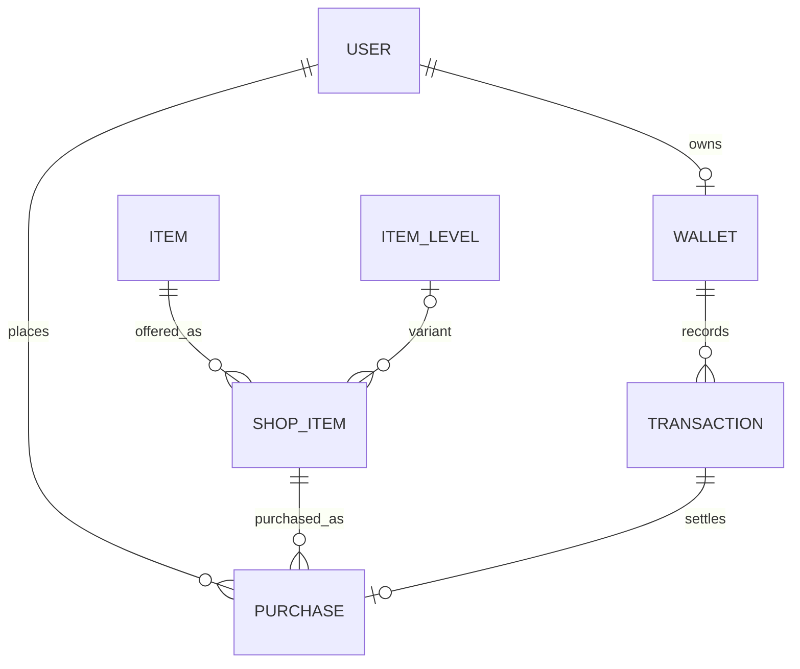

# ERD y diccionario de datos · Parte C — DuckyBank y DuckyShop

- **Proyecto:** DuckyArenas · Equipo 5
- **Responsable del dominio:** Fernando · Parte C
- **Versión documental:** 0.3 · 07/11/2026
- **Estado:** inventario del ORM y servicios integrados en `develop`; candidato para revisión conjunta A/B/C y Core.

> Este documento describe el estado observable del código en `develop`. No ratifica que `Wallet` sea el saldo global canónico, no aprueba contratos externos y no sustituye las decisiones de Core sobre identidad, autorización, conservación o ciclo de vida.

## 1. Alcance y propiedad

La Parte C comprende:

- **Bank:** cartera local, saldo disponible y libro de movimientos.
- **Shop:** catálogo comercial, validación de ofertas y coordinación de compras.
- **Duckies / Inventory:** catálogo general de objetos, variantes, posesión y entrega. Shop consume sus modelos y servicios, pero no debe escribir directamente en sus tablas de inventario.
- **Core:** identidad, autenticación, autorización y ciclo de vida global del usuario.
- **Ecomotor / Rewards:** coordinación funcional de recompensas. La emisión de monedas desde Rewards requiere un contrato explícito con Bank y Core.

El catálogo comercial no es el catálogo de objetos: `ShopItem` representa una oferta/SKU y referencia un `Item` propiedad de Duckies.

## 2. ERD físico observado en `develop`

El diagrama refleja las relaciones Django actuales. No representa una aprobación global de la arquitectura.

### Cardinalidades y `on_delete`

| Relación | Cardinalidad | Regla ORM | Interpretación |
|---|---|---|---|
| `User` → `Wallet` | User 0..1 Wallet; Wallet 1 User | `OneToOneField`, `CASCADE` | Un usuario puede no tener cartera provisionada. |
| `Wallet` → `Transaction` | Wallet 0..N movimientos | `ForeignKey`, `CASCADE` | El ledger depende de la cartera en el esquema actual. |
| `User` → `Purchase` | User 0..N compras | `ForeignKey`, `CASCADE` | La compra está asociada al usuario. |
| `ShopItem` → `Purchase` | SKU 0..N compras | `ForeignKey`, `PROTECT` | Una oferta con compras no puede eliminarse mediante borrado ORM normal. |
| `Transaction` → `Purchase` | Transaction 0..1 Purchase; Purchase 1 Transaction | `OneToOneField`, `PROTECT` | Cada compra persistida referencia un movimiento Bank. |
| `Item` → `ShopItem` | Item 0..N ofertas | `ForeignKey`, `PROTECT` desde ShopItem | Duckies conserva el objeto; Shop puede ofrecerlo en más de un SKU. |
| `ItemLevel` → `ShopItem` | Nivel 0..N ofertas; SKU 0..1 nivel | `ForeignKey`, `PROTECT`, nullable | La variante es opcional; la validación de categoría determina cuándo es obligatoria. |

**Importante:** `CASCADE` sobre User/Wallet/Purchase y Wallet/Transaction describe el comportamiento técnico actual, no una política de retención aprobada. La política global de eliminación, anonimización, supresión y conservación sigue dependiendo de Core.

## 3. Diccionario de datos

### 3.1 `Wallet` — cartera local

| Campo | Tipo | Restricción / significado |
|---|---|---|
| `id` | `BigAutoField` | PK automática |
| `user` | `OneToOneField(AUTH_USER_MODEL)` | Obligatorio, único, `CASCADE`, `related_name="duki_wallet"` |
| `available_balance` | `PositiveBigIntegerField` | `default=0`; saldo disponible local |
| `created_at` | `DateTimeField` | `auto_now_add=True` |
| `updated_at` | `DateTimeField` | `auto_now=True` |

Restricción SQL: `available_balance >= 0`.

**Provisionamiento:** `ensure_wallet_provisioned(user)` crea explícitamente una cartera de saldo cero para un usuario persistido y devuelve `(wallet, created)`, usando `get_or_create`. Es idempotente y no reemplaza el saldo existente. No se invoca desde lecturas ni desde créditos/débitos. El llamador debe ser un orquestador de ciclo de vida acordado; la existencia del servicio no significa que Core haya aprobado o conectado ese orquestador.

### 3.2 `Transaction` — ledger de Bank

| Campo | Tipo | Restricción / significado |
|---|---|---|
| `id` | `BigAutoField` | PK automática |
| `wallet` | `ForeignKey(Wallet)` | Obligatorio, `CASCADE`, `related_name="transactions"` |
| `transaction_type` | `CharField(20)` | `REWARD`, `PURCHASE`, `REFUND`, `ADJUSTMENT` |
| `amount` | `BigIntegerField` | No cero; positivo para crédito e ingreso, negativo para débito por convención de servicios |
| `balance_after` | `PositiveBigIntegerField` | Snapshot del saldo después del movimiento; no negativo |
| `operation_key` | `CharField(255)` | Obligatorio y no vacío; único junto con `wallet` |
| `source_platform` | `CharField(100)` | Origen de la operación |
| `issuing_entity` | `CharField(100)` | Emisor/componente responsable |
| `reference_type` | `CharField(100)` | Referencia tipada, opcional |
| `reference_id` | `CharField(255)` | Identificador causal, opcional |
| `description` | `CharField(255)` | Texto explicativo, opcional |
| `request_fingerprint` | `CharField(64)` | Huella semántica usada para detectar reutilización incompatible de clave |
| `created_at` | `DateTimeField` | `auto_now_add=True`; orden descendente por fecha e ID |

Restricciones SQL: unicidad `(wallet, operation_key)`, `amount != 0`, `balance_after >= 0` y `operation_key != ""`.

**Servicios:** `credit_coins`, `debit_coins` y `adjust_wallet` validan el importe, bloquean la Wallet con `select_for_update`, buscan una operación previa, verifican fondos y límite superior, actualizan saldo y crean el movimiento dentro de `transaction.atomic()`.

La huella actual incluye versión, tipo, importe firmado, origen, emisor, tipo de referencia e ID de referencia. No incluye `description`. Repetir una clave con huella distinta genera `IdempotencyConflict`; una repetición compatible devuelve el movimiento existente sin volver a modificar saldo.

`wallet_summary` y `transaction_history` son consultas del usuario indicado. Las vistas HTTP aplican `login_required` y filtran por `request.user`.

### 3.3 `ShopItem` — oferta comercial / SKU

| Campo | Tipo | Restricción / significado |
|---|---|---|
| `id` | `BigAutoField` | PK automática |
| `code` | `CharField(100)` | Único; identificador comercial del SKU |
| `item` | `ForeignKey(duckies.Item)` | Obligatorio, `PROTECT`, `related_name="shop_offers"` |
| `item_level` | `ForeignKey(duckies.ItemLevel)` | Opcional, `PROTECT`, `related_name="shop_offers"` |
| `name` | `CharField(150)` | Nombre comercial |
| `description` | `TextField` | Opcional |
| `price_coins` | `PositiveBigIntegerField` | Precio unitario; validador mínimo 1 y constraint SQL `> 0` |
| `included_quantity` | `PositiveIntegerField` | `default=1`; cantidad entregada por unidad de SKU |
| `is_available` | `BooleanField` | `default=True` |
| `featured` | `BooleanField` | `default=False` |
| `created_at` / `updated_at` | `DateTimeField` | Alta y última actualización |

Orden: `-featured`, `name`, `id`. Constraints SQL: `price_coins > 0` e `included_quantity > 0`.

**Validación de oferta V1:** no se venden objetos `HISTORICAL`; se admiten `COSMETIC`, `ATTACK`, `DEFENSE` y `HINT`. `ATTACK`/`DEFENSE` requieren `ItemLevel`; las demás categorías no lo admiten. `ATTACK`/`DEFENSE`/`HINT` deben ser consumibles; `COSMETIC` debe ser permanente. Los objetos permanentes se venden en unidades de uno. El servicio vuelve a validar la oferta en el servidor antes de cobrar.

### 3.4 `Purchase` — compra completada

| Campo | Tipo | Restricción / significado |
|---|---|---|
| `id` | `BigAutoField` | PK automática |
| `user` | `ForeignKey(AUTH_USER_MODEL)` | Obligatorio, `CASCADE`, `related_name="duki_purchases"` |
| `shop_item` | `ForeignKey(ShopItem)` | Obligatorio, `PROTECT`, `related_name="purchases"` |
| `operation_key` | `CharField(255)` | Único junto con `user` |
| `request_fingerprint` | `CharField(64)` | Huella de usuario, SKU y cantidad |
| `unit_price_coins` | `PositiveBigIntegerField` | Precio unitario aplicado |
| `quantity` | `PositiveIntegerField` | Cantidad de paquetes solicitada |
| `total_price_coins` | `PositiveBigIntegerField` | Total cobrado |
| `status` | `CharField(20)` | `COMPLETED` o `REFUNDED`; default `COMPLETED` |
| `bank_transaction` | `OneToOneField(bank.Transaction)` | Obligatorio, `PROTECT`, `related_name="purchase"` |
| `delivery_reference` | `CharField(255)` | Referencia persistida de la entrega |
| `created_at` / `updated_at` | `DateTimeField` | Alta y última actualización |

Constraints SQL: unicidad `(user, operation_key)`, campos de precio/cantidad positivos y `total_price_coins = unit_price_coins * quantity`.

La compra conserva el precio aplicado en el momento de la operación. No existe en este modelo una tabla independiente de líneas de compra ni un mecanismo automático de reembolso expuesto por Shop V1.

## 4. Flujo de compra implementado

`purchase_item(user, sku_code, operation_key, quantity=1)` coordina la compra local:

1. Valida clave, SKU y cantidad.
2. Calcula una huella de la petición (usuario, SKU y cantidad).
3. Abre una transacción y busca una compra previa compatible; una clave reutilizada con otro SKU/cantidad genera conflicto.
4. Bloquea el `Ducky` del comprador y vuelve a comprobar la compra previa para serializar reintentos concurrentes del mismo comprador.
5. Bloquea el SKU, comprueba disponibilidad y valida la configuración comercial.
6. Para objetos permanentes, comprueba que el comprador no posea ya el objeto.
7. Calcula total y cantidad entregada, verificando límites numéricos.
8. Ejecuta `debit_coins` con una clave derivada estable.
9. Ejecuta `grant_item` en Duckies con otra clave derivada estable.
10. Persiste `Purchase`, vinculando el movimiento Bank y la referencia de entrega.

La capa HTTP no recibe precio ni usuario desde el formulario: el usuario procede de `request.user`, el precio se lee del SKU en servidor y el formulario recibe `operation_key` y `quantity`. Las vistas de Bank/Shop son autenticadas y de lectura GET, salvo el endpoint de compra, que requiere POST.

**Límite transaccional:** la atomicidad conjunta depende de que Bank, Shop y Duckies operen sobre la misma base/alias y de que sus servicios no confirmen transacciones independientemente ni ejecuten I/O externo. No se debe presentar esta transacción local como garantía distribuida entre servicios o bases distintas.

## 5. Integración visual y entorno local

La integración de interfaz de PR #131 consume la presentación de Duckies desde Shop, pero el dominio comercial sigue en `apps.shop`. Esta dependencia de presentación no cambia la propiedad de modelos ni autoriza a Shop a escribir directamente en inventario.

`config/urls.py` en `develop` monta rutas de login/logout/registro, Duckies, Bank, Shop y UI globalmente. `config/settings_team5_local.py` cambia la base de datos, activa `TEAM5_LOCAL_ISOLATED` y configura rutas de login/redirect, pero no redefine `ROOT_URLCONF`. Por tanto, la separación demostrada por ese archivo es de configuración/base de datos y no acredita por sí sola que las rutas globales estén aisladas. La propiedad y aceptación de las rutas globales corresponde a Core; Parte C no debe corregir `config/urls.py` unilateralmente.

En el entorno `TEAM5_LOCAL_ISOLATED`, `apps.duckies.team5_local.apps.Team5LocalConfig` registra una señal local que crea `Wallet` directamente al crear un usuario, y conecta el seed de Shop después de migraciones. Esa señal es específica del entorno local, no un flujo productivo. Existe ahora `ensure_wallet_provisioned`; sería preferible que el orquestador local invoque el servicio Bank en vez de manipular el modelo `Wallet` directamente, pero el cambio pertenece al propietario de la configuración local y debe coordinarse con Henry.

## 6. Pruebas y evidencia

Las pruebas de Bank/Shop cubren servicios, saldo no negativo, fondos insuficientes, idempotencia, conflictos, rollback, configuración de SKU, propiedad/entrega, reintentos y vistas HTTP. Los resultados históricos comunicados en PR anteriores no deben presentarse como ejecución de la suite actual.

Pendientes de evidencia específica:

- Concurrencia real de dos conexiones PostgreSQL para reintentos de compra y operaciones Bank.
- Validación conjunta de límites de bloqueo/orden de locks entre Duckies, Shop y Bank.
- Confirmar comportamiento de rollback con el mismo alias de base de datos usado por todos los dominios.
- Ejecutar regresión completa en el entorno Python/Django acordado; documentar fallos preexistentes por separado, sin atribuirlos automáticamente a Parte C.
- Verificar funcionalmente las rutas integradas y su aislamiento con Core.

## 7. Decisiones todavía abiertas

| Tema | Estado / propietario |
|---|---|
| Fuente canónica global del saldo y titularidad económica | Pendiente de Core; `Wallet` es el saldo local implementado, no una ratificación global. |
| Identidad, autorización y permisos por operación | Pendiente de Core. Las vistas autenticadas actuales no sustituyen autorización global por dominio. |
| Ciclo de vida, anonimización, supresión y retención de Wallet/Transaction/Purchase | Pendiente de Core; revisar `CASCADE`/`PROTECT` frente a política acordada antes de cambios físicos. |
| Orquestador de provisionamiento | `ensure_wallet_provisioned` está implementado; llamador global aprobado y conectado sigue pendiente. |
| Rewards → Bank | No hay contrato global aprobado para emisión de monedas; no activar créditos automáticos ni asumir atomicidad entre dominios. |
| Shop → Duckies | La entrega usa `grant_item`; mantener Duckies como propietario de inventario y confirmar contrato compartido/versionado. |
| Reembolsos | `PurchaseStatus.REFUNDED` existe, pero no hay flujo de reembolso automático implementado en Shop V1. |
| Concurrencia PostgreSQL | Requiere prueba real con conexiones independientes; los tests SQLite no demuestran `select_for_update` de PostgreSQL. |
| Rutas globales y autenticación de la interfaz | Revisar con Henry/Core; no modificar `config/urls.py` desde Parte C unilateralmente. |

## 8. Criterio de aceptación documental

- El diccionario coincide con los modelos y constraints actuales de `develop`.
- Las cardinalidades y reglas `on_delete` están separadas de las políticas de retención todavía no acordadas.
- Se distinguen las responsabilidades de Bank, Shop, Duckies y Core.
- La transacción local y sus límites están explícitos.
- Las pruebas históricas no se presentan como resultados nuevos.
- Las decisiones compartidas pendientes permanecen abiertas hasta su ratificación por los propietarios.
