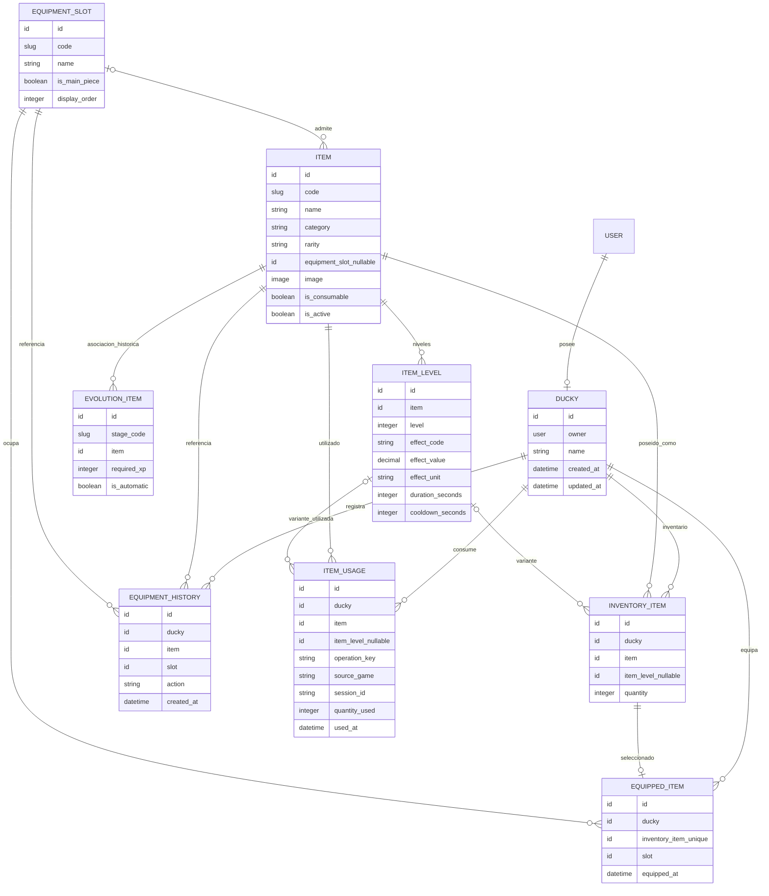

# Parte B · Duckies, Avatar, Inventory y Equipment

**Documento técnico provisional · Versión B-0.1 · 13/10/2026**  
**Responsable:** Henry · Equipo 5, DuckyArena  
**Aplicación Django:** `apps.duckies`  
**Estado:** Borrador de consolidación para revisión con Partes A/C, Rewards y Óscar/Core. **No constituye aprobación global, ORM definitivo ni contrato implementado.**

---

## 1. Estado, fuentes y alcance

Este documento consolida el diseño de Parte B discutido hasta la fecha y el `models.py` de Duckies compartido por su responsable. Se contrasta con:

- `ecomotor.md`: ERD V2 provisional de Parte A, aceptado internamente pero pendiente de integración global.
- [bank-shop.md](bank-shop.md): documento provisional de Parte C, con fronteras comerciales y económicas pendientes.
- [Rewards v0](../contracts/rewards-v0.md): contrato conceptual candidato de recompensas, sin firmas ni modelos definitivos aprobados.
- Conversaciones de coordinación del Equipo 5 y los modelos de Bank/Shop y Ecomotor compartidos anteriormente.

**Precaución documental:** los nombres de servicios propuestos en este documento (`grant_item`, `consume_item`, etc.) son **interfaces candidatas**, no endpoints oficiales ni implementaciones verificadas. Las reglas funcionales procedentes de los PDF originales del proyecto solo se consideran confirmadas cuando están expresamente recogidas en la documentación disponible; las demás quedan pendientes de contraste.

### 1.1 Estado de implementación conocido

El `models.py` compartido define **nueve modelos**: `Ducky`, `EquipmentSlot`, `Item`, `ItemLevel`, `InventoryItem`, `EquippedItem`, `EquipmentHistory`, `EvolutionItem` e `ItemUsage`.

No se ha acreditado en la documentación disponible la implementación completa de servicios de entrega, consumo, equipamiento, sincronización con Ecomotor, integración de compra, vistas, API, fixtures, migraciones definitivas o pruebas. **Modelo definido no equivale a flujo funcional implementado.**

### 1.2 Responsabilidad de Parte B

Parte B es la autoridad sobre:

- La identidad y características de los objetos digitales del juego.
- El catálogo de piezas históricas, cosméticos y consumibles.
- Los niveles/variantes de objetos cuando procedan.
- La posesión y cantidades de objetos por Ducky.
- El equipamiento del avatar y su historial.
- El registro de uso/consumo de objetos.
- La entrega o desbloqueo de objetos solicitado por propietarios autorizados, mediante servicios acordados.

**No es autoridad sobre:** XP, niveles de personaje, etapas y estadísticas base (Ecomotor); precios, disponibilidad comercial y compras (Shop); saldos y movimientos de DukiCoins (Bank); autenticación, User y permisos globales (Core); elegibilidad y reglas de recompensas (Rewards/Ecomotor).

---

## 2. Fronteras de dominio y arquitectura

| Dominio | Autoridad | Interacción con Duckies |
|---|---|---|
| Core / `users` | Usuario, autenticación, autorización y política de conservación | `Ducky.owner` apunta a `settings.AUTH_USER_MODEL`; validar identidad y acceso |
| Ecomotor / Parte A | XP histórica/de dominio, niveles, etapas, evolución, estadísticas | Comunicar evoluciones/desbloqueos elegibles; Duckies decide cómo registrar la posesión |
| Rewards | Validación de hechos recompensables, reglas y coordinación | Solicita concesiones de objetos con identidad idempotente |
| Shop / Parte C | Catálogo comercial, precios, compras, entrega comercial | Consulta propiedad y solicita concesión de ítems digitales |
| Bank / Parte C | Saldo único y movimientos de DukiCoins | Sin escritura directa de Duckies; Shop/Rewards coordinan el efecto monetario |
| Juegos (Training, Escape, Quiz, Clash, etc.) | Resultado y uso efectivo en la partida, según contrato de cada juego | Consulta objetos disponibles y solicita consumo autorizado; aplica el efecto del juego |

### Principios de integración

1. **Propiedad por dominio:** ningún otro módulo modifica directamente `InventoryItem`, `EquippedItem` o `ItemUsage`.
2. **Autoridad del servidor:** el navegador no fija cantidades concedidas, identidad del objeto, nivel, elegibilidad ni efectos.
3. **Idempotencia persistente:** reintentar una misma entrega/consumo no debe repetir el efecto.
4. **Atomicidad local:** inventario y su historial deben cambiar conjuntamente.
5. **No equipamiento implícito:** entregar/desbloquear un objeto no equivale a equiparlo, salvo regla futura aprobada.
6. **No duplicación de saldos ni XP:** Duckies no crea balances de monedas ni XP propia.
7. **No asumir contratos externos cerrados:** las integraciones con Core, Rewards y juegos siguen pendientes.

---

## 3. ERD actual de Parte B



**Nota:** `USER` pertenece a Core y no se crea en `duckies`. `EvolutionItem.stage_code` es una **referencia lógica por código**, no una FK física a `EvolutionStage`. El diagrama refleja relaciones semánticas; el ORM y sus constraints descritos abajo prevalecen ante cualquier simplificación gráfica.

---

## 4. Diccionario de entidades y reglas actuales

### 4.1 `Ducky`

| Campo | Diseño conocido |
|---|---|
| `owner` | `OneToOneField(settings.AUTH_USER_MODEL, on_delete=CASCADE, related_name="ducky")` |
| `name` | Nombre del avatar, default `Ducky` |
| `created_at`, `updated_at` | Marcas temporales |

Un usuario puede tener cero o un Ducky según la relación física; la regla de creación obligatoria/inicialización todavía debe concretarse con Core. No debe confundirse `Ducky.owner` con el perfil de Ecomotor: este último es otra entidad asociada al User.

### 4.2 `EquipmentSlot`

| Campo | Diseño conocido |
|---|---|
| `code` | `SlugField(max_length=50, unique=True)` |
| `name` | Nombre visible |
| `is_main_piece` | Distingue piezas principales |
| `display_order` | Orden de presentación |

DAR3 conserva **seis piezas principales por época**, pero los seis códigos definitivos de slots, sus nombres y las reglas para complementos no constan como cerrados. **Seis piezas no significa necesariamente seis campos en `Ducky` ni entrega automática de seis objetos.**

### 4.3 `Item`

| Campo | Diseño conocido |
|---|---|
| `code` | `SlugField(max_length=100, unique=True)`; identidad técnica del objeto |
| `name`, `description` | Presentación |
| `category` | `HISTORICAL`, `COSMETIC`, `ATTACK`, `DEFENSE`, `HINT` |
| `rarity` | `COMMON`, `RARE`, `EPIC`, `LEGENDARY` |
| `equipment_slot` | FK nullable a `EquipmentSlot`, `PROTECT` |
| `image` | `ImageField` |
| `is_consumable` | Marca objeto consumible |
| `is_active` | Disponibilidad funcional del catálogo, distinta de disponibilidad comercial |
| `created_at`, `updated_at` | Marcas temporales |

Validaciones declaradas en `clean()`:

- Históricos y cosméticos son permanentes.
- Ataque, defensa y pista son consumibles.
- Los históricos requieren un slot principal.
- Solo históricos y cosméticos son equipables.

**Importante:** Django no llama automáticamente a `full_clean()` al ejecutar `save()`. Las validaciones de `clean()` requieren uso explícito en los servicios/formularios y, cuando sea posible, constraints complementarias de BD.

### 4.4 `ItemLevel`

| Campo | Diseño conocido |
|---|---|
| `item` | FK a `Item`, `PROTECT`, `related_name="levels"` |
| `level` | Nivel entre 1 y 3 |
| `effect_code` | `EXTRA_QUESTIONS`, `TIME_ACCELERATION`, `SMOKE`, `SHIELD`, `EXTRA_TIME`, `FIFTY_FIFTY`, `EXTRA_HINT` |
| `effect_value` | `DecimalField(9,2)`, no negativo |
| `effect_unit` | Unidad opcional |
| `duration_seconds`, `cooldown_seconds` | Duración y espera |

Restricción de unicidad `(item, level)`. La validación actual permite niveles para **ATTACK** y **DEFENSE**; **HINT** es consumible sin `ItemLevel`. La lista de efectos es catálogo técnico actual, no prueba de que todos estén autorizados funcionalmente para V1.

Ejemplo discutido de progresión, **no regla oficial**: un objeto `EXTRA_QUESTIONS` podría añadir +1, +2 o +4 preguntas en niveles 1, 2 y 3. La definición de efecto, balance y aplicabilidad pertenece al contrato con el juego.

### 4.5 `InventoryItem`

| Campo | Diseño conocido |
|---|---|
| `ducky` | FK a `Ducky`, `CASCADE`, `related_name="inventory"` |
| `item` | FK a `Item`, `PROTECT` |
| `item_level` | FK nullable a `ItemLevel`, `PROTECT` |
| `quantity` | Entero positivo, mínimo 1 |
| `created_at`, `updated_at` | Marcas temporales |

Unicidad condicional conocida:

- `(ducky, item)` si `item_level IS NULL`.
- `(ducky, item_level)` si `item_level IS NOT NULL`.

Validaciones de `clean()`:

- El nivel seleccionado debe pertenecer al mismo `Item`.
- Un objeto permanente tiene cantidad 1.
- Ataque/defensa requieren nivel.
- Las demás categorías no usan nivel.

**Riesgo:** la unicidad de filas no evita por sí sola dos niveles mal asociados a un objeto ni garantiza validaciones de negocio si se escribe sin `full_clean()`. Los servicios deben comprobar coherencia y utilizar transacciones.

### 4.6 `EquippedItem`

| Campo | Diseño conocido |
|---|---|
| `ducky` | FK a `Ducky`, `CASCADE` |
| `inventory_item` | `OneToOneField` a `InventoryItem`, `CASCADE` |
| `slot` | FK a `EquipmentSlot`, `PROTECT` |
| `equipped_at` | Fecha de equipamiento |

Unicidad `(ducky, slot)`. `clean()` verifica que el inventario pertenezca al Ducky y que el slot coincida con el del objeto. Equipar es una operación distinta de poseer; un cambio debe actualizar estado e historial en una misma transacción.

### 4.7 `EquipmentHistory`

Registro de acciones `EQUIP` / `UNEQUIP`, con referencias a Ducky, Item y EquipmentSlot, y `created_at`. El historial de equipamiento **no equivale** al historial de adquisición ni al Museo Ducky completo. Debe acordarse la conservación y la composición del Museo con Ecomotor.

### 4.8 `EvolutionItem`

| Campo | Diseño conocido |
|---|---|
| `stage_code` | `SlugField(max_length=60)` temporal |
| `item` | FK a `Item`, `PROTECT` |
| `required_xp` | XP mínima adicional/configurable, default 0 |
| `is_automatic` | Booleano default `True` |

Unicidad `(stage_code, item)`; validación de que el objeto sea `HISTORICAL`.

**Cuestiones abiertas relevantes:**

- `EvolutionStage.code` de Ecomotor es `CharField(max_length=32)` y `EvolutionItem.stage_code` es `SlugField(max_length=60)`: los formatos y longitudes no están alineados.
- `required_xp` puede duplicar `EvolutionStage.minimum_xp` si no representa una condición independiente aprobada.
- `is_automatic=True` **no autoriza por sí solo** entregar/equipar objetos al evolucionar: Parte A deja explícitamente pendiente esa regla.
- Elegir entre referencia lógica por código o FK a `"ecomotor.EvolutionStage"` requiere acuerdo A/B y revisión de migraciones; no introducir FK unilateralmente.
- Las misiones y recompensas por misión no deben confundirse con las transiciones de etapa.

### 4.9 `ItemUsage`

| Campo | Diseño conocido |
|---|---|
| `ducky` | FK a `Ducky`, `CASCADE` |
| `item`, `item_level` | Referencia al objeto y nivel opcional |
| `operation_key` | `CharField(max_length=255)` |
| `source_game`, `session_id` | Origen de consumo |
| `quantity_used` | Entero positivo |
| `used_at` | Fecha de uso |

Unicidad `(ducky, operation_key)`. El modelo registra **consumos**, no concesiones. El servicio debe asegurar coherencia de item/nivel, cantidades, autorización, replay compatible y actualización atómica del inventario.

---

## 5. Modelo adicional candidato: trazabilidad de entregas

### 5.1 Problema

El inventario conserva el **estado actual** de posesión y `ItemUsage` registra el **consumo**. Ninguno, por sí solo, deja constancia idempotente de cada **entrega** procedente de Shop, Rewards, Ecomotor u otras fuentes.

### 5.2 `ItemGrant` (propuesta, **no aprobada**)

| Campo conceptual | Propósito |
|---|---|
| `ducky` | Destinatario |
| `item` y `item_level` opcional | Objeto/variante concedidos |
| `quantity` | Cantidad concedida |
| `operation_key` | Identidad persistente local de la entrega |
| `source` | Rewards, Shop, Ecomotor, administración autorizada, etc. |
| `reference_id` | Hecho, compra o recompensa que originó la entrega |
| `request_fingerprint` | Detectar misma clave con parámetros incompatibles |
| `created_at` | Fecha de registro |

Se propone unicidad `(ducky, operation_key)`, comparación de huella y respuesta de resultado original. El formato de claves, la relación con `RewardEvent`/`Purchase`, los campos definitivos y la retención deben cerrarse conjuntamente. **No añadir la décima tabla sin acuerdo**, aunque resolver la trazabilidad de entregas sí es una necesidad de diseño.

### 5.3 Estados y semántica

- **Concesión:** aumenta posesión o crea fila de inventario y registra la operación.
- **Desbloqueo:** habilita el derecho de acceso/adquisición; **no necesariamente implica posesión**. Su representación persistente está pendiente.
- **Equipamiento:** ocupa un slot y deja historial; no es efecto automático de conceder.
- **Consumo:** reduce cantidad y registra `ItemUsage`; si llega a cero, puede eliminarse la fila de inventario bajo política acordada.

La distinción desbloqueado / poseído / equipado es obligatoria a nivel conceptual; el modelo físico para desbloqueos todavía no está cerrado.

---

## 6. Contratos de integración candidatos

**Todos los contratos de esta sección son propuestas para negociación.** Los nombres, argumentos, errores, retorno, autorización, referencias y transacciones no están aprobados por todas las partes.

### B-01 · Ecomotor → Duckies: evolución y objetos históricos

**Disparador:** Ecomotor confirma una o varias etapas alcanzadas tras conceder XP histórica.

**Operación candidata:** `unlock_stage_items(user, stage_code, *, operation_key)` o concesiones individuales mediante un servicio común.

**Reglas mínimas a acordar:**

1. Ecomotor valida la evolución y su causa; Duckies no calcula XP ni etapas.
2. Una concesión de XP puede cruzar varias etapas; cada efecto histórico debe tener identidad propia y ser deduplicable.
3. Los objetos de etapas anteriores se conservan; no se reemplazan silenciosamente.
4. No se equipa automáticamente salvo regla aprobada.
5. Debe distinguirse entre desbloqueo, concesión automática y adquisición posterior.
6. Las seis piezas principales por época no implican que todas se entreguen al evolucionar.

**Bloqueos:** reglas de obtención, `EvolutionItem.is_automatic`, umbrales, códigos de etapa, tratamiento de misiones y atomicidad con el evento de evolución.

### B-02 · Shop → Duckies: entrega digital tras compra

**Operación candidata:**

```python
grant_item(
    user,
    item_code,
    *,
    level=None,
    quantity=1,
    source,
    operation_key,
    reference_id,
)
```

**Responsabilidad de Shop:** validar producto, precio, compra y pago; decidir qué objeto/variante/cantidad entrega la oferta. **Responsabilidad de Duckies:** validar objeto y variante, propiedad previa, cantidad, restricciones de dominio, aplicar inventario y registrar entrega idempotente.

**Pendientes críticos:**

- `ShopItem.item_code` debe referirse inequívocamente a `Item.code`.
- `ShopItem` actual no representa explícitamente `ItemLevel` (niveles 1–3 de ataque/defensa).
- Acordar si `included_quantity` es el tamaño de un paquete y si cantidad entregada = `Purchase.quantity × ShopItem.included_quantity`.
- Política para permanentes ya poseídos: rechazar compra antes del débito o devolver resultado idempotente si es el mismo hecho; no cobrar dos veces.
- Un producto físico de merchandising **no** genera necesariamente `InventoryItem`.
- La clave de entrega debe vincularse inequívocamente con la compra; no confiar en `operation_key` arbitraria del cliente.

### B-03 · Duckies → Shop: consulta de propiedad

**Operación candidata:**

```python
get_item_ownership(user, item_code, *, level=None)
# Ejemplo de resultado conceptual:
# {"owned": True, "quantity": 2, "is_consumable": True}
```

Shop puede utilizarla para mostrar disponibilidad o impedir compras incompatibles. **No basta una consulta previa:** la validación definitiva debe repetirse bajo la transacción de entrega para evitar carreras.

### B-04 · Shop ↔ Bank ↔ Duckies: compra completa

El coordinador candidato es Shop. Bank debita; Duckies entrega; Shop registra Purchase. Si comparten **misma BD y conexión/alias transaccional**, la operación exterior puede confirmar o revertir todos los cambios juntos.

**Flujo lógico candidato:**

1. Validar usuario y operación; recuperar primero un duplicado compatible ya completado.
2. Abrir transacción antes de leer estado mutable.
3. Validar oferta, precio, cantidad y propiedad de forma consistente.
4. Debitar en Bank con clave estable.
5. Entregar en Duckies con clave de entrega estable.
6. Registrar Purchase y referencias; confirmar conjuntamente.

El orden físico definitivo de escrituras no está aprobado. Si Bank, Shop o Duckies operan sobre conexiones/BD independientes, **no prometer atomicidad**: acordar recuperación/compensación antes de implementar.

### B-05 · Rewards → Duckies: recompensa con objetos

Rewards/Ecomotor valida hecho, destinatario, elegibilidad y reglas; Duckies solo concede el efecto de objeto solicitado por un coordinador autorizado.

La identidad candidata global de Rewards es `(origen autorizado, identificador del hecho, destinatario)`. Debe derivarse una clave **local estable y específica del efecto** para Duckies, compatible con múltiples objetos concedidos por una misma recompensa. La huella debe detectar reintentos incompatibles. Una recompensa puede conceder objetos **sin XP**; no crear `XPEvent` ficticio.

**Bloqueos:** contrato `RewardEvent`, granularidad por objeto, huella, autorización, respuesta y reglas de desbloqueo frente a posesión.

### B-06 · Juegos → Duckies: consumo de objetos

**Operación candidata:**

```python
consume_item(
    user,
    item_code,
    *,
    level=None,
    quantity=1,
    operation_key,
    source_game,
    session_id,
)
```

Duckies valida propiedad, categoría consumible, nivel, cantidad y duplicados; descuenta y registra `ItemUsage` en la misma transacción. El juego decide cuándo se autoriza el uso y aplica el efecto. Deben acordarse reservas, cancelaciones y fallos de aplicación del efecto para evitar consumir sin usar.

**Especial atención:** `ItemUsage` ya tiene unicidad local, pero necesita comparación semántica de parámetros y un servicio transaccional; una sesión por sí sola no identifica cada uso.

### B-07 · Duckies ↔ Core: identidad e inicialización

`Ducky.owner` referencia el User global; `UserProfileEcomotor` es un perfil distinto. Acordar cuándo se crea `Ducky`, cómo se recupera un perfil parcial, quién puede llamar a servicios de entrega/consumo y cómo se gestionan borrado/retención. No modificar `AUTH_USER_MODEL` ni asumir nombres de campos no confirmados.

### B-08 · Duckies ↔ Ecomotor: Museo e historial

Ecomotor conserva `XPEvent`/`EvolutionEvent`; Duckies conserva inventario y `EquipmentHistory`. El Museo Ducky requiere una composición de ambos dominios y **no está aprobado un modelo Museo**. Acordar qué piezas se muestran como desbloqueadas, obtenidas, equipadas o históricamente usadas.

---

## 7. Catálogo, variantes, efectos y equipamiento

### 7.1 Piezas históricas

- El diseño funcional menciona seis piezas principales por época.
- `EquipmentSlot.is_main_piece` permite distinguir slots principales, pero el catálogo definitivo está pendiente.
- Las siete etapas son Prehistoria, Griega, Romana, Renacentista, Contemporánea, Siglo XX y Actual; los **códigos técnicos oficiales** aún deben acordarse.
- `EvolutionItem` asocia etapa y objeto, pero la regla de adquisición no está cerrada.
- El inventario conserva piezas de etapas anteriores; no inferir eliminación automática.

### 7.2 Cosméticos

Son permanentes y equipables si tienen slot válido. Su adquisición puede ser comercial o por recompensa, según reglas futuras. Debe aclararse si un cosmético puede ocupar un slot principal y si hay slots de accesorios independientes.

### 7.3 Ataque, defensa y pistas

Ataque y defensa son consumibles y tienen `ItemLevel` 1–3 según el modelo actual. Las pistas son consumibles sin nivel. El juego debe validar si el efecto está permitido para esa modalidad, turno, fase y partida. `effect_value` no debe interpretarse automáticamente como una regla universal sin contrato de juego.

### 7.4 `is_active` y disponibilidad comercial

`Item.is_active` es una condición del catálogo de Duckies; `ShopItem.is_available` es una condición de venta. Desactivar una oferta no debe borrar posesión existente ni impedir recuperar el resultado de una compra ya completada. La política para utilizar objetos inactivos requiere decisión explícita.

---

## 8. Integridad, concurrencia e idempotencia

### 8.1 Restricciones presentes

| Invariante | Mecanismo conocido |
|---|---|
| Un Ducky por User | `OneToOneField` |
| Código de objeto y slot único | `unique=True` |
| Un nivel por objeto y número de nivel | `UNIQUE(item, level)` |
| Inventario sin filas duplicadas por variante | Unicidades condicionales |
| Una ocupación por slot | `UNIQUE(ducky, slot)` |
| Una fila de equipamiento por inventario | `OneToOneField` |
| Un registro de consumo por clave y Ducky | `UNIQUE(ducky, operation_key)` |
| Una asociación histórica por etapa/objeto | `UNIQUE(stage_code, item)` |

### 8.2 Reglas que necesitan servicios y/o constraints adicionales

- `InventoryItem.item_level.item_id == InventoryItem.item_id`.
- `EquippedItem.inventory_item.ducky_id == EquippedItem.ducky_id`.
- `EquippedItem.slot_id == EquippedItem.inventory_item.item.equipment_slot_id`.
- `ItemUsage.item_level` pertenece al objeto consumido.
- Cantidad suficiente y no negativa durante consumos concurrentes.
- Cantidad 1 para permanentes y política de no duplicación.
- Un reintento de consumo/entrega compatible no vuelve a aplicar cambios.
- Una misma clave con otro objeto, cantidad, nivel u origen produce conflicto.
- Historial y estado se confirman o revierten juntos.

### 8.3 Reglas D-19 del equipo

El diseño compartido establece **SQLite**, `transaction_mode=IMMEDIATE`, timeout de cinco segundos, `transaction.atomic()` antes de consultar estado mutable, transacciones cortas, constraints, idempotencia persistente y retries en nuevas transacciones. No hacer HTTP, WebSockets ni I/O externo dentro de una transacción. No asumir que `select_for_update()` ofrece en SQLite las mismas garantías que PostgreSQL.

### 8.4 Recompensas y compras

- Una misma identidad Rewards y contenido compatible debe recuperar el resultado original, no el estado actual del inventario.
- Una compra repetida debe recuperar la compra y entrega originales aunque el producto se haya desactivado después.
- El registro de entrega y la mutación de inventario deben ser atómicos.
- Una operación de Rewards que conceda XP, monedas y objeto requiere coordinación externa; `ItemGrant` no sustituye a `RewardEvent`.

---

## 9. Problemas detectados y alternativas

| ID | Problema | Impacto | Propuesta / decisión pendiente |
|---|---|---|---|
| B-P01 | No hay registro persistente de concesiones | Entregas duplicadas o imposibles de auditar | Evaluar `ItemGrant` u otra solución equivalente |
| B-P02 | `EvolutionItem.stage_code` y `EvolutionStage.code` difieren en tipo/longitud | Códigos inválidos o desalineados | Alinear contrato; decidir código lógico vs FK |
| B-P03 | `EvolutionItem.required_xp` frente a umbral de etapa | Posible doble criterio de XP | Definir si es condición adicional o eliminar duplicación |
| B-P04 | `is_automatic` no tiene semántica global aprobada | Concesión no autorizada de piezas | Cerrar desbloqueo vs concesión vs equipamiento |
| B-P05 | Shop no expresa nivel de ítem | Entrega ambigua de ataques/defensas | Referencia de variante o campo nivel acordado |
| B-P06 | Cantidad comercial vs inventario | Entrega incorrecta | Definir `included_quantity`, `Purchase.quantity` y total |
| B-P07 | `clean()` no se ejecuta automáticamente en `save()` | Datos inconsistentes | Servicios con `full_clean()` y constraints pertinentes |
| B-P08 | Consumo sin recuperación ante fallo del juego | Objeto gastado sin efecto | Contrato de reserva/confirmación o compensación |
| B-P09 | No está definida creación de Ducky | Perfil ausente o parcial | Acordar inicialización idempotente con Core |
| B-P10 | Seis slots/códigos no cerrados | Catálogo incompatible | Catálogo y fixtures revisados |
| B-P11 | Museo no definido | Historial incompleto | Composición de datos A+B, sin inventar tabla |
| B-P12 | Política de borrado y conservación pendiente | Pérdida de trazabilidad | Acordar con Core antes de migraciones definitivas |
| B-P13 | Efectos y límites de juego no confirmados | Mecánicas incorrectas | Contratos con equipos emisores/juegos |
| B-P14 | Misiones y recompensas por etapa sin regla de entrega cerrada | Premios omitidos o duplicados | Coordinar con Ecomotor/Rewards |

---

## 10. Responsabilidades y decisiones por cerrar

| Responsable | Debe confirmar o entregar |
|---|---|
| **Henry / Parte B** | Catálogo y slots; integridad de modelos; política de posesión; propuesta de registro de concesiones; servicios de entrega/consulta/consumo/equipamiento; pruebas |
| **Jaime / Parte A** | Códigos de etapa; cuándo una evolución desbloquea/concede piezas; misiones; reglas de XP y Rewards; evento y claves de referencia |
| **Fernando / Parte C** | Referencia comercial de ítem y variante; cantidades; coordinador de compra; llamada a entrega; débito/rollback; productos digitales vs físicos |
| **Óscar / Core** | User/autenticación; permisos entre apps; inicialización; retención/borrado; integración global y fuente canónica de saldo (competencia de Bank/Core) |
| **Equipos de juegos** | Eventos autorizados de uso, efectos y límites, identidad de sesión/acción, cancelaciones y recuperación |
| **Equipo 5 conjuntamente** | ERD consolidado, contratos y transacciones, estrategia de migración, alcance V1, pruebas de integración |

### 10.1 Preguntas de cierre prioritarias

1. ¿La evolución desbloquea, concede o equipa alguna pieza? ¿Qué ocurre con las seis piezas principales?
2. ¿La adquisición histórica puede proceder de misiones, Shop y Rewards, y cómo se identifica cada hecho?
3. ¿Se conserva `stage_code` lógico o se introduce una FK a `EvolutionStage`? ¿Qué ocurre con `required_xp`?
4. ¿Cómo identifica Shop el nivel 1/2/3 de un objeto y cómo calcula la cantidad entregada?
5. ¿Qué respuesta exacta devuelve Duckies en concesiones nuevas, duplicadas y conflictivas?
6. ¿Se aprueba `ItemGrant` o una alternativa con la misma garantía persistente?
7. ¿Todos los módulos comparten la misma BD/alias y transacción en compras y Rewards?
8. ¿Qué sucede si un juego falla después de solicitar el consumo de un objeto?
9. ¿Qué slots y códigos de catálogo son oficiales? ¿Qué objetos son equipables?
10. ¿Cuándo se crea Ducky y cómo se tratan usuarios legacy sin perfil completo?
11. ¿Cómo se representa el Museo Ducky sin confundir evolución, propiedad y equipamiento?
12. ¿Qué reglas de borrado, conservación y auditoría exige Core?

---

## 11. Plan de implementación propuesto, condicionado a aprobación

**Fase 0 — Contratos y diseño.** Revisar las preguntas de §10, acordar interfaces y errores, fijar ERD A+B+C, comprobar migraciones de las ramas y permisos de Core. No crear migraciones definitivas sin cerrar estas decisiones.

**Fase 1 — Catálogos e inicialización.** Definir slots, códigos de objetos, niveles, referencias a etapas y creación idempotente de Ducky. Fixtures revisados.

**Fase 2 — Servicios propietarios.** Implementar consulta de posesión, concesión idempotente, equipamiento/desequipamiento con historial y consumo transaccional. Registrar entrega si se aprueba `ItemGrant`.

**Fase 3 — Integraciones.** Conectar Rewards→Duckies, Ecomotor→Duckies, Shop→Duckies y juegos→Duckies respetando coordinadores y transacciones aprobadas.

**Fase 4 — API y UI.** Exponer únicamente las rutas necesarias y autorizadas; inventario, avatar, equipamiento, objetos y Museo según alcance V1.

**Fase 5 — Concurrencia, fallos y aceptación.** Ejecutar pruebas unitarias y de integración, incluidos retries y rollback sobre SQLite file-backed.

---

## 12. Pruebas de aceptación previstas

### Modelos y catálogos

- Un Ducky por usuario; creación idempotente.
- Categorías y equipabilidad válidas.
- Objeto histórico asociado solo a slot principal.
- Niveles 1–3 exclusivos de ataque/defensa y pertenecientes al objeto.
- Inventario con variantes únicas y cantidad positiva.
- Imposibilidad de equipar inventario ajeno o en slot incompatible.

### Entrega y Rewards

- Entrega válida de permanente y consumible.
- Reintento compatible sin doble concesión.
- Misma clave con datos incompatibles produce conflicto.
- Fallo al registrar concesión revierte inventario.
- Premio con solo objeto y sin XP.
- Recompensa con múltiples objetos y claves por efecto.
- Evolución que cruza varias etapas sin equipamiento implícito.

### Compra

- Compra digital con débito y entrega únicos.
- Saldo insuficiente sin entrega.
- Objeto permanente ya poseído sin cobro indebido.
- Producto desactivado después de compra: replay recupera resultado anterior.
- Fallo de entrega revierte débito y Purchase cuando comparten transacción.
- Cantidades y niveles de producto correctos.
- Merchandising físico sin concesión digital indebida.

### Consumo y equipamiento

- Consumo de cantidad suficiente y rechazo de saldo de ítems insuficiente.
- Dos usos concurrentes no gastan la misma unidad.
- Reintento de uso no consume dos veces.
- Fallo durante consumo revierte inventario e historial.
- Equipar/desequipar registra historia sin duplicar ocupación de slot.
- Inventario antiguo permanece tras evolución.

### Infraestructura

- `TransactionTestCase` y al menos una ejecución sobre SQLite file-backed.
- Pruebas de autorización y origen confiable.
- Concurrencia, claves conflictivas, rollback y reintentos en transacciones nuevas.
- Verificación de migraciones y dependencias entre apps antes de integrar a `develop`.

Estas son **pruebas previstas**, no pruebas declaradas como ejecutadas.

---

## 13. Estado final del documento

| Elemento | Estado |
|---|---|
| Nueve modelos actuales de Duckies | Compartidos en código; implementación funcional no verificada |
| Reglas de categoría, nivel, inventario y equipamiento | Definidas parcialmente en `clean()` y constraints actuales |
| Catálogo oficial de slots y objetos | Pendiente |
| `EvolutionItem` y entrega por evolución | Pendiente de contrato con Parte A |
| `ItemGrant` / historial de concesiones | Propuesta técnica, no aprobada |
| Shop → Duckies | Contrato candidato, no aprobado |
| Rewards → Duckies | Contrato conceptual candidato, no aprobado |
| Juegos → Duckies | Contrato candidato, no aprobado |
| Core → Duckies | Inicialización, permisos y conservación pendientes |
| ERD consolidado y ORM definitivo | Pendientes de aprobación global |

**Conclusión:** Parte B dispone de una base de modelos para catálogo, posesión, equipamiento y consumo. Su principal trabajo pendiente es cerrar la **semántica de desbloqueo y concesión**, garantizar **idempotencia persistente** y definir servicios propietarios compatibles con Shop, Rewards, Ecomotor y los juegos. Este borrador sirve para la revisión conjunta; no debe interpretarse como autorización para migraciones o integraciones definitivas.
