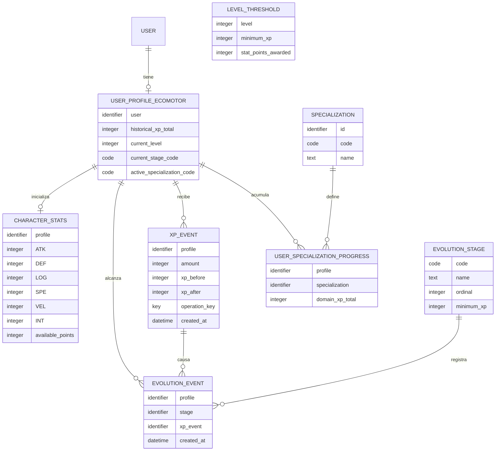
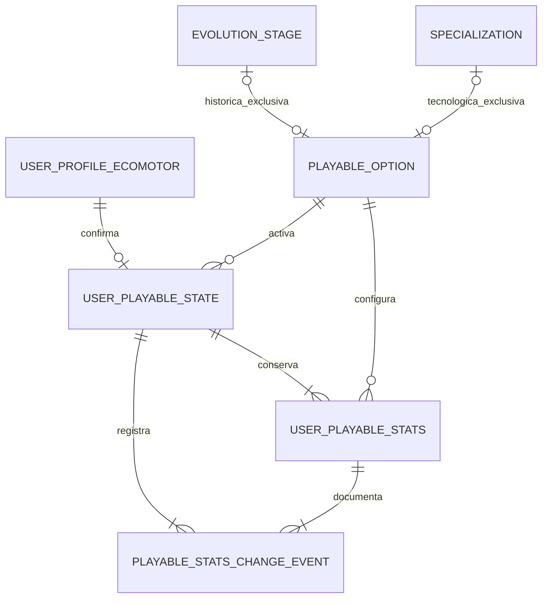

# Ecomotor y evolución · ERD V2 provisional de Parte A

> Actualización DOC-S12-A: develop `84f809d` integra selección S11-A por PR #44.
> UserSpecializationProgress y domain_xp_total ya son físicos; no hay servicio
> integrado de concesión positiva. DomainXPEvent es **solo conceptual**, separado
> en §13 y sin autorización de ORM/migración; el inventario permanece en nueve entidades.

> S7-A integrado en develop mediante [PR #32](https://github.com/Martret92/duckyarenas-team5/pull/32),
> baseline `b42cb5f` verificada el 18/10/2026: [contrato](../contracts/ecomotor-stat-allocation-v1.md).
> UserProfileEcomotor 1:N StatAllocationEvent, CASCADE provisional. Añade
> operation_key, attribute, points_spent, increase_applied, available_points_before/after,
> attribute_before/after (con signo), stage_code_at_allocation sin FK y created_at.
> Clave única por perfil, saldo no negativo, gasto/incremento positivos 1:1 y
> snapshots aritméticos coherentes. Admin solo lectura, 0005 aditiva protegida.
> Aceptación interna, conservación global pendiente; el ERD V2 histórico de ocho
> entidades no incluye este incremento y no se reescribe.

## 1. Estado, fuentes y alcance

**Actualización 02C · 20/10/2026:** el [diseño objetivo §14](#14-opciones-jugables--modelos-conceptuales-02c)
añade cuatro modelos solo conceptuales, fuera del recuento de nueve entidades
físicas actuales. Se conserva el ERD V2 histórico de ocho. S13-A1 (#47) y S14-A
(#50) están integrados sin tablas nuevas; las referencias previas a especialización
pendiente son antecedentes. Nueva selección histórica/tecnológica no implementada.

Diseño documental aceptado **internamente por Parte A**, V2-A1…V2-A29, con las
condiciones del [registro](../decisions.md). No es aprobación global de Óscar,
Core ni Partes B/C, ni autorización del ORM definitivo. D-01…D-19 siguen intactas;
D-20/D-21 registran acuerdos internos de reparto/apps del 08/10. D-13 queda
como antecedente y D-14…D-16 conservan validación técnica pendiente.
El estado estructural integrado se detalla en §§1.1–1.2. S1–S7-A locales ya están
implementados según [arquitectura](../architecture.md#21-estado-vigente-de-implementación--doc-1);
esto no implica aprobación global ni integración con Core/B/C/Rewards.

DAR3 es la referencia general. Las especificaciones posteriores de
`DuckyEcomotor.pdf`, `DAR_formulas.pdf`, `DAR_DuckyClash.pdf`, `DuckyTraining.pdf`
y `DuckyEscape.pdf` prevalecen cuando actualizan explícitamente una anterior.
La consolidación transversal consulta directamente sus pasajes pertinentes,
según [arquitectura](../architecture.md). Daily del 09/10/2026: se indicaron
aclaraciones parciales, sin aprobación global del diseño físico.
Ejemplos numéricos y código no constituyen parámetros oficiales.

Este documento sustituye la descripción operativa V1 por el diseño V2 provisional.
A-01…A-16 se conservan como antecedentes en §10; no se revocan retroactivamente.
El ERD consolidado del Equipo 5, los contratos y el ORM definitivo siguen pendientes.

### 1.1. Integración estructural vigente · Día 4

Los catálogos LevelThreshold, EvolutionStage y Specialization ya están en
`develop` mediante `ecomotor.0001_initial` (PR #23). Las otras cinco entidades
del ERD V2 se integraron mediante PR #24, basada en `e8cc573`:

| Entidad | Migración |
| --- | --- |
| UserProfileEcomotor: ampliación de progreso | users.0002_ecomotor_progress |
| CharacterStats | ecomotor.0002_characterstats |
| XPEvent y EvolutionEvent | ecomotor.0003_xp_and_evolution_events |
| UserSpecializationProgress | ecomotor.0004_user_specialization_progress |

Las ocho entidades históricas tienen representación física en develop; la arquitectura
V2 sigue siendo interna y provisional. M-01 aborta ante perfiles Ecomotor legacy
antes de modificar el esquema; no asigna niveles ni etapas y permite usuarios
sin ese perfil y perfiles Bank. Las cuatro migraciones bloquean su reversión
automática, incluso sin datos. No crean personajes, catálogos ni eventos.

CASCADE al perfil y al XPEvent causal sigue siendo provisional; las etapas y
especializaciones referenciadas usan PROTECT. La igualdad entre el perfil de
EvolutionEvent y el de su XPEvent causal se valida en S3, no mediante una
constraint entre tablas. Los historiales son conceptualmente inmutables, sin
protección física completa. La clave de XPEvent es local al perfil y a XP
histórica; no deduplica Rewards. La XP de dominio permanece independiente.

Admin y S2-A–S7-A también están integrados (PR #25 y #27–#32); véanse los
[contratos locales](../architecture.md#21-estado-vigente-de-implementación--doc-1).
Conservación/legacy global, parámetros autorizados, especializaciones/XP de dominio
y contratos A/B/C/Rewards continúan abiertos.

### 1.2. Esquema físico vigente · StatAllocationEvent (S7-A)

La migración [0005_stat_allocation_event](../../apps/ecomotor/migrations/0005_stat_allocation_event.py),
posterior a ecomotor.0004 y users.0002, añade únicamente la tabla y sus constraints,
sin backfill, con reversión protegida incluso vacía. Su modelo está en
[apps/ecomotor/models.py](../../apps/ecomotor/models.py).
Parte A tiene ahora **nueve entidades físicas**: ocho en apps.ecomotor y el perfil
en apps.users. El diagrama/diccionario de §§2–5 conservan el V2 histórico de ocho;
no representan por sí solos todo el esquema vigente.

**Relación añadida:** UserProfileEcomotor 1 → 0..N StatAllocationEvent; cada evento
pertenece a un perfil mediante FK CASCADE provisional. No hay FK a EvolutionStage,
XPEvent, User, Rewards, Bank ni inventario: se conserva el código histórico de etapa.

| Campo persistido | Tipo / significado vigente |
| --- | --- |
| id | BigAutoField autogenerado |
| profile | ForeignKey a users.UserProfileEcomotor; CASCADE provisional |
| operation_key | CharField(255), no vacío; UNIQUE(profile, operation_key) |
| attribute | CharField(16), uno de atk, def_stat, log_stat, spe, vel, int_stat |
| points_spent / increase_applied | PositiveIntegerField; positivos e iguales (coste 1:1) |
| available_points_before / after | PositiveIntegerField; before = after + points_spent |
| attribute_before / after | IntegerField con signo; after = before + increase_applied |
| stage_code_at_allocation | CharField(32), no vacío; snapshot sin FK al catálogo |
| created_at | DateTimeField(auto_now_add=True) |

El [servicio S7-A](../contracts/ecomotor-stat-allocation-v1.md) valida elegibilidad
en Actual y persiste stats y evento atómicamente; esa elegibilidad no es un CHECK
entre tablas. Replay devuelve snapshots originales; no reinterpreta catálogos.
Admin solo lectura. Valores funcionales, conservación y V2-A28 siguen pendientes.

## 2. Entidades y cardinalidades · V2 histórico de ocho entidades

Antecedente de diseño previo a S7-A: perfil en apps.users y otras siete entidades
en apps.ecomotor. Se conservan rutas/labels D-18 y referencias a
settings.AUTH_USER_MODEL. La ampliación vigente está en §1.2.

Los tipos del diagrama son semánticos, no clases ORM ni longitudes definitivas.
Las asociaciones del perfil con `EvolutionStage.code`, `LevelThreshold.level`
y `Specialization.code` son referencias lógicas por valor, no FKs físicas nuevas
hacia `apps.ecomotor`; deben validarse en los servicios. La especialización activa
es nullable y solo corresponde a Actual. Esto conserva la separación entre apps
sin introducir una dependencia circular de modelos.

User puede no tener perfil; cada perfil pertenece a un User y es único por User.
La relación física OneToOne permite cero o un CharacterStats por perfil; un perfil
**correctamente inicializado exige exactamente uno**, garantizado por inicialización
transaccional, no por la mera unicidad. Cada evento y progreso pertenece a un perfil.
Un XPEvent puede causar cero o varias evoluciones, cada una con una sola causa.
Cada catálogo puede tener cero o muchas referencias históricas/progresos.

## 3. Diccionario V2 provisional

El diccionario conserva la especificación V2 provisional histórica de ocho entidades,
con previsiones anteriores al ORM; no sustituye los modelos/migraciones integrados
de §§1.1–1.2 ni sus contratos S2-A–S7-A. Los términos «previsto», «futuro» o «por
confirmar» de sus tablas expresan ese corte histórico, sin revertir lo implementado.
D-12 se conserva como antecedente de los perfiles mínimos ampliados por PR #24.
La novena entidad vigente es StatAllocationEvent, no RewardEvent ni XP de dominio.

| Entidad | Datos y significado | Integridad y trazabilidad |
| --- | --- | --- |
| UserProfileEcomotor | `user`: identidad Core; `historical_xp_total`: XP histórica consolidada; `current_level`: nivel alcanzado; `current_stage_code`: etapa; `active_specialization_code`: código nullable de especialización activa | Un perfil por User; XP acumulativa no negativa y no decreciente; códigos y nivel válidos según catálogos; V2-A6/A7/A21/A29 |
| CharacterStats | `profile`: OneToOne; `ATK`, `DEF`, `LOG`, `SPE`, `VEL`, `INT`: atributos persistentes; `available_points`: puntos disponibles para asignar | Uno por perfil inicializado; asignación transaccional sin gastar puntos dos veces; límites y valores iniciales pendientes; V2-A2/A8/A17/A18 |
| LevelThreshold | `level`: nivel único; `minimum_xp`: umbral independiente del de etapas; `stat_points_awarded`: puntos concedidos al alcanzar el nivel | Niveles positivos consecutivos; primer umbral XP 0; puntos otorgados no negativos; cantidades oficiales y cambios administrativos pendientes; V2-A7/A20 |
| EvolutionStage | `code`: estable y único; `name`: presentación; `ordinal`: único; `minimum_xp`: umbral | Exactamente siete etapas, ordinales consecutivos 1–7; Prehistoria XP 0 y umbrales estrictamente crecientes; comprobación del orden entre filas en validación de configuración; V2-A1/A9/A21 |
| XPEvent | `profile`, `amount`, `xp_before`, `xp_after`, `operation_key`, `created_at` | Cantidad positiva; snapshots coherentes; clave persistente por perfil; historial inmutable; V2-A10/A22 |
| EvolutionEvent | `profile`, `stage`, `xp_event` causal, `created_at` | Unicidad perfil/etapa; mismo perfil que la causa; todas las etapas cruzadas registradas; V2-A5/A11/A23 |
| Specialization | `id`: identificador; `code`: estable y único; `name`: etiqueta | Catálogo protegido cuando está referenciado; códigos definitivos pendientes; V2-A24 |
| UserSpecializationProgress | `profile`, `specialization`, `domain_xp_total`: XP de dominio acumulada | Unicidad por pareja; XP no negativa e independiente de XP histórica; sin `rank` en el mínimo; V2-A25/A26 |

`RewardRule` y `RewardEvent` son conceptos compartidos candidatos (V2-A15/A16),
fuera de las ocho entidades físicas mínimas. No se aprueban campos, FKs, tablas,
apps ni contratos definitivos. [Rewards v0](../contracts/rewards-v0.md) concentra
su propuesta conceptual compartida. La trazabilidad de XP de dominio se
concretará con Rewards;
no se inventa aquí una novena entidad ni se reutiliza XPEvent como si fueran la
misma magnitud.

### Detalle técnico previsto por campo

`Null` expresa `null` de almacenamiento; todas las relaciones requieren destino
existente salvo el código nullable de especialización activa. `Unique` se refiere
al campo individual: las unicidades compuestas se indican en constraints.
`—` en default significa **sin default de modelo**; el servicio debe proporcionar
el valor. Un default propuesto no inicializa por sí solo el agregado ni autoriza
backfills legacy. Se propone `blank=False` salvo el código activo nullable
(`blank=True`, normalizando ausencia a NULL, no a cadena vacía).

`BigAutoField` para identificadores sigue `DEFAULT_AUTO_FIELD` actual, sin duplicar
User. `CharField` con longitudes 32 (códigos), 100 (nombres) y 255 (clave) retoma
el antecedente V1 como **previsión pendiente de confirmar**, especialmente con los
contratos de claves. `related_name`, índices adicionales y nombres físicos de
constraints se concretarán antes del ORM; no se aprueban aquí. `created_at` es
fecha de registro local, no fecha de actividad recibida del juego.

### 3.1. `UserProfileEcomotor` · `apps.users`

| Campo | Tipo Django previsto | Null | Unique | Default | Constraints, FK y estado | on_delete |
| --- | --- | --- | --- | --- | --- | --- |
| id | BigAutoField | No | PK | Autogenerado | Clave primaria; previsión según configuración actual | — |
| user | OneToOneField(settings.AUTH_USER_MODEL) | No | Sí | — | FK a User de Core; D-11/D-12 vigentes | CASCADE actual D-12; retención futura pendiente Core |
| historical_xp_total | PositiveBigIntegerField | No | No | 0 previsto | CHECK >= 0; no decrecimiento por servicio; V2-A6 | — |
| current_level | PositiveIntegerField | No | No | — | CHECK > 0; asociación lógica a LevelThreshold.level; inicialización explícita | Sin FK/on_delete |
| current_stage_code | CharField(max_length=32), longitud provisional | No | No | — | No vacío; asociación lógica a EvolutionStage.code; V2-A6/A21 | Sin FK/on_delete |
| active_specialization_code | CharField(max_length=32), longitud provisional | Sí | No | None previsto | Código válido o NULL; solo en Actual; obligatoriedad pendiente V2-A19 | Sin FK/on_delete |

### 3.2. `CharacterStats` · `apps.ecomotor`

| Campo | Tipo Django previsto | Null | Unique | Default | Constraints, FK y estado | on_delete |
| --- | --- | --- | --- | --- | --- | --- |
| id | BigAutoField | No | PK | Autogenerado | Clave primaria; previsión según configuración actual | — |
| profile | OneToOneField(UserProfileEcomotor) | No | Sí | — | FK al perfil; exactamente uno tras inicialización V2-A13 | CASCADE provisional, condicionado a Core |
| ATK | IntegerField provisional | No | No | Sin default: iniciales pendientes | Base persistente V2-A2; límites por rol/especialización pendientes V2-A18; no fijar todos a 5 | — |
| DEF | IntegerField provisional | No | No | Sin default: iniciales pendientes | Base persistente V2-A2; límites por rol/especialización pendientes V2-A18; no fijar todos a 5 | — |
| LOG | IntegerField provisional | No | No | Sin default: iniciales pendientes | Base persistente V2-A2; límites por rol/especialización pendientes V2-A18; no fijar todos a 5 | — |
| SPE | IntegerField provisional | No | No | Sin default: iniciales pendientes | Base persistente V2-A2; límites por rol/especialización pendientes V2-A18; no fijar todos a 5 | — |
| VEL | IntegerField provisional | No | No | Sin default: iniciales pendientes | Base persistente V2-A2; límites por rol/especialización pendientes V2-A18; no fijar todos a 5 | — |
| INT | IntegerField provisional | No | No | Sin default: iniciales pendientes | Base persistente V2-A2; límites por rol/especialización pendientes V2-A18; no fijar todos a 5 | — |
| available_points | PositiveIntegerField provisional | No | No | Sin default: iniciales pendientes | CHECK >= 0 previsto; concesión/asignación transaccional V2-A8; capacidad numérica por confirmar | — |

### 3.3. `LevelThreshold` · `apps.ecomotor`

| Campo | Tipo Django previsto | Null | Unique | Default | Constraints, FK y estado | on_delete |
| --- | --- | --- | --- | --- | --- | --- |
| id | BigAutoField | No | PK | Autogenerado | Clave primaria; previsión según configuración actual | — |
| level | PositiveIntegerField | No | Sí | — | CHECK > 0; catálogo consecutivo validado globalmente V2-A20 | — |
| minimum_xp | PositiveBigIntegerField | No | No | — | CHECK >= 0; primer nivel configurado XP 0; orden/coherencia de umbrales por validación de catálogo | — |
| stat_points_awarded | PositiveIntegerField provisional | No | No | — | CHECK >= 0; configurables por nivel V2-A20; cero permitido, sin cantidad oficial | — |

### 3.4. `EvolutionStage` · `apps.ecomotor`

| Campo | Tipo Django previsto | Null | Unique | Default | Constraints, FK y estado | on_delete |
| --- | --- | --- | --- | --- | --- | --- |
| id | BigAutoField | No | PK | Autogenerado | Clave primaria; previsión según configuración actual | — |
| code | CharField(max_length=32), longitud provisional | No | Sí | — | No vacío; identidad estable; códigos finales pendientes V2-A21 | — |
| name | CharField(max_length=100), longitud provisional | No | No | — | Etiqueta obligatoria; no usarla como identidad técnica | — |
| ordinal | PositiveSmallIntegerField | No | Sí | — | CHECK entre 1 y 7; catálogo completo exactamente siete ordinales consecutivos V2-A21 | — |
| minimum_xp | PositiveBigIntegerField | No | No | — | CHECK >= 0; ordinal 1 / Prehistoria XP 0; estrictamente creciente por catálogo | — |

### 3.5. `XPEvent` · `apps.ecomotor`

| Campo | Tipo Django previsto | Null | Unique | Default | Constraints, FK y estado | on_delete |
| --- | --- | --- | --- | --- | --- | --- |
| id | BigAutoField | No | PK | Autogenerado | Clave primaria; previsión según configuración actual | — |
| profile | ForeignKey(UserProfileEcomotor) | No | No | — | FK; UNIQUE(profile, operation_key) | CASCADE provisional, condicionado a Core |
| amount | PositiveBigIntegerField | No | No | — | CHECK > 0; concesión histórica positiva | — |
| xp_before | PositiveBigIntegerField | No | No | — | CHECK >= 0; snapshot previo | — |
| xp_after | PositiveBigIntegerField | No | No | — | CHECK >= 0 y xp_after = xp_before + amount | — |
| operation_key | CharField(max_length=255), longitud provisional | No | No global | — | No vacío; UNIQUE(profile, operation_key); contrato/contenido global pendientes | — |
| created_at | DateTimeField(auto_now_add=True) previsto | No | No | Sin default; fecha automática de creación | Fecha local de registro; historial inmutable V2-A22; no fecha de partida | — |

### 3.6. `EvolutionEvent` · `apps.ecomotor`

| Campo | Tipo Django previsto | Null | Unique | Default | Constraints, FK y estado | on_delete |
| --- | --- | --- | --- | --- | --- | --- |
| id | BigAutoField | No | PK | Autogenerado | Clave primaria; previsión según configuración actual | — |
| profile | ForeignKey(UserProfileEcomotor) | No | No | — | FK; UNIQUE(profile, stage); mismo perfil de causa por servicio | CASCADE provisional, condicionado a Core |
| stage | ForeignKey(EvolutionStage) | No | No | — | FK; UNIQUE(profile, stage); catálogo histórico protegido | PROTECT interno |
| xp_event | ForeignKey(XPEvent) | No | No | — | FK causal; varias evoluciones por concesión V2-A5 | CASCADE provisional; conservación conjunta pendiente Core |
| created_at | DateTimeField(auto_now_add=True) previsto | No | No | Sin default; fecha automática de creación | Registro de transición; historial inmutable V2-A23 | — |

### 3.7. `Specialization` · `apps.ecomotor`

| Campo | Tipo Django previsto | Null | Unique | Default | Constraints, FK y estado | on_delete |
| --- | --- | --- | --- | --- | --- | --- |
| id | BigAutoField | No | PK | Autogenerado | Clave primaria; previsión según configuración actual | — |
| code | CharField(max_length=32), longitud provisional | No | Sí | — | No vacío; identidad estable V2-A24; literales Sistemas/Data pendientes | — |
| name | CharField(max_length=100), longitud provisional | No | No | — | Etiqueta obligatoria; normalización Data / Data & IA pendiente | — |

### 3.8. `UserSpecializationProgress` · `apps.ecomotor`

| Campo | Tipo Django previsto | Null | Unique | Default | Constraints, FK y estado | on_delete |
| --- | --- | --- | --- | --- | --- | --- |
| id | BigAutoField | No | PK | Autogenerado | Clave primaria; previsión según configuración actual | — |
| profile | ForeignKey(UserProfileEcomotor) | No | No | — | FK; UNIQUE(profile, specialization) | CASCADE provisional, condicionado a Core |
| specialization | ForeignKey(Specialization) | No | No | — | FK; UNIQUE(profile, specialization) | PROTECT interno |
| domain_xp_total | PositiveBigIntegerField | No | No | 0 previsto | CHECK >= 0; XP de dominio independiente; contrato idempotente V2-A26 condicionado | — |

No hay campo `rank` en UserSpecializationProgress mínimo. Los seis atributos se
listan por separado, sin aprobar sus valores iniciales ni límites físicos.
Las asociaciones por códigos/nivel no son ForeignKey: el servicio valida catálogos
antes de escribir y no un `CheckConstraint` que consulte otras tablas.

## 4. Borrado y conservación

| Referencia | Regla documentada | Estado y condición |
| --- | --- | --- |
| Perfil → User | CASCADE | Implementación actual D-12 intacta; conservación futura pendiente con Core |
| CharacterStats / XPEvent / EvolutionEvent / progreso → perfil | CASCADE | Provisional y condicionada a política de conservación de Core; no autoriza borrar historiales ordinariamente |
| EvolutionEvent → XPEvent causal | CASCADE como antecedente de eliminación global coherente | Provisional; revisar con Core la conservación de ambos historiales, sin permitir eliminar eventos aislados |
| EvolutionEvent → EvolutionStage | PROTECT | Protección de catálogo referenciado históricamente en el diseño interno |
| Progreso → Specialization | PROTECT | Protección de especialización referenciada |
| Códigos/nivel del perfil → catálogos | Sin on_delete físico: referencias lógicas | Validar existencia y proteger cambios de códigos usados; conservación y reconciliación administrativa pendientes |

CASCADE no equivale a permitir editar/borrar eventos por Admin o CRUD ordinario.
La política legal/funcional de retención, anonimización o eliminación no queda
resuelta por este ERD. Antes de cerrar migraciones debe validarse con Core.

## 5. Constraints y validaciones

| Invariante | Garantía prevista |
| --- | --- |
| Un perfil por User, stats por perfil, umbral por nivel; código y ordinal de etapa únicos | Unicidad/OneToOne de BD; existencia de stats mediante inicialización |
| `UNIQUE(profile, operation_key)` en XPEvent | Restricción de BD e idempotencia persistente; clave válida y no vacía por servicio |
| `amount > 0`; `xp_after = xp_before + amount` | Restricciones de fila y validación de servicio; snapshots no negativos |
| `UNIQUE(profile, stage)` en EvolutionEvent | Restricción de BD; no repetir evolución en retries |
| Perfil de EvolutionEvent igual al del XPEvent causal | Validación transaccional de servicio; no asumir CheckConstraint entre tablas |
| `UNIQUE(profile, specialization)` y XP de dominio no negativa | Restricciones de BD y servicio propietario |
| Niveles positivos consecutivos, primer umbral XP 0 y stat_points_awarded >= 0 (V2-A20) | CHECK > 0 / >= 0 por fila; continuidad y primer umbral por validación de catálogo completo |
| Exactamente siete etapas, ordinales consecutivos 1–7, Prehistoria XP 0 y umbrales estrictamente crecientes (V2-A21) | Unicidad y CHECK 1–7 por fila; número de filas, continuidad y orden de XP por validación del catálogo completo |
| XP histórica no decreciente y eventos inmutables | Servicios propietarios, permisos y pruebas; un CHECK de fila no compara por sí solo el estado anterior |

Las constraints complementan los servicios, no los sustituyen. La coherencia de
catálogos, claves lógicas, configuración histórica y límites de especialización
requiere validación explícita (V2-A14/A18/A20/A28).

## 6. Progreso, inicialización y transacciones

Orden funcional: **Prehistoria → Griega → Romana → Renacentista → Contemporánea
→ Siglo XX → Actual**. Los códigos son estables; no se inventa una lista oficial
de códigos. V2-A21 exige exactamente siete etapas y ordinales consecutivos
1–7, con Prehistoria en el ordinal 1 y XP mínima 0. V2-A20 exige niveles positivos
consecutivos, primer nivel configurado con umbral XP 0 y
`stat_points_awarded` no negativo (cero permitido). Niveles y etapas tienen
umbrales independientes configurables; los valores restantes y la política de
cambios administrativos siguen pendientes. Estas invariantes de catálogo no
se garantizan únicamente con constraints de fila.

La inicialización explícita (V2-A13) crea/valida perfil y stats conjuntamente,
con XP histórica 0, primer nivel configurado, Prehistoria y sin especialización
activa. S2-A ya toma los puntos iniciales de stat_points_awarded del nivel 1, sin doble
concesión; los atributos iniciales requieren configuración confiable autorizada
y no se han fijado valores oficiales. Un reintento devuelve el estado inicializado sin resetearlo.
No utiliza signals ni crea XPEvent/EvolutionEvent ficticios. Un perfil legacy o
parcial no se trata silenciosamente como nuevo: se aplica M-01.

Conceder XP (V2-A12) abre transacción antes de leer estado mutable, valida identidad,
clave y cantidad positiva, comprueba duplicados y actualiza XP histórica, nivel,
puntos de todos los niveles alcanzados, etapa actual, XPEvent y todas las
EvolutionEvent correspondientes. Una concesión puede cruzar varias etapas. La
asignación de puntos también es transaccional y no consume dos veces el mismo saldo.
No implica entregar/equipar automáticamente vestimenta.

La semántica local heredada de idempotencia conserva: misma clave y cantidad,
resultado ya procesado; clave repetida con cantidad incompatible, conflicto sin
reescritura. La comparación del contenido completo y alcance global de claves
se acordará con Rewards/Core/juegos. No basta la clave de XPEvent para evitar
por sí sola duplicados de monedas, objetos o XP de dominio (V2-A4/A26).

D-19 permanece vigente: SQLite, `IMMEDIATE`, timeout 5 segundos, `transaction.atomic()`
antes de leer estado mutable, transacciones cortas, constraints e idempotencia
persistente. No hay I/O externo en la transacción. Un fallo revierte los efectos
locales; los retries comienzan nueva transacción con la misma clave. No se promete
atomicidad global entre módulos o transacciones independientes.

## 7. Especializaciones, stats y reglas trasladadas

Developer, Ciberseguridad, Sistemas, Data y Gamer aparecen dentro de Actual.
Specialization mantiene identidad/código estable y nombre; Sistemas/AdminSys y
Data/Data & IA (incluido el ejemplo `data_ia`) requieren normalización conjunta.
La selección inicial se contempla en Actual (V2-A19), pero su obligatoriedad
sigue pendiente; el cambio posterior queda fuera del mínimo.

XP histórica y XP de dominio son independientes. V2-A25 recupera progreso por
especialización, revisando parcialmente V2-A3. Los rangos funcionales **Junior,
Middle, Senior y Maestro** se conservan, pero reglas, umbrales y representación
adicional no están aprobados: el mínimo no contiene `rank` ni adopta INITIAL o
la correspondencia automática Maestro/MASTER del V1.

CharacterStats persiste la base; estadísticas efectivas derivadas de objetos,
roles o reglas no se confunden con ella. Los atributos iguales a 5 de
DAR_formulas son ejemplo. DuckyClash documenta atributos iniciales por rol y
límites específicos: no se fijan aquí valores ni cambios automáticos al seleccionar
especialización. La representación de límites queda condicionada (V2-A18).

DuckyTraining contempla XP por partidas repetidas y una moneda por juego y día:
repetibilidad y límite diario son distintos de deduplicar una misma actividad.
Identidad de juego, día/zona horaria y aplicación multidominio deben acordarse.
DuckyEscape puede penalizar XP provisional de partida, sin descontar XP histórica
ya consolidada. Correcciones, devoluciones y recompensas coordinadas siguen abiertas.

## 8. Inventory, compras e historiales

DAR3 conserva seis piezas principales por época y complementos estéticos.
Ecomotor posterior describe apariencias y desbloqueos configurables, sin aclarar
obtención/equipamiento. V2-A27 está condicionada: no asumir conjuntos automáticos,
adquisición individual obligatoria, seis campos por etapa ni equivalencia entre
vestimenta histórica y objetos de combate. Inventory conserva posesión y definición;
Avatar/Equipment conserva estado de equipamiento.

DuckyClash describe tres tipos generales de ataque y tres de defensa, no seis
productos de Shop. Ecomotor también contempla pistas, personalización y otras
categorías comerciales: no se crean categorías adicionales por iniciativa propia.
Bank posee saldo; Shop gestiona compra y catálogo comercial; Ecomotor participa
en comprobaciones consultando a Bank. Coordinador, límites transaccionales y
recuperación con Inventory siguen pendientes.

XPEvent/EvolutionEvent cubren historial de progreso; historial de equipamiento y
Museo Ducky se coordinan con B. No se inventa un modelo Museo ni se elimina su
requisito. Cobertura V1, lecturas y conservación conjunta requieren acuerdo.
El mínimo funcional de recompensas de DAR3 se recoge en
[Rewards v0](../contracts/rewards-v0.md) y arquitectura; payloads,
REST, WebSockets, autorizaciones y contratos definitivos no se aprueban aquí.

## 9. Cambios administrativos, Core y M-01

V2-A28 exige conservar progreso, sin rebajas, reescritura de eventos ni nuevas
concesiones silenciosas al editar umbrales. Aplicación prospectiva/retroactiva,
reconciliación de niveles/etapas y cambios de catálogo siguen condicionadas.
No se decide unilateralmente una política de recálculo.

M-01 **fail-closed** continúa: perfiles legacy solo con User no se reinterpretan
como inicializados, no se borran, no reciben Prehistoria/defaults ni llamadas a B
por una migración. Sin legacy se puede avanzar al esquema revisado; con legacy,
se aborta explícitamente hasta disponer de estrategia validada con Core. Cualquier
estado temporal nullable de migración debe revisarse, sin ocultar perfiles parciales.
No se cambia AUTH_USER_MODEL ni se resuelve el conflicto PR07/CustomUser: D-17
mantiene los acuerdos actuales. V2-A29 queda parcialmente condicionada a Core.

## 10. Antecedentes V1 y trazabilidad

A-01…A-16 permanecen como aceptación interna histórica, no aprobación global.
El detalle V1 se conserva en el historial Git anterior a esta actualización.

| Acuerdo histórico | Contenido V1 | Relación con V2 |
| --- | --- | --- |
| A-01 | Perfil como agregado | V2-A6; estadísticas separadas |
| A-02 | XPEvent inmutable | V2-A10/A22 |
| A-03 | Era persistente | EvolutionStage: V2-A1/A9/A21 |
| A-04 | current_era_code persistido | current_stage_code y nivel: V2-A6/A7 |
| A-05 | EvolutionEvent | Causa directa XPEvent: V2-A5/A11/A23 |
| A-06 | Evoluciones múltiples | V2-A12 conserva todas las transiciones |
| A-07 | Atomicidad e idempotencia | Local V2-A12; global condicionada V2-A4 |
| A-08 | Concesión/equipamiento de conjuntos A→B | Antecedente compartido; V2-A27 condicionado, sin equipamiento automático aprobado |
| A-09 | Progreso independiente con rangos | V2-A3 revisada por A25; sin rank físico mínimo |
| A-10 | API pública de Parte A | Contratos definitivos pendientes |
| A-11 | Frontera Rewards→A | V2-A15/A16/A26 condicionadas |
| A-12 | Inicialización explícita | V2-A13; sin conjuntos automáticos ni eventos ficticios |
| A-13 | Idempotencia de XP | V2-A22 y contrato global pendiente |
| A-14 | Asociaciones por códigos | Referencias lógicas del perfil mantenidas |
| A-15 | Catálogo de nueve épocas | Siete etapas V2-A21; configuración condicionada A28 |
| A-16 | Historial/Museo como composición A+B | V2-A23/A27; cobertura compartida pendiente |

Las 29 decisiones, sin añadir otras, se registran individualmente en
[decisions.md](../decisions.md). Las condiciones prioritarias, responsables e impacto
están en [pending-decisions.md](../pending-decisions.md); las tareas y pruebas en el
[plan](../team5-work-plan.md). No se da por aprobado ningún contrato de B/C o Core.

## 11. Verificación · antecedente y estado vigente

El plan previo a implementación siguiente se conserva como antecedente V2:
revisar con Core conservación, M-01 y dependencias de migración; con B/C Rewards,
vestimenta y compras; con Óscar parámetros ambiguos, especialización y alcance V1.
Después del diseño revisado, probar inicialización/reintentos/legacy, XP y dominio
independientes, umbrales múltiples, puntos, eventos causales, invariantes y claves
conflictivas, permisos, rollback y recuperación multidominio. D-19 exige
TransactionTestCase y al menos una ejecución SQLite file-backed para concurrencia.
Inicialización, XP, consultas y asignación ya cuentan con tests locales integrados,
incluidas concurrencia file-backed y migraciones protegidas. Especialización/dominio
y recuperación multidominio siguen pendientes. Última regresión comunicada: 407
correctos; DOC-1 no ejecuta de nuevo la suite ni añade tests.

## 12. Antecedente fechado 08/10–09/10 y Rewards v0 candidato

En aquel corte, la actualización fue exclusivamente conceptual: el diagrama, las ocho entidades, campos,
cardinalidades, constraints y políticas provisionales de §§2–5 permanecen intactos.
D-20/D-21 fijan reparto/apps objetivo, sin trasladar modelos o aprobar integración.

[Rewards v0](../contracts/rewards-v0.md) es la referencia única de la semántica
candidata compartida: identidad/huella, reglas/versiones, resultados, duplicados,
conflictos, efectos independientes y transacción exterior condicionada a misma
BD/conexión. No se duplican sus campos aquí. RewardEvent queda fuera de estas
ocho entidades y RewardRule no se aprueba como tabla; tampoco nuevas FKs/on_delete.
La idempotencia local de XPEvent no cubre por sí sola el premio completo.

Daily del 09/10/2026: la rectificación de XP externa exige aclarar
elegibilidad/vigencia de XP histórica y de dominio (V2-A10/A22/A25/A26/A28),
sin borrar progreso ni cambiar estos campos por inferencia.
Antes de Actual se habló de stats determinadas por rol y en Actual de distribuir
o editar puntos. Es una aclaración parcial: iniciales,
presupuesto/límites y redistribución de CharacterStats siguen pendientes
(V2-A2/A8/A17/A18). Posibles puntos de cursos requieren un servicio independiente
de concesión, sin crear XPEvent ficticios ni atribuirlo automáticamente a V2-A12.

Training mantiene XP repetible y moneda por juego/día; Escape distingue pruebas
y premio final, con nueva versión consolidada pendiente y momento de registro por
acordar. El texto previo sobre penalización describe el PDF local, no resolución
definitiva del contrato Escape actualizado. Reservas de Clash corresponden a Bank
si se implementan; no se añaden al ERD de A ni se imponen en V1.

Óscar/Core debe validar User/auth, integración, conservación y migración legacy.
D-17 y M-01 continúan; los CASCADE provisionales no adquieren aprobación por esta
reunión. D-19 sigue vigente y no garantiza atomicidad multidominio por sí sola.
[Pendientes](../pending-decisions.md) concentra las preguntas de cierre.

## 13. DomainXPEvent · concepto S12-A separado del esquema físico

El [contrato conceptual S12-A](../contracts/ecomotor-domain-xp-v1.md) registra la
alternativa C aprobada internamente por Jaime/Parte A en 02B. DomainXPEvent sirve
como concepto de trazabilidad de concesiones positivas de dominio: causa,
prevención de duplicados, repetición histórica y conflictos de identidad, importe
o especialización. El principio de identidad es origen–hecho–perfil, no una
UniqueConstraint física ya decidida.

Este apartado **no añade una tabla al ORM, un diccionario de campos físicos ni
una migración**. No se fijan tipos, índices, ForeignKeys, cardinalidades físicas
o políticas on_delete. Sus vínculos con perfil, especialización/progreso y causa
son necesidades conceptuales cuya representación y conservación deben concretarse.
No se copia el CASCADE provisional de XPEvent u otros historiales.

UserSpecializationProgress continúa como tabla integrada con domain_xp_total;
S11-A selecciona y crea en cero, sin conceder XP positiva. Evento conceptual y
acumulado deben confirmarse/revertirse juntos en el futuro servicio conforme a
D-19. XPEvent y XP histórica permanecen separados e intactos.

Antes de persistir DomainXPEvent, Core debe acordar conservación, anonimización,
eliminación y on_delete de sus relaciones. Antes de premios reales hacen falta
orígenes autorizados, vínculo confiable hecho–destinatario y reglas validadas;
ValidatedRewardFact por sí solo no autoriza. P5/P7 y Rewards F2-A siguen bloqueados
en sus aspectos pendientes; no se modifica el diagrama físico ni DOC-6.

## 14. Opciones jugables · modelos conceptuales 02C

**Precisión objetivo [ATR-OBJ-01](../decisions.md#atr-obj-01--nomenclatura-de-atributos-objetivo--20102026):** tras la conciliación de la PR #61
sobre Ataque, Defensa, Velocidad, Inteligencia, Lógica y Cuak confirmados por Óscar,
Jaime confirma internamente LOG = Lógica y CUACK = Especial / Especialización.
Sustituye solo la nomenclatura objetivo LOG Logística/SPE del diseño inicial;
no modifica la estructura ni los atributos V1. Bases, presupuesto, fórmulas y
migración legacy siguen pendientes, sin adoptar 45 puntos como valor oficial.
Una imagen de vestimenta completa por época no determina un objeto o relación
Duckies. [Procedencia y alcance](../decisions.md#conciliación-de-aclaraciones-de-óscar--20102026)
y [pendientes](../pending-decisions.md#17-aclaraciones-confirmadas-de-óscar--pendientes-residuales).
El diagrama, cardinalidades y diseño físico permanecen intactos en esta tarea.

ARQ-OP-01/02/03 y DOC-ERD-01, aprobados internamente por Equipo 5 el 20/10/2026.
**No implementados:** no añaden tablas a las nueve existentes. ARQ-OP-02 aprueba
internamente un diseño provisional de campos y restricciones para PlayableOption,
UserPlayableState y UserPlayableStats. No están aprobadas migraciones, relaciones
físicas definitivas ni políticas on_delete. [Contrato objetivo](../contracts/ecomotor-playable-options-target-v1.md)
y [decisiones 02C](../decisions.md#02c--arquitectura-objetivo-del-ecomotor--20102026).
Diagrama conceptual adicional, sin sustituir el Mermaid V2 histórico:

Cada opción refiere a **exactamente una** EvolutionStage o Specialization,
nunca ambas ni ninguna; el diagrama no expresa por sí solo ese XOR. Una identidad
histórica/tecnológica tiene como máximo una opción; catálogos pueden tener filas
aún sin opción. Perfil tiene cero o un estado explícito; estado confirmado tiene
una opción activa y al menos una configuración propia válida: primera elección
y configuración se confirman atómicamente. Cada configuración tiene historia
desde su confirmación inicial. Cardinalidades conceptuales, no FKs ejecutables.

| Modelo conceptual | Datos previstos | Cardinalidad e invariantes |
| --- | --- | --- |
| PlayableOption | Identidad de catálogo, referencia histórica o tecnológica exclusiva, seis bases ATK/DEF/VEL/INT/LOG/CUACK. | Una de EvolutionStage/Specialization, nunca ambas/ninguna; sin duplicados de identidad histórica/tecnológica. Cero o muchas configuraciones de jugadores. |
| UserPlayableState | Perfil UserProfileEcomotor, opción activa, presupuesto inicial autorizado y revisión de estado. | Un estado máximo por perfil, solo al confirmar primera elección. Ausencia no clasifica legacy como nuevo. Activa con configuración válida propia. |
| UserPlayableStats | Estado, opción, snapshot de seis bases, seis incrementos y revisión de configuración. | UNIQUE(playable_state, option); incrementos válidos y suma dentro del presupuesto del estado. Bases conservadas, no catálogo vivo reinterpretado. |
| PlayableStatsChangeEvent | Identidad de operación, estado, configuración, tipo primera configuración/redistribución, reparto anterior/posterior, revisiones y fecha de confirmación. | UNIQUE(playable_state, operation_key); configuración/estado/propietario coherentes. Historia conservada sin reinterpretación; representación física pendiente. |

ATK Ataque, DEF Defensa, VEL Velocidad, INT Inteligencia, LOG Lógica,
CUACK Especial / Especialización. CUACK es numérico, no identidad tecnológica;
no hay un séptimo atributo. V1 conserva log_stat = Logística y spe = Especial /
Especialización; sin conversión automática SPE → CUACK ni reinterpretación de
log_stat histórico. Efectivas = bases conservadas +
incrementos. Presupuesto fijo utilizable independientemente en cada Ducky, no
saldo global agotado; puntos pendientes permitidos. Bases y cantidad pendientes.
Training no mejora los seis atributos ni concede puntos adicionales para ellos
en esta V1 objetivo; futuro requiere confirmación funcional y coordinación.

### 14.1. Restricciones, servicios y detalles físicos pendientes

| Capa | Regla objetivo / estado |
| --- | --- |
| Integridad persistente prevista | Un estado por perfil, identidad histórica/tecnológica exclusiva no duplicada; UNIQUE(playable_state, option) y UNIQUE(playable_state, operation_key). ARQ-OP-02 aprueba diseño provisional de campos y restricciones de los tres modelos de catálogo/estado/stats; concreción física definitiva, índices y nombres de constraints pendientes, sin migraciones aprobadas. |
| Invariantes de servicio | Nivel 8/elegibilidad, propiedad, activa con configuración propia válida, suma dentro del presupuesto, estado/revisión esperados, causalidad histórica y atomicidad. No suponer CHECK entre tablas. |
| Concurrencia | D-19: atomic, alias común, BEGIN IMMEDIATE, timeout 5 s, unicidad/revisión y rollback. Orden replay/revisión y reparto idéntico pendientes, retry explícito posterior. |
| Pendiente físico Core/P5 | Relaciones y referencias de eventos, conservación/anonimización/eliminación y on_delete; no copiar CASCADE provisional ni aprobar migración por el diagrama. |

Épocas objetivo en orden: **Prehistórico, Griego, Romano, Medieval, Renacentista,
Revolución Industrial y Siglo XX**, niveles 1–7 con umbrales coincidentes. Nivel 8
abre elección, no octava época. Tecnología: Developer, Ciber, Sistemas, Data IA,
Gamer; códigos pendientes. No renombrar nueve épocas DAR3 ni siete etapas V1
terminadas en Actual. Validadores anteriores compatibles hasta activación;
sin puntos nuevos por nivel en el objetivo.

### 14.2. Conservación y coexistencia con V1

XPEvent, EvolutionEvent, StatAllocationEvent, CharacterStats y
UserSpecializationProgress permanecen. No reasignar stats globales/eventos a
opciones por inferencia ni borrar historia/recalcular XP/niveles. S13-A2 pendiente:
conservar rangos no equivale a columna ya implementada. DomainXPEvent y RewardEvent
siguen conceptuales/candidatos con bloqueos propios, fuera del recuento físico.
Inventariar datos y clasificar nuevos/legacy explícitamente antes de migrar;
activación coordinada sin autoridades contradictorias de selección vieja/nueva.
La identidad jugable no decide apariencia, inventario o vestimenta de DOC-5.
[Pendientes](../pending-decisions.md#13-pendientes-residuales-de-la-arquitectura-objetivo-02c).

## 15. A3 · Frontera física de la transición

A3-ARQ-01 y A3-CLAS/CAT/REPLAY-01 son direcciones internas **condicionadas**;
[contrato A3](../contracts/ecomotor-transition-target-v1.md) y
[pendientes](../pending-decisions.md#15-a3--condiciones-de-compatibilidad-y-activación).
Base `7039ae6`: A1.1/A1.2 y A2.1 están integrados como módulos puros, no nuevos
modelos. Se conservan las nueve entidades físicas locales de Parte A, el V2
histórico de ocho y el diagrama conceptual 02C; ninguna tabla se añade aquí.

| Necesidad conceptual A3 | Dirección aprobada / bloqueo físico |
| --- | --- |
| Política de progresión por perfil | Registro persistente unívoco asociado a UserProfileEcomotor, con procedencia y estado de transición separados. Campos Django, tipos, restricciones y relaciones definitivos pendientes; auditoría antes de clasificar existentes. No es UserPlayableState ni permiso de XP. |
| Catálogo objetivo | Separado, versionado e inmutable una vez usado, conservando identidades/referencias EvolutionStage V1. No se aprueba nombre de modelo, campos, claves o migración; A1.1 solo valida snapshots puros. |
| Nuevas evoluciones causales | EvolutionEvent.stage apunta físicamente a EvolutionStage V1. Cómo referenciar nuevas épocas sin perder causalidad/historia es bloqueo obligatorio; no escoger otra FK o reescribir eventos por inferencia. |
| PlayableOption histórico | La relación EvolutionStage de §14 es el diseño conceptual 02C anterior a esta precisión. Debe adaptarse al catálogo separado con integridad histórica; A3 no aprueba la solución física ni descarta la aprobación provisional ARQ-OP-02 de campos/restricciones. |
| Procedencia de XP objetivo | Nuevas operaciones requieren procedencia persistente e inmutable; representación pendiente, sin añadir campos/tablas aquí. UNIQUE(profile, operation_key) se conserva entre versiones. |

XPEvent V1 no registra versión, nivel o época como snapshots; EvolutionEvent
no guarda los atributos históricos originales de la etapa. No completar historia
con catálogos actuales ni renombrar filas V1 para representar épocas objetivo.
Tres cortes: nueve épocas DAR3, siete etapas V1 terminadas en Actual y siete
épocas objetivo terminadas en Siglo XX; nivel 8 no añade época.

**Dependencia física externa existente:** en [Duckies](../../apps/duckies/models.py),
EvolutionItem.stage es OneToOne a EvolutionStage con PROTECT. Sus
[servicios](../../apps/duckies/services.py) buscan por current_stage_code y comparan
ordinales; también dependen de active_specialization_code en selección/vestimenta.
Coordinar con Henry referencias de catálogo y consumidores. Progresión, identidad
jugable y apariencia no se confunden. No modificar ni aprobar esquema Duckies aquí.

Inventario/auditoría reales, migración autorizada e idempotente y activación
coordinada requieren relaciones aprobadas, consumidores compatibles y pruebas.
No reasignar CharacterStats, borrar puntos disponibles o alterar XPEvent,
EvolutionEvent, StatAllocationEvent y progresos existentes por inferencia.
Core/P5 mantiene conservación, anonimización/eliminación y on_delete pendientes.
No se resuelve con este apartado un nuevo esquema, migración o escritor objetivo.

## 16. A3.3 · Política de progresión e historial conceptuales

Desarrollo interno de A3-CLAS-01 sobre `75177a2`:
[decisiones](../decisions.md#a33--clasificación-persistente-de-perfiles--20102026),
[contrato A3.3](../contracts/ecomotor-profile-classification-v1.md) y
[pendientes](../pending-decisions.md#18-a33--pendientes-de-clasificación-persistente).
**No implementado:** no añade tablas al recuento físico de nueve ni sustituye el
ERD V2 histórico de ocho o los cuatro modelos conceptuales jugables de §14.

| Modelo candidato | Cardinalidad y datos conceptuales | Invariantes / límites |
| --- | --- | --- |
| ProfileProgressionPolicy | Perfil con cero o un registro, registro con exactamente un UserProfileEcomotor: OneToOne conceptual. profile, origin, transition_state, revision, created_at, updated_at. | Procedencia explícita sin default e inmutable una vez confirmada; transición separada, revisión monotónica no negativa. Sin registro = no clasificado, no PENDING_REVIEW. No es UserPlayableState ni permiso XP. |
| ProfileProgressionPolicyEvent | Perfil con cero o muchos eventos; cada evento afecta un perfil. operation_key, acción, estados/revisiones anteriores y posteriores, fecha de confirmación y referencia a operador autorizado pendiente de Core. | Historial inmutable, UNIQUE(profile, operation_key) conceptual en clasificación. Misma operación repetida sin efectos; contenido incompatible en conflicto. No sustituye XPEvent/EvolutionEvent/StatAllocationEvent. |

Procedencias candidatas: LEGACY_V1, NATIVE_V1, NATIVE_TARGET. Estados candidatos:
PENDING_REVIEW, V1_VERIFIED, TARGET_PREPARED, TARGET_CONFIRMED, BLOCKED. Nombres,
matriz/transiciones y autorizaciones aún por concretar; no son constantes o
constraints Django aprobados. Tipos/campos definitivos, relación física entre
política e historial, operador y on_delete siguen pendientes de Core/P5.

La futura operación confirma política y evento en una frontera atómica del mismo
alias, D-19/BEGIN IMMEDIATE/timeout 5 s, idempotencia, revisión esperada y rollback;
sin I/O externo ni select_for_update efectivo supuesto. No inferir clasificación
por fecha, XP/nivel/época/especialización/stats o ausencia de estado jugable.
TARGET_CONFIRMED no habilita concesiones: S3 V1 permanece como único escritor
hasta corte global autorizado, también para perfiles sin clasificación.

A3.1 y A3.2 están integrados (#58/#60), sin clasificar o migrar. COMPATIBLE tiene
alcance limitado; la evidencia puede quedar obsoleta y debe validarse con actualidad
suficiente. No hay backfill, reparación ni procedencia inventada de eventos V1.
Se conservan los historiales existentes y la nomenclatura objetivo ATR-OBJ-01.
