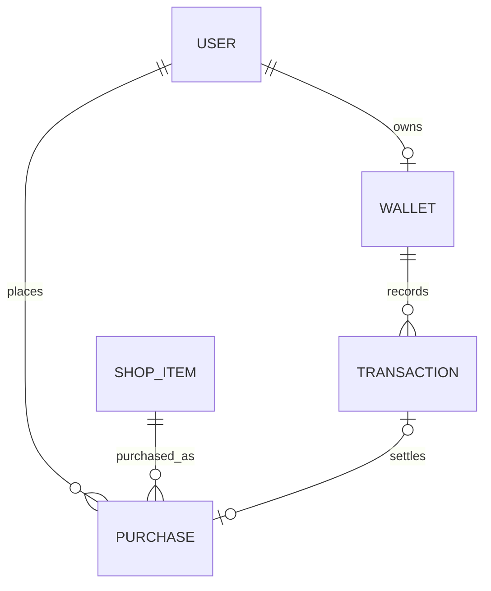

# ERD y diccionario de datos · Parte C — DuckyBank y DuckyShop

- **Proyecto:** DuckyArenas · Equipo 5 - **Responsable:** Fernando · Parte C - **Versión:** Borrador 0.2 · 13/10/2026 - **Estado:** Candidato para revisión conjunta A/B/C y Óscar/Core

> Este documento describe el modelo que aparece en el código actual y separa sus relaciones verificadas de las propuestas pendientes. No constituye aprobación detallada del ERD, del ORM ni de los contratos compartidos. La conformidad verbal general comunicada en la daily del 13/10 no debe interpretarse como aprobación de estos detalles.

## 1. Objetivo y alcance

Documentar las entidades candidatas de DuckyBank y DuckyShop, su diccionario de datos, restricciones y relaciones, antes de consolidar el ERD conjunto del Equipo 5.

La Parte C cubre la cartera y los movimientos económicos, el catálogo comercial y las compras. Inventory/Duckies conserva la responsabilidad sobre la posesión de objetos; Ecomotor coordina funcionalmente Rewards y conserva la responsabilidad sobre XP, evolución y estadísticas.

## 2. Estado arquitectónico y límites

La estructura objetivo recogida en D-21 es `apps.ecomotor`, `apps.duckies`, `apps.bank` y `apps.shop`, conservando `apps.users`; Rewards se coordina desde Ecomotor y no exige una app independiente. D-21 es un acuerdo interno de organización objetivo, sujeto a la revisión de las fronteras y contratos compartidos.

En la rama actual de la Parte C, los cuatro modelos descritos aquí todavía están definidos en `apps/ecomotor/models.py`, y sus servicios están en `apps/ecomotor/services.py`. Esta ubicación refleja el estado actual del código, no confirma que sea la ubicación definitiva de los modelos. No se deben mover modelos ni modificar migraciones hasta revisar el ERD conjunto y acordar una estrategia de migración.

### Responsabilidad propuesta por dominio

| Dominio | Responsabilidad | Estado |
|---|---|---|
| Core / `User` | Identidad, autenticación y autorización común | Dependencia externa; contrato pendiente |
| Ecomotor / Rewards | Evaluar hechos recompensables y coordinar efectos de recompensa | Rewards v0 es candidato, no contrato cerrado |
| Bank | Saldo económico canónico y movimientos trazables | Responsabilidad de Parte C; fuente canónica concreta pendiente de confirmación con Core |
| Shop | Oferta comercial, precio, disponibilidad y compra | Parte C; frontera con Bank e Inventory pendiente |
| Duckies / Inventory | Catálogo general de objetos, posesión, cantidades y entrega | Parte B; contrato B/C pendiente |
| Avatar / Equipment | Estado de equipamiento | Parte B; alcance y contrato pendientes |

No se crea una segunda cartera/saldo. El `UserProfileBank` existente es un perfil vinculado a `User`; no almacena saldo en el código actual. `Wallet.available_balance` es el campo del saldo en la implementación actual, pero su confirmación como fuente física canónica requiere acuerdo con Core.

## 3. ERD candidato de las entidades de Parte C

El siguiente diagrama representa las relaciones que existen actualmente en el ORM. No dibuja como FK la relación con `Item`/Inventory porque el código actual solo contiene `ShopItem.item_code` como texto y no existe una relación Django con modelos de Parte B.

### Relaciones externas todavía conceptuales

- `ShopItem.item_code` pretende identificar el objeto de Inventory, pero formato, unicidad, existencia, versiones y operación de entrega deben acordarse con Henry.
- No se ha aprobado una FK física entre `ShopItem` e `Item` ni entre `Purchase` e inventario/posesión.
- No se ha aprobado el coordinador definitivo de compra ni la estrategia de recuperación cuando Bank confirma el débito pero la entrega de Inventory no se confirma en la misma transacción.

## 4. Diccionario de datos

Los nombres y tipos de esta sección reflejan los modelos de la rama de Parte C incluida en el paquete de revisión. Se presentan para revisión; no se elevan automáticamente a esquema definitivo.

### 4.1 `Wallet` — cartera de DuckyBank

| Campo | Tipo actual | Regla actual | Descripción |
|---|---|---|---|
| `id` | `BigAutoField` | PK automática | Identificador interno de la cartera |
| `user` | `OneToOneField(AUTH_USER_MODEL)` | `CASCADE`, único, `related_name="duki_wallet"` | Usuario propietario |
| `available_balance` | `PositiveBigIntegerField` | `default=0` | Saldo disponible en la implementación actual |
| `created_at` | `DateTimeField` | `auto_now_add=True` | Fecha de creación |
| `updated_at` | `DateTimeField` | `auto_now=True` | Última actualización |

**Cardinalidad:** cada `Wallet` pertenece a un único `User`; un `User` puede tener cero o una `Wallet`.

**Reglas y cuestiones pendientes:** el estado económico lo debe decidir el servidor. La política de creación de cartera (explícita o al primer movimiento) no debe confundirse con la creación automática de `UserProfileBank`, que no se implementa mediante señales. La conservación/eliminación del saldo y el historial cuando se elimina un usuario sigue pendiente (P5).

**Nombre canónico:** el borrador anterior proponía `coins`; el modelo actual usa `available_balance`. No renombrar el campo sin acuerdo, porque afecta al contrato y al esquema.

### 4.2 `Transaction` — libro de movimientos

| Campo | Tipo actual | Regla actual | Descripción |
|---|---|---|---|
| `id` | `BigAutoField` | PK automática | Identificador del movimiento |
| `wallet` | `ForeignKey(Wallet)` | `CASCADE`, `related_name="transactions"` | Cartera afectada |
| `transaction_type` | `CharField(20)` | Choices: `REWARD`, `PURCHASE`, `REFUND`, `ADJUSTMENT` | Clase de movimiento |
| `amount` | `BigIntegerField` | Positivo para ingreso y negativo para gasto por convención de servicios; no hay `CheckConstraint` explícito contra cero en `Meta` | Importe contabilizado |
| `balance_after` | `PositiveBigIntegerField` | `CheckConstraint(balance_after >= 0)` | Saldo resultante persistido |
| `operation_key` | `CharField(255)` | Único junto con `wallet` | Clave de idempotencia local del ledger |
| `source_platform` | `CharField(100)` | Obligatorio en ORM | Sistema de origen |
| `issuing_entity` | `CharField(100)` | Obligatorio en ORM | Componente emisor |
| `description` | `CharField(255)` | `blank=True` | Descripción legible |
| `reference_type` | `CharField(100)` | `blank=True` | Tipo de entidad referenciada |
| `reference_id` | `CharField(255)` | `blank=True` | Identificador referenciado |
| `created_at` | `DateTimeField` | `auto_now_add=True`; orden descendente por fecha e ID | Fecha del movimiento |

**Restricciones ORM actuales:** unicidad de `(wallet, operation_key)` y `balance_after >= 0`.

**Reglas de servicio actuales:** los métodos de crédito y débito rechazan importes menores o iguales a cero y requieren `operation_key`; el ledger rechaza un saldo resultante negativo. El ajuste rechaza el importe cero. Las validaciones de servicio no sustituyen las restricciones de base de datos para escrituras directas.

**Idempotencia pendiente de revisión:** el código actual compara `amount` y `transaction_type` cuando encuentra la misma clave. No compara `source_platform`, `issuing_entity`, `reference_type`, `reference_id` o `description`. Hay que acordar qué campos definen una reutilización incompatible de una clave local; no confundir esta idempotencia de Bank con la deduplicación global del hecho en Rewards v0.

### 4.3 `ShopItem` — oferta comercial

| Campo | Tipo actual | Regla actual | Descripción |
|---|---|---|---|
| `id` | `BigAutoField` | PK automática | Identificador de la oferta |
| `code` | `CharField(100)` | Único | Código comercial interno de Shop |
| `item_code` | `CharField(100)` | Obligatorio, sin FK ni unicidad declarada | Referencia textual candidata al objeto de Inventory |
| `name` | `CharField(150)` | Obligatorio | Nombre comercial |
| `description` | `TextField` | `blank=True` | Descripción comercial |
| `price_coins` | `PositiveBigIntegerField` | `MinValueValidator(1)` en el modelo | Precio en monedas |
| `included_quantity` | `PositiveIntegerField` | `default=1` | Cantidad incluida en la oferta; semántica pendiente |
| `is_available` | `BooleanField` | `default=True` | Disponibilidad comercial |
| `featured` | `BooleanField` | `default=False` | Indicador de producto destacado |
| `created_at` | `DateTimeField` | `auto_now_add=True` | Fecha de creación |
| `updated_at` | `DateTimeField` | `auto_now=True` | Última actualización |

**Orden actual:** `-featured`, `name`, `id`. El código actual no define constraints de `Meta` para exigir `price_coins > 0` en SQL; `MinValueValidator` se ejecuta cuando un formulario o `full_clean()` valida el objeto, pero `save()` no llama automáticamente a `full_clean()`.

**Relación con Inventory:** no hay FK. `item_code` es solo un texto en la implementación incluida. La unicidad/canonicalización de ese código, si un objeto puede tener varias ofertas y si el catálogo general pertenece exclusivamente a B siguen pendientes. La propuesta antigua `Item 1 — 0..1 ShopItem` no es una relación implementada.

**Cantidad:** el modelo contiene tanto `included_quantity` como `Purchase.quantity`. El servicio de compra actual no recibe un parámetro `quantity` y persiste `Purchase.quantity = 1`; debe acordarse qué significa cada campo antes de cambiar el contrato.

### 4.4 `Purchase` — registro de compra

| Campo | Tipo actual | Regla actual | Descripción |
|---|---|---|---|
| `id` | `BigAutoField` | PK automática | Identificador de compra |
| `user` | `ForeignKey(AUTH_USER_MODEL)` | `CASCADE`, `related_name="duki_purchases"` | Comprador |
| `shop_item` | `ForeignKey(ShopItem)` | `PROTECT`, `related_name="purchases"` | Oferta adquirida |
| `operation_key` | `CharField(255)` | Único junto con `user` | Clave idempotente de la compra |
| `unit_price_coins` | `PositiveBigIntegerField` | `CheckConstraint > 0` | Precio unitario aplicado |
| `quantity` | `PositiveIntegerField` | `MinValueValidator(1)` y `CheckConstraint > 0` | Cantidad registrada en la compra |
| `total_price_coins` | `PositiveBigIntegerField` | `CheckConstraint > 0` | Total registrado |
| `status` | `CharField(20)` | `COMPLETED` o `REFUNDED`; default `COMPLETED` | Estado comercial actual |
| `bank_transaction` | `OneToOneField(Transaction)` | Nullable/blank, `PROTECT`, `related_name="purchase"` | Movimiento asociado al cobro |
| `created_at` | `DateTimeField` | `auto_now_add=True`; orden descendente por fecha e ID | Fecha de creación |
| `updated_at` | `DateTimeField` | `auto_now=True` | Última actualización |

**Restricciones ORM actuales:** unicidad de `(user, operation_key)` y restricciones `unit_price_coins > 0`, `quantity > 0`, `total_price_coins > 0`.

**Integridad pendiente:** no hay una restricción SQL que compruebe `total_price_coins = unit_price_coins * quantity`. Tampoco existe una constraint que exija que toda compra `COMPLETED` tenga `bank_transaction`; el servicio pretende mantener compra, débito y entrega en una única operación local.

**Estados:** el código actual solo define `COMPLETED` y `REFUNDED`. Los estados `PENDING` y `FAILED` del borrador anterior no forman parte del modelo actual y no deben añadirse sin acordar el flujo de recuperación.

## 5. Cardinalidades y `on_delete` actuales

| Relación | Cardinalidad actual | `on_delete` | Estado / observación |
|---|---|---|---|
| `User` — `Wallet` | `User 1 : 0..1 Wallet` | `CASCADE` desde `Wallet.user` | Código actual; política de conservación con Core pendiente |
| `Wallet` — `Transaction` | `Wallet 1 : N Transaction` | `CASCADE` desde `Transaction.wallet` | Código actual; podría eliminar historial al borrar Wallet, pendiente P5 |
| `User` — `Purchase` | `User 1 : N Purchase` | `CASCADE` desde `Purchase.user` | Código actual; conservación de historial pendiente P5 |
| `ShopItem` — `Purchase` | `ShopItem 1 : N Purchase` | `PROTECT` desde `Purchase.shop_item` | Código actual; impide borrar la oferta con compras relacionadas |
| `Transaction` — `Purchase` | `Transaction 1 : 0..1 Purchase` y `Purchase 1 : 0..1 Transaction` | `PROTECT` desde `Purchase.bank_transaction` | Código actual; relación opcional en ORM; coherencia del estado se garantiza por servicio, no por constraint cruzada |
| `User` — `UserProfileBank` | `User 1 : 0..1 UserProfileBank` | `CASCADE` | Perfil en `apps.users`; no almacena saldo |

Las reglas de borrado anteriores describen el ORM actual y no se consideran decisión definitiva de conservación. La política de eliminación, anonimización o retención de usuarios, perfiles, Wallet y ledger debe cerrarse con Core (P5) antes de fijar el esquema final.

## 6. Servicios actuales y límites de integración

El código actual ofrece funciones Python internas en `apps/ecomotor/services.py`; en el paquete revisado no hay un endpoint HTTP/REST de Bank o Shop implementado. Por tanto, estas firmas son descripción del servicio actual, no contratos externos aprobados.

- `credit_wallet(user, amount, *, operation_key, ...)`: crea o recupera un movimiento de crédito idempotente local.
- `debit_wallet(user, amount, *, operation_key, ...)`: intenta registrar un débito si existe saldo suficiente.
- `wallet_summary(user)` y `transaction_history(user, ...)`: exponen resumen e historial en el nivel de servicio.
- `purchase_item(user, shop_item, *, operation_key, deliver)`: coordina compra, débito y callback de entrega.
- `refund_purchase(purchase, *, operation_key, ...)`: registra un crédito de reembolso y actualiza el estado de compra.
- `adjust_wallet(...)`: permite un ajuste positivo o negativo distinto de cero, sujeto al saldo resultante.

### Transacciones y concurrencia (D-19)

El proyecto conserva SQLite V1 con `transaction_mode = "IMMEDIATE"`, timeout explícito de 5 segundos y operaciones críticas dentro de `transaction.atomic()` antes de leer estado mutable. `select_for_update()` puede expresar intención, pero no proporciona bloqueo por fila en SQLite. Las transacciones deben ser breves y no contener HTTP ni I/O externo.

En `purchase_item`, `deliver` se ejecuta dentro de la transacción. Esto solo permite rollback conjunto si es trabajo local compatible con la misma base de datos/conexión transaccional y no confirma por separado. Si Inventory está en otra base de datos o el callback realiza una llamada remota, el código no ofrece atomicidad global y el flujo debe detenerse hasta acordar recuperación/compensación.

### Diferencias de comportamiento que deben corregirse o acordarse antes de declarar el código alineado

1. **Orden de idempotencia en compra:** `purchase_item` comprueba `is_available` antes de buscar una compra con la misma clave. Si una compra ya se procesó y la oferta después se desactiva, un reintento puede recibir `ProductUnavailable` en vez del resultado persistido. Revisar este orden en el servicio.
2. **Contenido de clave de ledger:** la validación actual de clave reutilizada solo compara importe y tipo. Debe revisarse si referencias y origen forman parte de los parámetros incompatibles, especialmente para reembolsos de compras diferentes.
3. **Cantidad de compra:** el servicio actual fija `quantity=1`; confirmar la semántica de `included_quantity` y si la cantidad comprada debe ser configurable.
4. **Constraints de integridad:** estudiar, tras el acuerdo del ERD, cómo garantizar en base de datos importe no nulo/cero prohibido, total coherente con precio por cantidad y asociación entre compra completada y movimiento. No añadir constraints a ciegas antes del contrato de compra.
5. **Pruebas de concurrencia:** los tests actuales de Parte C cubren flujos ordinarios, idempotencia, fondos insuficientes, compra, rollback y reembolso; no sustituyen las pruebas `TransactionTestCase` y SQLite file-backed requeridas por D-19.

## 7. Contratos y relaciones externas pendientes

### Rewards / Ecomotor → Bank

La operación interna `credit_wallet` no constituye un endpoint oficial ni resuelve la deduplicación global de Rewards. Deben acordarse identidad del hecho y destinatario, autorización del origen con Core, clave local/global, resultado ante duplicado/conflicto y referencias auditables. Rewards v0 sigue siendo una propuesta técnica candidata.

### Shop → Bank

Debe acordarse el coordinador de compra, la clave que correlaciona la compra con el débito, la validación del precio, el resultado recuperable de duplicados y el comportamiento en fallos. Rewards v0 no aprueba automáticamente el contrato de compra.

### Shop → Duckies / Inventory

Debe acordarse el identificador válido del objeto, la operación de concesión, cantidades y clave idempotente de entrega. Shop no debe escribir directamente en tablas ajenas ni duplicar la responsabilidad de posesión.

### User / Core

Se mantiene el `User` estándar de Django de acuerdo con D-09/D-10/D-17; Parte C no crea un User propio ni implementa autenticación paralela. Identidad autorizada, JWT, permisos y conservación siguen pendientes con Core.

## 8. Integración con Parte A: riesgo de migraciones

La migración inicial `ecomotor.0001_initial` de la Parte C crea `ShopItem`, `Wallet`, `Transaction` y `Purchase`. La migración `ecomotor.0001_initial` de la rama `feature/part-a-progression-s1` crea `EvolutionStage`, `LevelThreshold` y `Specialization`. Ambas usan el mismo label de Django (`ecomotor`), por lo que no pueden copiarse juntas como dos migraciones `0001`.

La Parte A también añade `CharacterStats`, `XPEvent`, `EvolutionEvent`, `UserSpecializationProgress` y campos de progresión en `UserProfileEcomotor`. La migración `users.0002_ecomotor_progress` incorpora M-01: falla de forma explícita si encuentra perfiles legacy, para evitar una migración silenciosa sin estrategia de conservación.

**No basta con renombrar archivos de migración.** Antes de generar el grafo definitivo, A/B/C deben confirmar si el ORM final separará de verdad los modelos en `apps.bank` y `apps.shop` o conservará temporalmente los modelos C bajo `ecomotor`. El traslado de modelos entre labels puede afectar el estado de migraciones y los nombres físicos de tablas, así que requiere una estrategia explícita y pruebas sobre SQLite file-backed.

## 9. Cuestiones de revisión conjunta

| ID | Pregunta | Participantes | Bloquea |
|---|---|---|---|
| C-01 | Confirmar con Core la fuente física canónica de Wallet/saldo y la conservación de movimientos | Fernando + Óscar/Core | ORM definitivo / política de borrado |
| C-02 | Confirmar si `available_balance` es el nombre físico/canónico o si el contrato externo solo expone otro término | A/B/C + Core | Contrato Bank |
| C-03 | Confirmar `item_code`, relación con Item, cardinalidad y propiedad del catálogo general | Henry + Fernando | Relación Shop/Inventory |
| C-04 | Definir la semántica de `included_quantity` frente a `Purchase.quantity` | Henry + Fernando | Compra y entrega |
| C-05 | Definir estados de compra, coordinator y recuperación tras fallo de entrega | A/B/C + Core según corresponda | Servicio de compra |
| C-06 | Definir política de borrado/anonimización y conservación del historial financiero | Core + A/B/C | `on_delete` y migraciones |
| C-07 | Definir idempotencia local de Bank y su relación con la identidad global de Rewards | Jaime + Fernando + Core | Servicio Bank/Rewards |
| C-08 | Confirmar operación idempotente de entrega, cantidades y referencias de Inventory | Henry + Fernando | Integración de compra |
| C-09 | Revisar transacción compartida real: misma BD/alias, sin commits independientes ni I/O externo | A/B/C | Atomicidad de la vertical |
| C-10 | Confirmar alcance de V1 para productos digitales, merchandising físico y apuestas/Clash | Equipo 5 + Core | Alcance de Shop/Bank |

## 10. Reglas candidatas de aceptación

Las siguientes reglas recuperan criterios del borrador anterior de Parte C. Son propuestas para revisión conjunta, no contratos aprobados ni garantías de atomicidad entre dominios.

1. Repetir una operación de crédito con la misma clave y una intención compatible no genera un segundo movimiento local.
2. Reutilizar una clave con parámetros incompatibles debe producir un conflicto sin generar un nuevo movimiento.
3. Un débito no puede dejar el saldo en negativo.
4. No se puede completar una compra de un producto que no esté disponible.
5. El precio y la disponibilidad deben validarse en el servidor; no se debe confiar en importes enviados por el cliente.
6. Si el saldo es insuficiente, no debe confirmarse la compra ni registrarse un débito.
7. Repetir una compra con la misma clave no debe duplicar el cargo ni la entrega.
8. Un fallo de entrega no debe dejar una compra marcada como completada con un cargo aislado. Si no existe una transacción compartida real, se debe acordar una recuperación explícita antes de habilitar el flujo.
9. Los movimientos y las compras deben conservar trazabilidad suficiente para reconstruir su origen y sus referencias.
10. Las pruebas deben cubrir flujos correctos, duplicados, claves incompatibles, saldo insuficiente y fallos intermedios, incluidos rollback o recuperación según el diseño acordado.

Estos criterios deberán contrastarse con los contratos de Bank, Shop, Rewards e Inventory antes de utilizarlos como especificación de implementación.

## 11. Criterio de salida de H1

Antes de cambiar ORM o migraciones, el ERD conjunto debe mostrar las entidades A/B/C, sus cardinalidades, `on_delete`, restricciones e interfaces externas; marcar explícitamente lo provisional y registrar las decisiones que dependan de Core. Después se podrá fijar la arquitectura física y preparar una secuencia de migraciones que preserve los historiales.

**Estado:** borrador para revisión. No aprobado globalmente; no usar como autorización para ejecutar migraciones. Basado en el código actual de Parte C y la documentación de `develop` actualizada por el PR #19, incluida Rewards v0 y el plan de trabajo.
